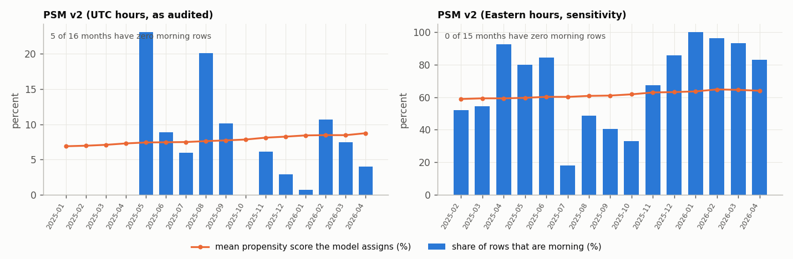
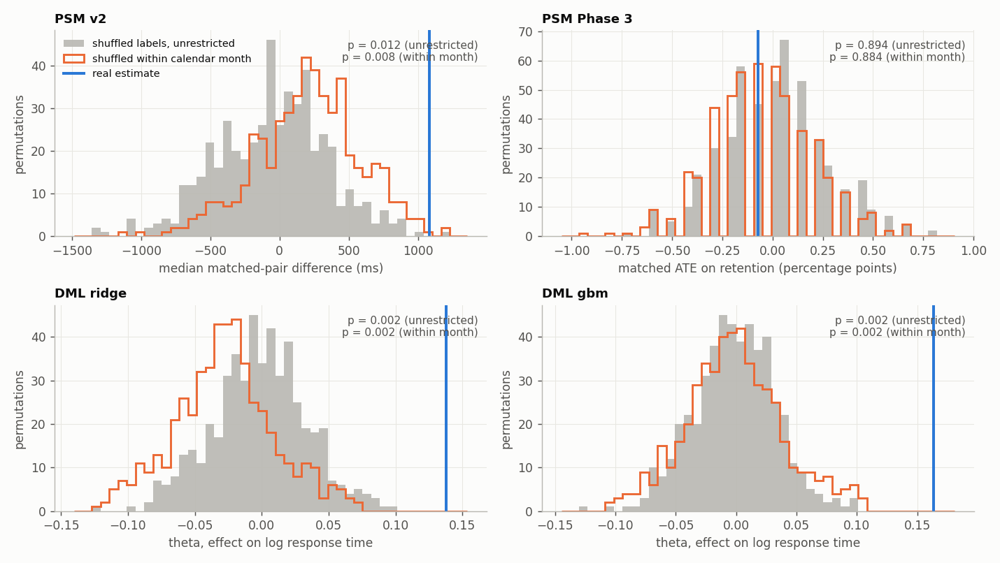
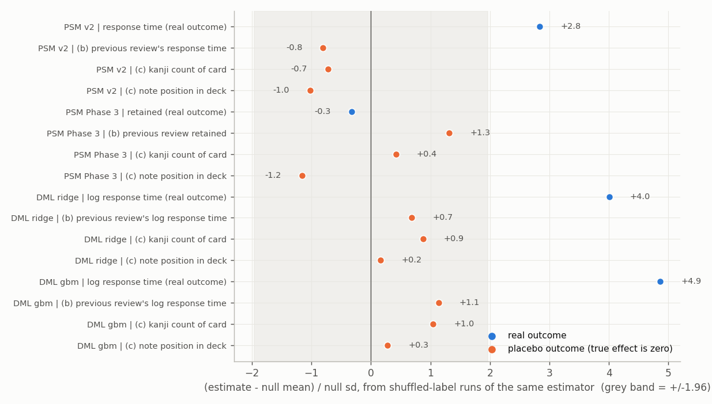
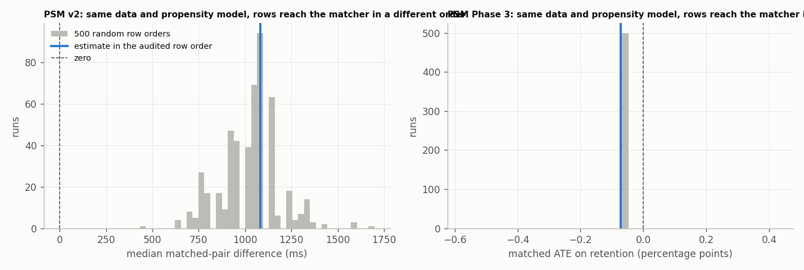
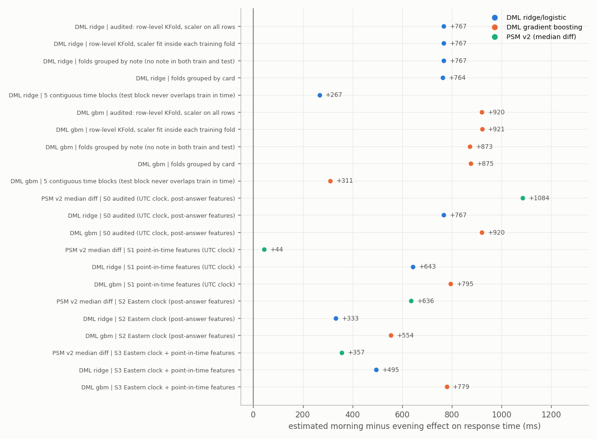
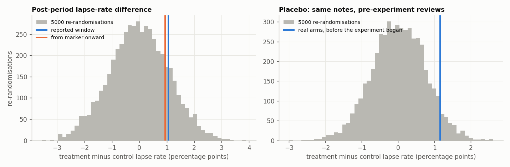

# Audit of the causal analyses

Repository `Causal-Inference-on-Spaced-Repetition-Learning-Data` at commit `e07e50d` · audit run 2026-10-18

This file is generated by `audit/build_report.py` from `audit/REPORT.template.md`. Every number this audit computes comes from `audit/results/*.json`, which the scripts in `audit/` write. Numbers quoted from the repo's own notebooks, README or resume are marked as such. The code is reproduced in Appendix A.

## 0. Scope and ground rules

**Audited.** The propensity-score analyses (v1, v2 and the Phase 3 retention analysis), the double machine learning (DML) analysis in `dashboard.py`, and, because their numbers appear in the README, the dashboard and the resume, the 60-day RCT, the Kaplan-Meier/Cox analysis and the ITS. The RCT is audited by re-running it. The Cox analysis is audited by reconstructing its card table from `revlog`. The ITS is read, not re-estimated.

**Not changed.** No audited file was edited and nothing was committed. `git status --short` shows only the new `audit/` directory (untracked). The repo's results, notebooks, README and dashboard are exactly as they were. The statements in this report are limited to what each check shows; no sentence of the README or dashboard is rewritten here.

**Data.** A byte copy of the Anki collection taken on 2026-10-18 (SHA-256 `9b30206f8a8ee9291544d7381af0fe2a666fc872fde831a334ff661eab311acd`, 7,159,808 bytes), opened read-only. Each analysis is re-run on the snapshot of the collection that matches the run being audited: reviews before 2026-04-24 for the notebooks (52,119 rows) and before 2026-07-11 for the DML. Section 2 shows those snapshots reproduce every reported count.

**Environment.** Python 3.11.9, numpy 2.3.4, pandas 2.3.3, scipy 1.16.3, scikit-learn 1.7.2.

**Seeds.** Every random step has a fixed seed in the scripts: unrestricted shuffles 20260418, within-month shuffles 20260419, row orders 20260420 (`s2`) and 20260421 (`s3`), re-randomisation 20260422 (`s5`).

## 1. Findings at a glance

| # | Finding | Where | What it does to a reported number |
|---|---|---|---|
| 1 | All 56 reported figures reproduce exactly from the collection (0 failures). | §2 | Nothing: the reported numbers are what the code produces. |
| 2 | Every hour-of-day split reads the UTC clock. The collection is on US Eastern time (machine time zone and `col.crt` both say so). The analyses' "morning" (hours 6-11) is roughly 01:00-08:00 Eastern and "evening" (18-23) is roughly 13:00-20:00 Eastern, depending on daylight saving. | §5.2 | Re-reading the clock in Eastern time moves PSM v2 from +1,084 to +636 ms, DML from +767 / +920 to +333 / +554 ms, and the Phase 3 retention effect from -0.07 pp (p=0.827) to +0.22 pp (p=0.026; see the matcher caveat in §5.6). |
| 3 | `revlog.factor` and `revlog.ivl` are written after the answer. The v2 and DML "at review time" features are post-answer values, so the v1 to v2 change did not make the features point-in-time. 26.5% of the v2 rows and 27.0% of the DML rows are in the "hard" sample because of their own answer. In Phase 3 one covariate (`log_ivl`) predicts the outcome with AUC 0.901. | §5.3-5.4 | With pre-answer values (UTC clock kept) PSM v2 goes from +1,084 to +44 ms (p=0.145); the DML estimates move to +643 / +795 ms. |
| 4 | The PSM v2 estimate depends on the order of the rows. The propensity score has almost no information (AUC 0.535), so many rows tie and the nearest-neighbour search breaks ties by row order. | §4.4 | Across 500 row orders the median difference runs from 432 to 1,698 ms; 6.4% of orders give Mann-Whitney p above 0.05. The reported +1,084 ms is one draw. |
| 5 | The [0.05, 0.95] overlap check passes for PSM and DML-ridge only because the score carries no information. Calendar-month positivity fails: 5 of 16 months have no morning row in the PSM v2 sample. DML with gradient boosting puts 29.3% of rows below 0.05. | §3 | Trimming changes nothing for v2, DML-ridge and DML-GBM (to within 13 ms). It moves the Phase 3 estimate from -0.073 to +0.436 pp. |
| 6 | DML cross-fitting uses row-level shuffled folds on time-ordered data: 77.8-81.4% of held-out rows have their card in training and 87.6-89.7% have their note in training (ranges across the five folds). The estimate is unchanged when folds are grouped by note or card but falls to +267 ms (ridge, card-clustered p=0.164) and +311 ms (GBM, card-clustered p=0.082) with contiguous time blocks. | §5.5 | The headline DML magnitude depends on the fold design. |
| 7 | The deployed (Streamlit Cloud) branch of the DML code applies none of the hard-review or capped-time filters that the local branch applies. | §5.6 | It computes on 29,531 rows and gives +332 / +558 ms instead of +767 / +920 ms. |
| 8 | Cox/KM: the reported hazard ratio of 2.06 is for a +1 unit change in ease factor, with a positive coefficient. Higher ease factor goes with higher hazard, the opposite of how the finding is worded. The duration variable is each card's total reviews, which includes reviews after the first lapse for all 240 reconstructed event cards. | §5.7 | Computed as the notebook's own text describes it (reviews until the first lapse, factor before it) the hazard ratio is 0.457. |
| 9 | RCT: the star marker was written to the treatment notes at 2026-04-26 18:36:58 UTC, 2.6 days after the analysis window opened; reviews are analysed as independent although assignment was by note; the same notes already differed by +1.15 pp in lapse rate before the experiment. | §7 | Lapse p moves from 0.154 (z-test) to 0.317 (clustered by note). The +482 ms response-time difference moves from Mann-Whitney p=1.1e-04 to re-randomisation p=0.017. The lapse difference-in-differences is -0.10 pp (p=0.937). |
| 10 | Git history contains no commit that fixes a leak. `git log -S` for "leak" and "timing" returns nothing; the hits for "shift" and "lag" are prose and `.shift(1)` calls. The v1 to v2 change was made before the first commit. | §6 | Nothing. The only record of the fix is the text in the v2 notebook and README. |

Checks that came back clean: the placebo outcomes (previous review's response time, kanji count, deck position) show nothing for PSM v2, DML-ridge and DML-GBM (§4.3); DML-ridge is unchanged by note-grouped folds, in-fold scaling and card-clustered standard errors (§5.5); the RCT's arms are balanced on kanji count and deck position (§7); the Phase 3 estimate sits inside its shuffled-label null (p=0.894).

## 2. Replication: do the reported numbers come out of the code?

56 quantities printed by the executed notebooks and by the DML run were compared with the same quantities re-computed by `audit_lib.py`, which mirrors the audited code line by line. Counts must match exactly; continuous values must match to the printed precision. **56 of 56 match.** Full table in `results/00_replication.md`; excerpt:

| analysis | quantity | reported | reproduced | match | source |
|---|---|---|---|---|---|
| PSM v2 | matched pairs | 309 | 309 | PASS | psm_response_time_v2_executed.ipynb cell 7 |
| PSM v2 | ATE median diff (ms) | 1084 | 1084 | PASS | psm_response_time_v2_executed.ipynb cell 12 |
| PSM v2 | median-diff CI low | 209 | 208.975 | PASS | psm_response_time_v2_executed.ipynb cell 12 |
| PSM v2 | median-diff CI high | 1924 | 1924 | PASS | psm_response_time_v2_executed.ipynb cell 12 |
| PSM v2 | Mann-Whitney p | 0.0045 | 0.00451 | PASS | psm_response_time_v2_executed.ipynb cell 12 |
| PSM Phase 3 | matched pairs | 1375 | 1375 | PASS | anki_causal_analysis_executed.ipynb cell 17 |
| PSM Phase 3 | ATE (retention) | -0.0007 | -0.000727 | PASS | anki_causal_analysis_executed.ipynb cell 19 |
| PSM Phase 3 | t-test p | 0.8267 | 0.826683 | PASS | anki_causal_analysis_executed.ipynb cell 19 |
| DML ridge | theta (log RT) | 0.138 | 0.137956 | PASS | DML run of 2026-07-10 (conversation log) / dashboard.py run_dml() |
| DML ridge | ATE (ms) | 767 | 766.685 | PASS | DML run of 2026-07-10 (conversation log) / dashboard.py run_dml() |
| DML gbm | theta (log RT) | 0.1634 | 0.163393 | PASS | DML run of 2026-07-10 (conversation log) / dashboard.py run_dml() |
| DML gbm | ATE (ms) | 920 | 919.964 | PASS | DML run of 2026-07-10 (conversation log) / dashboard.py run_dml() |

The sample cut-offs that reproduce the counts exactly are reviews before 2026-04-24 UTC (v2, Phase 3) and before 2026-07-11 UTC (DML).

## 3. Item 1: overlap

**Method.** For each analysis the propensity score by arm, the share of rows outside [0.05, 0.95], the AUC of the score, a calendar-month positivity table, and the estimate after trimming to the band. PSM scores are the audited in-sample logistic scores. DML scores are the audited cross-fitted out-of-fold scores, for both learners. Trimming has two variants for PSM (drop rows and keep the original score; drop rows and refit score and matching) and two for DML (drop rows; clip the score to the band, as DoubleML's trimming does).

![Propensity score by arm for each audited analysis. Left: full [0,1] axis (log counts) with the 0.05 / 0.95 band. Right: the same scores zoomed to their range.](figures/overlap_ps_by_arm.png)

*Propensity score by arm for each audited analysis. Left: full [0,1] axis (log counts) with the 0.05 / 0.95 band. Right: the same scores zoomed to their range.*

| analysis | n | morning | PS range morning | PS range evening | outside [0.05,0.95] | below 0.05 | above 0.95 | PS AUC |
|---|---|---|---|---|---|---|---|---|
| PSM v2 (UTC hours, as audited) | 4038 | 309 | 0.062-0.094 | 0.060-0.097 | 0 (0.0%) | 0 | 0 | 0.535 |
| PSM Phase 3 (UTC hours, as audited) | 21803 | 1375 | 0.056-0.072 | 0.001-0.072 | 27 (0.1%) | 27 | 0 | 0.521 |
| DML ridge (UTC hours, as audited) | 4763 | 530 | 0.107-0.117 | 0.107-0.117 | 0 (0.0%) | 0 | 0 | 0.482 |
| DML gbm (UTC hours, as audited) | 4763 | 530 | 0.009-0.628 | 0.002-0.650 | 1394 (29.3%) | 1394 | 0 | 0.748 |
| PSM v2 (Eastern hours, sensitivity) | 4929 | 2999 | 0.492-0.702 | 0.503-0.693 | 0 (0.0%) | 0 | 0 | 0.525 |

| analysis | estimate | full | trim, keep PS | trim, refit PS | rows dropped |
|---|---|---|---|---|---|
| PSM v2 (UTC hours, as audited) | median diff, ms | +1084 | +1084 | +1084 | 0 |
| PSM v2 (UTC hours, as audited) | mean diff, ms | +508 | +508 | +508 | 0 |
| PSM Phase 3 (UTC hours, as audited) | ATE retention, pp | -0.073 | -0.073 | +0.436 | 27 |
| DML ridge (UTC hours, as audited) | ATE ms | +767 | +767 (drop rows) | +767 (clip PS) | 0 |
| DML gbm (UTC hours, as audited) | ATE ms | +920 | +918 (drop rows) | +907 (clip PS) | 1394 |


**Reading.**

- **PSM v2 and DML-ridge pass the band check vacuously.** All scores sit in 0.060-0.097 (v2) and 0.107-0.117 (ridge). The AUC is 0.535 and 0.482: the covariates carry essentially no information about morning versus evening, so the score is close to the base rate for every row. A band that spans 0.05 to 0.95 cannot flag a problem in a score that never leaves 0.06-0.12.
- **PSM Phase 3.** 27 rows (0.1%) are below 0.05, all evening rows. All 27 of them are rows with `deck_enc == 0`, a covariate for which no morning row exists. Dropping them and keeping the original score leaves the estimate at -0.073 pp; refitting the score on the remaining rows moves the matched estimate to +0.436 pp. That shift is 2.0 standard deviations of the estimator's shuffled-label null (0.26 pp, §4) and stays inside the notebook's reported 95% interval [-0.65, +0.51] pp.
- **DML with gradient boosting.** 1,394 rows (29.3%) have an out-of-fold score below 0.05, none above 0.95. The boosting learner picks up calendar structure (AUC 0.748): in the 4 of 19 months with no morning row its mean score is 0.0080, against 0.1137 elsewhere. Dropping those rows changes the estimate from +920 to +918 ms and clipping gives +907 ms.
- **Positivity by calendar month does not hold in the audited samples.** In PSM v2, 5 of 16 calendar months contain no morning row, yet the model's mean score in those months is 0.0722 (against 0.0802 in months that do have morning rows): the linear logistic score cannot represent "no morning reviews before May 2025". The notebook's own limitation note says the same in words.
- **PSM v1** (not re-run, §9) reports in its saved output the same shape: scores 0.064-0.097, train accuracy 0.926, no unit outside the band.
- **With the clock read in Eastern time** (§5.2) the picture is different: 2,999 of 4,929 PSM v2 rows are morning, scores span 0.492-0.702, and no calendar month is empty.



*PSM v2: share of rows that are morning in each calendar month (bars) and the mean propensity score the model assigns (line), UTC clock as audited (left) and Eastern clock (right).*

**Does trimming change the estimate?** For PSM v2, DML-ridge and DML-GBM: no (table above). For Phase 3: removing 27 rows and refitting moves it by about 0.5 pp.

## 4. Item 2: placebo checks

### 4.1 Method

- **(a) Shuffle the labels.** The morning/evening labels are shuffled 500 times and the whole estimator is refit each time (PSM: new propensity model and new matching; DML: new propensity nuisance). Two shuffles are run: unrestricted, and within calendar month, which keeps the clustering of morning reviews in time. For DML the outcome nuisance never sees the label, so it is fit once and only the propensity nuisance is refit per shuffle; this is exactly equivalent to rerunning the pipeline.
- **(b) Pre-treatment outcome.** The same card's previous review (its response time with capped 60-second values excluded, or whether it was retained for Phase 3). The current review's time of day cannot cause it.
- **(c) Outcomes the treatment cannot affect.** The kanji count of the card's Japanese field and the note's position in the deck (rank of note id). Both are fixed before any review.

### 4.2 (a) The real estimate against the shuffled-label null



*Shuffled-label null (grey: unrestricted; orange outline: within calendar month) and the real estimate (blue line) for each analysis.*

| analysis | statistic | real estimate | null sd | null 2.5% | null 97.5% | perm p (unrestricted) | perm p (within month) | B |
|---|---|---|---|---|---|---|---|---|
| PSM v2 | median_diff | 1084 | 399.7 | -834.2 | 757.6 | 0.01198 | 0.007984 | 500 |
| PSM Phase 3 | mean_diff | -0.0007273 | 0.002596 | -0.005091 | 0.005473 | 0.8942 | 0.8842 | 500 |
| DML ridge | theta (log RT) | 0.138 | 0.03491 | -0.07187 | 0.07088 | 0.001996 | 0.001996 | 500 |
| DML gbm | theta (log RT) | 0.1634 | 0.03391 | -0.06693 | 0.06381 | 0.001996 | 0.001996 | 500 |

The real DML estimates lie outside all 500 shuffles of either kind (0.002 is the smallest p-value 500 shuffles can give). PSM v2 has p=0.012 against the unrestricted null and p=0.0080 against the within-month null. The Phase 3 estimate sits in the middle of its null (p=0.894).

### 4.3 (b) and (c) Placebo outcomes



*Each estimate expressed in standard deviations of its own shuffled-label null. Blue: the real outcome. Orange: placebo outcomes, whose true effect is zero. Grey band: ±1.96.*

| analysis | outcome | n | estimate | null mean | null sd | centred z | perm p | perm p (centred) | analytic p | cluster-by-card p |
|---|---|---|---|---|---|---|---|---|---|---|
| PSM v2 | (b) previous review's response time | 277 | -302 | 34.78 | 419.2 | -0.8034 | 0.4691 | 0.4251 | 0.8395 | nan |
| PSM v2 | (c) kanji count of card | 308 | 0.05195 | 0.1789 | 0.1757 | -0.7227 | 0.8663 | 0.4551 | 0.9207 | nan |
| PSM v2 | (c) note position in deck | 308 | 0.0329 | 0.05718 | 0.02379 | -1.021 | 0.8383 | 0.3154 | 0.155 | nan |
| PSM Phase 3 | (b) previous review retained | 1149 | 0.004352 | -7.912e-05 | 0.003375 | 1.313 | 0.2196 | 0.1896 | nan | nan |
| PSM Phase 3 | (c) kanji count of card | 1375 | 0.52 | 0.4893 | 0.07312 | 0.4194 | 0.3353 | 0.6527 | 8.215e-23 | nan |
| PSM Phase 3 | (c) note position in deck | 1375 | 0.1405 | 0.1547 | 0.01228 | -1.156 | 0.8802 | 0.2495 | 4.416e-38 | nan |
| DML ridge | (b) previous review's log response time | 4532 | 0.02245 | -0.004045 | 0.03873 | 0.6842 | 0.6028 | 0.5269 | 0.5729 | 0.574 |
| DML ridge | (c) kanji count of card | 4736 | 0.07975 | -0.001327 | 0.09262 | 0.8754 | 0.3832 | 0.3653 | 0.4213 | 0.4441 |
| DML ridge | (c) note position in deck | 4736 | 0.002665 | 0.0004489 | 0.01371 | 0.1616 | 0.8403 | 0.8623 | 0.8384 | 0.8433 |
| DML gbm | (b) previous review's log response time | 4532 | 0.04023 | -0.003827 | 0.03878 | 1.136 | 0.3253 | 0.2675 | 0.3265 | 0.3204 |
| DML gbm | (c) kanji count of card | 4736 | 0.0978 | 0.001347 | 0.09232 | 1.045 | 0.2814 | 0.2894 | 0.3367 | 0.3356 |
| DML gbm | (c) note position in deck | 4736 | 0.004026 | 0.0002221 | 0.01368 | 0.2781 | 0.7705 | 0.7784 | 0.7679 | 0.7629 |

For PSM v2, DML-ridge and DML-GBM every placebo outcome is within the null band (largest centred z = 1.14 in absolute value; smallest permutation p = 0.281). These checks do not flag a problem for those three analyses.

**Phase 3 is different and needs care.** The raw matched difference in kanji count between morning and evening rows is +0.520 (analytic p = 8.2e-23) and in deck position +0.140 (p = 4.4e-38), which would read as strong imbalance on card content. But the same estimator applied to *shuffled* labels is not centred on zero for those outcomes: its null mean is +0.489 for kanji and +0.155 for deck position. Against that null the real values are ordinary (centred p = 0.653 and 0.250). In other words a difference of this size is what the matcher produces under shuffled labels, so the raw difference says little about the labels. The analytic p-values above are not meaningful for this estimator.

### 4.4 What the matcher does, and the row-order dependence

**Matching diagnostics with the real labels**

| quantity | PSM v2 | PSM Phase 3 |
|---|---|---|
| n rows | 4038 | 21803 |
| n treated | 309 | 1375 |
| n controls | 3729 | 20428 |
| n pairs | 309 | 1375 |
| n unique controls used | 262 | 952 |
| max times one control used | 5 | 54 |
| share of pairs on 10 most reused controls | 0.1133 | 0.2073 |
| median position of matched controls in row order | 0.4486 | 0.2762 |
| spearman control row position vs times used | -0.02118 | -0.03847 |
| share of rows sharing a ps value with another row | 0.2907 | 0.3541 |
| frame sorted by cid | True | True |
| share rows with missing card | 0.004458 | 0.001238 |
| mean deck position all treated | 0.5702 | 0.499 |
| mean deck position matched treated | 0.5702 | 0.499 |
| mean deck position matched controls | 0.538 | 0.3586 |
| mean deck position all controls | 0.5647 | 0.5171 |

**Row-order sensitivity** (same data and propensity model; only the order rows reach the matcher changes)

| analysis | estimate | audited order | mean over orders | sd | min | max | share of orders with p<0.05 | orders |
|---|---|---|---|---|---|---|---|---|
| PSM v2 | response time, ms | 1084 | 1028 | 158.1 | 432 | 1698 | 0.936 | 500 |
| PSM Phase 3 | retention (0/1) | -0.0007273 | -0.0007273 | 0 | -0.0007273 | -0.0007273 | 0 | 500 |



*Same data, same propensity model; only the order in which rows reach the nearest-neighbour search changes (many random orders). Blue: the estimate in the audited order.*

- **PSM v2 is not stable across row orders.** The audited run gives +1,084 ms. Across 500 random orders the median difference has mean 1,028, sd 158, minimum 432, maximum 1,698 ms; the Mann-Whitney p is below 0.05 in 93.6% of orders. The sign never changes. The number of distinct controls used is the same in every order (262), so the variation comes only from which of several tied controls is chosen. 29.1% of v2 rows share a propensity score with at least one other row.
- **Phase 3 is invariant to row order** (identical estimate in all 500 orders), so its off-centre null is not a tie-breaking effect. In the real labels, 952 distinct controls serve 1,375 pairs, one control is used 54 times, and the matched controls sit earlier in the deck (mean position 0.359) than all controls (0.517) or the treated rows (0.499). I did not establish why.

## 5. Item 3: leakage and timing

### 5.1 Every feature and when it becomes available

"Available" means the moment the value exists in the collection. A feature is flagged if it is computed from data at or after the review whose treatment or outcome is being analysed.

| Analysis | Feature / step | Source | Exists from | Flag |
|---|---|---|---|---|
| PSM v2 | treatment `morning` (hour 6-11 vs 18-23) | `revlog.id` read as UTC | the answer | **Clock is UTC, not the learner's time (§5.2).** |
| PSM v2 | selection `ef < 2.5` and covariate `ef` | `revlog.factor` | **after** the answer (§5.3) | **Post-answer.** 26.5% of rows enter the sample through their own answer (§5.4). |
| PSM v2 | covariate `log_ivl` | `log1p(abs(revlog.ivl))` | **after** the answer | **Post-answer.** Equals log1p(600) for every Again. |
| PSM v2 | covariate `log_days_since` | `shift(1)` within the filtered subset; missing filled with the full-sample median | previous in-subset row: before; fill value: after (uses all rows, both arms) | **Not the card's previous review** (the subset is selected on post-answer `ef`). Full-sample imputation. |
| PSM v2 | covariate `month_idx` | review timestamp (offset from full-sample minimum) | the review | Clean. |
| PSM v2 | outcome `time` | `revlog.time` | the answer (this is the outcome) | Outcome. Capped value 60,000 excluded. |
| PSM v2 | scaler and propensity model | fit on all rows, both arms | n/a | Scaler fit on full data (§5.5). In-sample score (standard for PSM). |
| PSM Phase 3 | covariates `ease_factor`, `log_ivl` | `revlog.factor`, `revlog.ivl` | **after** the answer | **Post-answer; `log_ivl` predicts the outcome with AUC 0.901** (§5.4). Selection `ivl != 0` also uses it. |
| PSM Phase 3 | covariate `deck_enc` | `cards.did` today | after the review (current deck) | Current-state. |
| PSM Phase 3 | outcome `retained = ease > 1` | `revlog.ease` | the answer | Outcome: the same answer that sets `ivl` and `factor`. |
| PSM v1 | sample = cards with `cards.factor` in the lowest quartile | `cards.factor` today | after every review in the study | **Selection on the end state of the card.** |
| DML | treatment hour windows 6-12 / 18-24 | `revlog.id` as UTC | the answer | Clock is UTC; windows differ from PSM's 6-11 / 18-23. |
| DML | selection `factor < 2500` and features `ease_factor`, `log_ivl` | `revlog.factor`, `revlog.ivl` | **after** the answer | **Post-answer.** 27.0% of rows enter through their own answer. |
| DML | `month_idx` | review timestamp | the review | Clean. |
| DML | folds | row-level shuffled `KFold(5, random_state=42)` | n/a | Splits cards, notes and time (§5.5). |
| DML | scaler | fit on all rows before folding | n/a | Features only; no effect found (§5.5). |
| Cox / KM | covariate `cards.factor` | snapshot at export time | after every review incl. the lapse (a lapse lowers it by 200 points) | **End-state covariate** (§5.7). |
| Cox / KM | duration `cards.reps` | total reviews at export | after the event | **Counts reviews after the first lapse** (§5.7). |
| ITS | outcome smoothing `rolling(7, center=True)` | trailing and leading days | the following 3 days | Uses days after each point, including across the breakpoint. Not re-estimated. |
| ITS | breakpoint | first gap of 3+ days in the full series | hindsight | Data-selected breakpoint. Not re-estimated. |
| RCT | analysis window start | local midnight 2026-04-24 | star marker exists only from 2026-04-26 18:36:58 UTC | **Window opens 2.6 days before the marker** (§7). |

### 5.2 The clock

`pd.to_datetime(revlog['id'], unit='ms')` is UTC. Every audited analysis takes `hour` from it. Two independent sources place the learner at UTC-5 (US Eastern): the machine's time zone, and `col.crt` = 2025-01-28 09:00:00 UTC, which is 04:00 at UTC-5 (Anki's default day rollover).


*Left and centre: change in revlog.factor against the previous row of the same card, grouped by this row's button and by the previous row's button. Right: reviews by hour on the UTC clock (what the analyses used) and the Eastern clock; grey marks the 6-11 and 18-23 windows.*

In the full collection (64,089 reviews) 1,415 reviews fall in hours 6-11 on the UTC clock; 18,512 do on the Eastern clock. The audited "morning" is therefore roughly 01:00-08:00 Eastern and the audited "evening" roughly 13:00-20:00 Eastern (daylight saving moves each by an hour). The v2 notebook's note "Zero morning hard reviews in Jan-Apr 2025 and Oct 2025" describes the UTC hours; on the Eastern clock no calendar month is empty (§3).

### 5.3 `revlog.factor` and `revlog.ivl` are written after the answer

#### A1. Change in revlog.factor against the previous row of the same card (review -> review rows)

37,852 consecutive review rows. If revlog.factor were the factor BEFORE the answer, the change would line up with the previous row's button instead.

| ease of THIS review | mean | std | count |
|---|---|---|---|
| 1 | -185.6 | 49.01 | 250 |
| 2 | -146.4 | 22.51 | 6359 |
| 3 | -0.04758 | 5.343 | 6305 |
| 4 | 149.9 | 5.372 | 24938 |

#### A1b. Same change, grouped by the PREVIOUS row's button

| ease of PREVIOUS review | mean | std | count |
|---|---|---|---|
| 2 | 20.61 | 130.6 | 7690 |
| 3 | 58.17 | 120.9 | 7126 |
| 4 | 94.95 | 101.9 | 23036 |

#### A2. revlog.ivl by button (type 1 = review rows)

ivl is the interval assigned by this answer; every Again row carries ivl = -600 (the 10-minute relearning step, in seconds).

| ease | rows | share_ivl_negative | median_ivl | median_lastIvl |
|---|---|---|---|---|
| 1 | 345 | 1 | -600 | 9 |
| 2 | 8241 | 0 | 14 | 11 |
| 3 | 8217 | 0 | 33 | 14 |
| 4 | 31883 | 0 | 63 | 19 |

- On review-to-review rows the change in `revlog.factor` against the previous row of the same card is -186 / -146 / 0 / +150 points for Again / Hard / Good / Easy **of the same row**. Grouped by the previous row's button there is no such alignment.
- Every Again row (type 1) has `revlog.ivl = -600`, the relearning step in seconds. `revlog.lastIvl` equals the previous row's `ivl` in 99.85% of 37,852 consecutive review rows, which is the interval *before* the answer.
- The Phase 3 notebook's own comment says the same ("`ivl` ... is the interval assigned after this review"). The v1 notebook labels `revlog.factor` "state at time of review"; the v2 notebook calls the same values "at the moment of that review".

### 5.4 What post-answer features do to the samples

#### B. PSM v2 sample (ef from revlog.factor < 2.5): status of each sample row's factor BEFORE its own answer

| pre-answer factor status | evening | morning | total | evening % | morning % | total % |
|---|---|---|---|---|---|---|
| NOT hard before this answer | 996 | 74 | 1070 | 26.7 | 23.9 | 26.5 |
| already hard before this answer | 2733 | 235 | 2968 | 73.3 | 76.1 | 73.5 |

#### B. DML sample (revlog.factor < 2500): status of each sample row's factor BEFORE its own answer

| pre-answer factor status | evening | morning | total | evening % | morning % | total % |
|---|---|---|---|---|---|---|
| NOT hard before this answer | 1145 | 140 | 1285 | 27.0 | 26.4 | 27.0 |
| already hard before this answer | 3088 | 390 | 3478 | 73.0 | 73.6 | 73.0 |

#### B2. Phase 3: outcome `retained` against the covariate `ivl` sign

AUC of log_ivl for predicting retained == 0: 0.9014. log_ivl is log1p(|revlog.ivl|), written after the answer.

| retained | ivl < 0 | ivl > 0 |
|---|---|---|
| retained = 0 (Again) | 184 | 0 |
| retained = 1 | 1659 | 19960 |

- Of the PSM v2 rows, 1,070 (26.5%) had a factor of 2.5 or more before their own answer and entered the "hard" sample because that answer lowered it. For the DML sample it is 1,285 (27.0%). The shares are similar in the two arms (v2: 26.7% evening, 23.9% morning; DML: 27.0% and 26.4%).
- In Phase 3, all 184 Again rows have a negative `ivl`; so do 1,659 of the 21,619 retained rows (learning steps). AUC of `log_ivl` for predicting a lapse is 0.901.

### 5.5 Cross-fitting folds, scalers and time order

#### C. Audited DML folds (KFold, shuffle=True, random_state=42, row level): what leaks across the train/test boundary

4,763 rows from 1,885 cards (1,217 notes); reviews per card mean 2.53; cards per note in the collection: {3: 3490}.

| fold | test rows | % test rows whose CARD is in training | % whose NOTE is in training | % with a LATER review of the same card in training | % with an EARLIER review of the same card in training | % of training rows dated after the test fold's first row |
|---|---|---|---|---|---|---|
| 0 | 953 | 80.1 | 89.7 | 58.0 | 55.7 | 99.8 |
| 1 | 953 | 78.2 | 89.1 | 53.7 | 51.5 | 100.0 |
| 2 | 953 | 77.8 | 87.6 | 55.5 | 53.6 | 99.8 |
| 3 | 952 | 78.2 | 88.2 | 52.6 | 56.4 | 100.0 |
| 4 | 952 | 81.4 | 89.6 | 55.9 | 57.7 | 99.9 |

#### D. DML estimate under alternative fold designs, with cluster-robust standard errors

Same samples, same learners. Only the folds, the scaling step or the SE changes.

| learner | design | theta | ATE ms | SE iid | SE cluster(card) | SE cluster(note) | p iid | p cluster(card) | p cluster(note) |
|---|---|---|---|---|---|---|---|---|---|
| ridge | audited: row-level KFold, scaler on all rows | 0.138 | 766.7 | 0.03442 | 0.03523 | 0.03522 | 6.127e-05 | 9.018e-05 | 8.957e-05 |
| ridge | row-level KFold, scaler fit inside each training fold | 0.138 | 766.9 | 0.03442 | 0.03524 | 0.03522 | 6.102e-05 | 8.985e-05 | 8.918e-05 |
| ridge | folds grouped by note (no note in both train and test) | 0.138 | 767.2 | 0.03449 | 0.03536 | 0.03538 | 6.279e-05 | 9.46e-05 | 9.539e-05 |
| ridge | folds grouped by card | 0.1375 | 763.7 | 0.03441 | 0.03526 | 0.03527 | 6.461e-05 | 9.692e-05 | 9.72e-05 |
| ridge | 5 contiguous time blocks (test block never overlaps train in time) | 0.05016 | 266.6 | 0.0349 | 0.03601 | 0.03667 | 0.1506 | 0.1636 | 0.1713 |
| gbm | audited: row-level KFold, scaler on all rows | 0.1634 | 920 | 0.03543 | 0.03592 | 0.03548 | 3.996e-06 | 5.404e-06 | 4.123e-06 |
| gbm | row-level KFold, scaler fit inside each training fold | 0.1636 | 921.1 | 0.03542 | 0.03592 | 0.03548 | 3.878e-06 | 5.25e-06 | 4.004e-06 |
| gbm | folds grouped by note (no note in both train and test) | 0.1556 | 872.6 | 0.03574 | 0.03613 | 0.03592 | 1.339e-05 | 1.655e-05 | 1.473e-05 |
| gbm | folds grouped by card | 0.1561 | 875.5 | 0.03572 | 0.03607 | 0.03559 | 1.242e-05 | 1.514e-05 | 1.155e-05 |
| gbm | 5 contiguous time blocks (test block never overlaps train in time) | 0.05821 | 310.7 | 0.03296 | 0.03349 | 0.03361 | 0.07738 | 0.08221 | 0.08327 |



*DML and PSM estimates in milliseconds under each fold design and under each timing specification (§5.6).*

- **Row-level folds split cards and notes.** Each card has 2.53 reviews on average and every note has 3 cards. In the five held-out folds 77.8-81.4% of rows have a review of the same card in training, 87.6-89.7% have a review of the same note, and 52.6-58.0% have a *later* review of the same card in training (ranges across folds). In each fold 99.8-100.0% of the training rows are dated after the first held-out row, so the data are time-ordered and the split is random.
- **Grouped folds and in-fold scaling change nothing for ridge** (+767 → +767 grouped by note, +767 with in-fold scaling). GBM moves from +920 to +873 ms grouped by note. Cluster-robust standard errors by card or note are at most 5.1% larger than the iid ones.
- **Time-blocked folds do change the estimate.** With five contiguous time blocks DML-ridge gives +267 ms (card-clustered p=0.164) and DML-GBM +311 ms (card-clustered p=0.082). With random folds the nuisance models can use neighbouring reviews in time to adjust for calendar drift; with blocks they cannot. This check shows the estimate depends on that; it does not say which design is right.
- **Scalers and encoders.** Scalers are fit on all rows in v2, Phase 3, v1 and DML (`dashboard.py` lines 202-203, before folding). They see features only, not labels or outcomes, and the in-fold run above shows no change. There are no categorical encoders (`deck_enc` is a hand-made indicator). The only train/test splitting anywhere is the DML's `KFold(shuffle=True)` and the `cv=5` inside `LogisticRegressionCV`. The notebooks fit and score the propensity model in-sample, which is standard for PSM. Imputation uses full-sample medians (`days_since.fillna(median)`) in v1, v2 and Phase 3. Section 5.8 lists every occurrence.

### 5.6 Sensitivity to the clock and to point-in-time features

#### E. Sensitivity of each estimate to the clock and to point-in-time features

Diagnostics only. The specifications change the sample as well as the covariates, so rows are not like-for-like replacements of the audited run.

| specification | PSM v2: n (morning/evening) | PSM v2 median diff ms (audited order) | PSM v2 MW p (audited order) | PSM v2 median diff across 100 row orders: mean [min, max] | Phase 3 ATE pp | Phase 3 p | DML ridge ATE ms (p cluster) | DML gbm ATE ms (p cluster) | DML n (morning/evening) |
|---|---|---|---|---|---|---|---|---|---|
| S0 audited (UTC clock, post-answer features) | 309/3729 | 1084 | 0.00451 | 1045 [629, 1332] | -0.07273 | 0.8267 | +767 (p 9e-05) | +920 (p 5.4e-06) | 530/4233 |
| S1 point-in-time features (UTC clock) | 301/3463 | 44 | 0.1454 | 44 [44, 44] | -0.1735 | 0.6535 | +643 (p 0.00053) | +795 (p 3.7e-05) | 496/3953 |
| S2 Eastern clock (post-answer features) | 2999/1930 | 636 | 2.2e-10 | 610 [444, 860] | 0.2169 | 0.0256 | +333 (p 0.0057) | +554 (p 3.9e-05) | 4172/2191 |
| S3 Eastern clock + point-in-time features | 2709/1803 | 357 | 6.366e-05 | 357 [357, 357] | 0.704 | 2.55e-09 | +495 (p 3e-05) | +779 (p 5.6e-09) | 3781/2038 |

These runs change the clock, the covariates or both, and the sample changes with them, so they are diagnostics and not replacements for the audited runs. What they show:

- **PSM v2 depends on the feature timing.** With pre-answer factor and interval (UTC clock kept) the median difference is +44 ms (p=0.145, 301 pairs) against +1,084 ms. DML moves less: +643 / +795 ms.
- **All four specifications keep the sign positive for response time** (morning slower): PSM v2 from +44 to +1,084 ms and DML from +333 to +920 ms across the four.
- **The Phase 3 null does not hold under the Eastern clock**: +0.22 pp (p=0.026) with post-answer features and +0.70 pp (p=2.6e-09) with point-in-time features, against -0.07 pp (p=0.827) as audited. Phase 3 matching has the off-centre null described in §4.3, so these two p-values should not be read at face value.

### 5.7 Survival analysis

The card table of 2026-04-23 no longer exists (`cards.factor`, `reps` and `lapses` change with every review), so it was reconstructed from `revlog` (reps = review rows; lapses = Again on review rows; factor = last post-answer factor).

#### F1. Reconstruction of the notebook's quartile table from revlog (cutoff 2026-04-24)

Cards: 9,019 (notebook 9,002); events: 240 (notebook 237). The cards table of 2026-04-23 no longer exists, so this is a reconstruction (reps = revlog rows; lapses = Again on review rows; factor = last post-answer factor).

| q | lapses | total | rate | reported lapses | reported total |
|---|---|---|---|---|---|
| Q1 (Hardest) | 208 | 2759 | 0.07539 | 205 | 2742 |
| Q2 | 15 | 2445 | 0.006135 | 15 | 2445 |
| Q3 | 13 | 2890 | 0.004498 | 13 | 2890 |
| Q4 (Easiest) | 4 | 925 | 0.004324 | 4 | 925 |

#### F3. Is the lapse feeding its own predictor? (event cards only)

| quantity | value |
|---|---|
| q1_threshold | 2.65 |
| n_events | 240 |
| events_in_Q1_by_final_factor | 208 |
| events_in_Q1_by_factor_before_first_lapse | 234 |
| events_with_reviews_after_first_lapse_counted_in_duration | 240 |
| median_reps_total_for_events | 14 |
| median_reps_at_first_lapse | 5 |
| median_factor_change_at_first_lapse_pts | 200 |

- **Reconstruction.** 9,019 cards and 240 events against the notebook's 9,002 and 237; Q2-Q4 match exactly and Q1 differs by 17 cards. The Cox fit on the reconstruction gives coefficient +0.719, hazard ratio 2.05 (notebook: 0.72 and 2.06).
- **Sign.** The coefficient is positive for a +1 unit change in ease factor: a higher ease factor goes with a *higher* hazard. The notebook's own printout says "increases by factor 2.060". The quartile table runs the other way (lowest-ease cards lapse most). The Cox model's duration is total reviews (next bullet), which changes what the coefficient measures; I did not decompose the sign further than showing that the time-to-first-lapse version flips it.
- **Time variable.** `duration = cards.reps` is the card's total reviews. For all 240 of 240 event cards that includes reviews after the first lapse (median 14 total reviews against 5 at the first lapse).
- **End-state covariate.** `cards.factor` includes the lapse's own effect: the median fall in factor at the first lapse is 200 points. The "86.7% of failures are in the bottom quartile" figure is 97.5% when the factor *before* the first lapse is used instead, so the share is a property of when the factor is read.
- **As the notebook's text describes it** (time to first lapse, factor before the lapse) the same Cox model gives coefficient -0.784, hazard ratio 0.457 (p=1.3e-12), the opposite direction. This is a diagnostic: it still uses the end-of-follow-up factor for cards that never lapsed.
- The "7% of my cards" wording on `post2_survival_analysis.png` is not the quartile's share of cards: the bottom quartile is 30.6% of the 9,019 cards; 7.5% is the lapse rate inside that quartile.

### 5.8 Source inventory

Classification is by regex pattern only. For example the `fillna(1)` at cell 10 of the main notebook and the `fillna` on a label map at cell 25 are not full-sample imputations.

#### G. Source inventory (regex over the audited .py files and notebook code cells)

| file | where | kind | code |
|---|---|---|---|
| dashboard.py | line 18 | train/test or CV split | from sklearn.model_selection import KFold |
| dashboard.py | line 19 | scaler fit on full data | from sklearn.preprocessing import StandardScaler |
| dashboard.py | line 202 | scaler fit on full data | scaler = StandardScaler() |
| dashboard.py | line 203 | scaler fit on full data | X_s = scaler.fit_transform(X) |
| dashboard.py | line 206 | train/test or CV split | kf = KFold(n_splits=n_splits, shuffle=True, random_state=seed) |
| dashboard.py | line 206 | shuffle / random state | kf = KFold(n_splits=n_splits, shuffle=True, random_state=seed) |
| dashboard.py | line 220 | train/test or CV split | def _logistic(): return LogisticRegressionCV(cv=5, max_iter=1000, random_state=42) |
| dashboard.py | line 220 | shuffle / random state | def _logistic(): return LogisticRegressionCV(cv=5, max_iter=1000, random_state=42) |
| dashboard.py | line 221 | shuffle / random state | def _gbr():      return GradientBoostingRegressor(n_estimators=100, max_depth=3, random_state=42) |
| dashboard.py | line 222 | shuffle / random state | def _gbc():      return GradientBoostingClassifier(n_estimators=100, max_depth=3, random_state=42) |
| dashboard.py | line 505 | rolling window | daily["reviews_7d"] = daily["reviews"].rolling(7, center=True, min_periods=1).mean() |
| dashboard.py | line 506 | rolling window | daily["ret_7d"]     = daily["retention"].rolling(7, center=True, min_periods=1).mean() |
| dashboard.py | line 612 | quantile cut on full data | lift_ci        = np.quantile(lift, [0.05, 0.95]) |
| anki_causal_analysis.ipynb | cell 6, line 6 | rolling window | daily['reviews_7d'] = daily['reviews'].rolling(7, center=True).mean() |
| anki_causal_analysis.ipynb | cell 6, line 16 | rolling window | ret_7d = daily['retention'].rolling(7, center=True).mean() |
| anki_causal_analysis.ipynb | cell 10, line 10 | imputation with a full-sample statistic | ts['gap_days']  = (ts['date'] - ts['prev_date']).dt.days.fillna(1) |
| anki_causal_analysis.ipynb | cell 10, line 29 | rolling window | rollstd = ts['reviews'].rolling(14).std() |
| anki_causal_analysis.ipynb | cell 11, line 6 | rolling window | ts['ret_smooth'] = ts['retention'].rolling(7, min_periods=1, center=True).mean() |
| anki_causal_analysis.ipynb | cell 14, line 2 | scaler fit on full data | from sklearn.preprocessing import StandardScaler |
| anki_causal_analysis.ipynb | cell 14, line 26 | imputation with a full-sample statistic | psm_df['log_days_since'] = np.log1p(psm_df['days_since_last'].fillna(psm_df['days_since_last'].median())) |
| anki_causal_analysis.ipynb | cell 15, line 5 | scaler fit on full data | scaler = StandardScaler() |
| anki_causal_analysis.ipynb | cell 15, line 6 | scaler fit on full data | X_sc = scaler.fit_transform(X) |
| anki_causal_analysis.ipynb | cell 15, line 8 | shuffle / random state | lr = LogisticRegression(max_iter=1000, C=1.0, random_state=42) |
| anki_causal_analysis.ipynb | cell 22, line 21 | quantile cut on full data | surv_fit['ef_quartile'] = pd.qcut( |
| anki_causal_analysis.ipynb | cell 25, line 5 | imputation with a full-sample statistic | hr_df['label'] = hr_df['covariate'].map({'ease_factor_c': 'Ease factor (mean-centered, +1 unit)'}).fillna(hr_d |
| psm_response_time.ipynb | cell 1, line 8 | scaler fit on full data | from sklearn.preprocessing import StandardScaler |
| psm_response_time.ipynb | cell 2, line 17 | quantile cut on full data | Q1_THRESH = reviewed['ease_factor'].quantile(0.25) |
| psm_response_time.ipynb | cell 3, line 17 | imputation with a full-sample statistic | df['log_days_since'] = np.log1p(df['days_since'].fillna(df['days_since'].median())) |
| psm_response_time.ipynb | cell 8, line 5 | scaler fit on full data | scaler = StandardScaler() |
| psm_response_time.ipynb | cell 8, line 6 | scaler fit on full data | X_sc = scaler.fit_transform(X) |
| psm_response_time.ipynb | cell 8, line 8 | shuffle / random state | lr = LogisticRegression(max_iter=1000, C=1.0, random_state=42) |
| psm_response_time.ipynb | cell 18, line 7 | scaler fit on full data | X_fs = scaler.fit_transform(X_f) |
| psm_response_time.ipynb | cell 18, line 8 | shuffle / random state | lr_f = LogisticRegression(max_iter=1000, C=1.0, random_state=42) |
| psm_response_time_v2.ipynb | cell 1, line 8 | scaler fit on full data | from sklearn.preprocessing import StandardScaler |
| psm_response_time_v2.ipynb | cell 4, line 8 | imputation with a full-sample statistic | df['log_days_since']= np.log1p(df['days_since'].fillna(df['days_since'].median())) |
| psm_response_time_v2.ipynb | cell 6, line 4 | scaler fit on full data | scaler = StandardScaler() |
| psm_response_time_v2.ipynb | cell 6, line 5 | scaler fit on full data | X_sc = scaler.fit_transform(X) |
| psm_response_time_v2.ipynb | cell 6, line 7 | shuffle / random state | lr = LogisticRegression(max_iter=1000, C=1.0, random_state=42) |

## 6. Item 4: the earlier leak fix in git

#### Repository state

```
HEAD e07e50d310bca7a957b600ab1c39da7a2dbf5d7d
git status --short: ?? audit/
git diff HEAD --stat -- dashboard.py export_data.py: (no differences: audited code equals committed code)
```

#### Commit log (every commit message in this repo)

```
e07e50d 2026-07-10 updated
24396c8 2026-06-23 updated
c508eb0 2026-06-14 updated
834afea 2026-06-08 updated
17f3e41 2026-06-07 updated
cbe2f9a 2026-06-02 updated
932ba64 2026-05-22 updated
ca6f97c 2026-05-19 updated
7727b2d 2026-05-18 updated
6613d51 2026-05-18 updated
f8d59d4 2026-05-18 updated
21455be 2026-05-15 updated
8e35ed8 2026-05-10 updated
03aeda6 2026-05-09 updated
a09da48 2026-05-04 updated
bbdcc7e 2026-05-03 updated
d947dae 2026-05-02 updated
50f6542 2026-05-01 Updated files
d7550da 2026-04-30 Updated files
93139ed 2026-04-26 Updated Export data
111faac 2026-04-25 Update dashboard.py
2cf5976 2026-04-25 Update dashboard.py
39624eb 2026-04-25 Updated Experiment metrics
77ed41c 2026-04-24 Update dashboard.py
1b1f8b6 2026-04-24 Updated Dashboard
cf7b6f0 2026-04-24 Updated Files
5a967f2 2026-04-24 New Project for Causal inference
ab291be 2026-04-24 Initial commit
```

#### git log -S / -G for the four terms

```
git log --all -S'leak'      -> 0 commits
    (none)
git log --all -i -G'leak'   -> 0 commits
    (none)
git log --all -S'timing'      -> 0 commits
    (none)
git log --all -i -G'timing'   -> 0 commits
    (none)
git log --all -S'shift'      -> 4 commits
    e07e50d 2026-07-10 updated
    39624eb 2026-04-25 Updated Experiment metrics
    cf7b6f0 2026-04-24 Updated Files
    5a967f2 2026-04-24 New Project for Causal inference
git log --all -i -G'shift'   -> 4 commits
    e07e50d 2026-07-10 updated
    39624eb 2026-04-25 Updated Experiment metrics
    cf7b6f0 2026-04-24 Updated Files
    5a967f2 2026-04-24 New Project for Causal inference
git log --all -S'lag'      -> 2 commits
    e07e50d 2026-07-10 updated
    5a967f2 2026-04-24 New Project for Causal inference
git log --all -i -G'lag'   -> 2 commits
    e07e50d 2026-07-10 updated
    5a967f2 2026-04-24 New Project for Causal inference
```

#### Matching lines inside the shift/lag hit commits

```
term=shift commit=e07e50d: 4 matching +/- lines (non-notebook files)
    +1. **Did a behavioral shift in September 2025 change my retention rate?** (Interrupted Time Series)
    +where `D_t = 1` after the intervention. Heteroscedasticity-robust standard errors (HC3). The intervention point was auto-detected as the date of the largest single-day r
    +The small negative level change suggests a behavioral shift around September 2025 — likely a period of inconsistent review or introduction of harder material — but the e
    +| ITS: Did Sep 2025 shift change retention? | Small negative level change (−1.4 pp) | Low — intervention detected algorithmically |
term=shift commit=39624eb: 1 matching +/- lines (non-notebook files)
    -        "Intervention auto-detected at **September 13, 2025** — largest single-day volume shift."
term=shift commit=cf7b6f0: 1 matching +/- lines (non-notebook files)
    +        "Intervention auto-detected at **September 13, 2025** — largest single-day volume shift."
term=shift commit=5a967f2: 2 matching +/- lines (non-notebook files)
    +I modelled my daily retention rate as a segmented regression with a level change (β₂) and slope change (β₃) at a detected intervention point. I used heteroscedasticity-r
    +| ITS: Did Sep 2025 shift change retention? | Small negative level change (−1.4 pp) | Low — intervention detected algorithmically, not pre-specified |
term=lag commit=e07e50d: 1 matching +/- lines (non-notebook files)
    +- `retained = (ease > 1)` — binary retention flag
term=lag commit=5a967f2: 1 matching +/- lines (non-notebook files)
    +I connected to my Anki SQLite database, extracted the `cards`, `revlog`, and `decks` tables, and built a feature-engineered DataFrame. Key features I created: datetime c
```

#### Working-tree grep for leak|timing|shift|lag (case-insensitive)

| file | where | text |
|---|---|---|
| assign_experiment_tags.py | line 241 | 3. File → Import  (or Ctrl+Shift+I). |
| ANALYSIS.md | line 17 | 1. **Did a behavioral shift in September 2025 change my retention rate?** (Interrupted Time Series) |
| ANALYSIS.md | line 99 | where `D_t = 1` after the intervention. Heteroscedasticity-robust standard errors (HC3). The intervention point was auto-detected as the date of the l |
| ANALYSIS.md | line 111 | The small negative level change suggests a behavioral shift around September 2025 — likely a period of inconsistent review or introduction of harder m |
| ANALYSIS.md | line 356 | | ITS: Did Sep 2025 shift change retention? | Small negative level change (−1.4 pp) | Low — intervention detected algorithmically | |
| README.md | line 76 | I modelled my daily retention rate as a segmented regression with a level change (β₂) and slope change (β₃) at a detected intervention point. I used h |
| README.md | line 198 | | ITS: Did Sep 2025 shift change retention? | Small negative level change (−1.4 pp) | Low — intervention detected algorithmically, not pre-specified | |
| anki_causal_analysis.ipynb | cell 0 (markdown), line 14 | | 2 | Interrupted Time Series (ITS) | Did behavioural changes shift retention trends? | |
| anki_causal_analysis.ipynb | cell 9 (markdown), line 11 | **Intervention identification:** We detect natural breakpoints by looking for structural shifts in daily review volume (≥2 std deviations) or multi-da |
| anki_causal_analysis.ipynb | cell 10 (code), line 9 | ts['prev_date'] = ts['date'].shift(1) |
| anki_causal_analysis.ipynb | cell 14 (code), line 24 | psm_df['prev_ts'] = psm_df.groupby('cid')['ts'].shift(1) |
| psm_response_time.ipynb | cell 3 (code), line 15 | df['prev_ts'] = df.groupby('cid')['ts'].shift(1) |
| psm_response_time_v2.ipynb | cell 4 (code), line 6 | df['prev_ts']       = df.groupby('cid')['ts'].shift(1) |

#### Pickaxe on the tokens that carry the v1 -> v2 change

```
-S'revlog.factor': e07e50d 2026-07-10, 39624eb 2026-04-25, cf7b6f0 2026-04-24, 5a967f2 2026-04-24
-S'cards.factor': e07e50d 2026-07-10, 5a967f2 2026-04-24
-S'at review time': e07e50d 2026-07-10, 39624eb 2026-04-25, cf7b6f0 2026-04-24, 5a967f2 2026-04-24
-S'current snapshot': e07e50d 2026-07-10, 5a967f2 2026-04-24
-S'point-in-time': (none)
-S'days_since': e07e50d 2026-07-10, 5a967f2 2026-04-24
-S'lastIvl': 5a967f2 2026-04-24
-S'.shift(': 5a967f2 2026-04-24
-S'run_dml': e07e50d 2026-07-10
```

#### v1 / v2 notebooks: git history against file timestamps

| file | added in commit | commits touching it | file mtime (Eastern) |
|---|---|---|---|
| psm_response_time.ipynb | 5a967f2 2026-04-24 13:59:56 -0400 | 1 | 2026-04-23 15:14 |
| psm_response_time_v2.ipynb | 5a967f2 2026-04-24 13:59:56 -0400 | 1 | 2026-04-23 15:37 |
| anki_causal_analysis.ipynb | 5a967f2 2026-04-24 13:59:56 -0400 | 1 | 2026-04-23 14:44 |
| psm_response_time_executed.ipynb | 5a967f2 2026-04-24 13:59:56 -0400 | 1 | 2026-04-23 15:15 |
| psm_response_time_v2_executed.ipynb | 5a967f2 2026-04-24 13:59:56 -0400 | 1 | 2026-04-23 15:37 |


**What is and is not in the history.**

- `git log --all -S'leak'` and `-S'timing'` return **no commits**; the working tree contains neither word. `-S'shift'` returns 4 commits and `-S'lag'` returns 2; in the non-notebook files every matching line is prose ("behavioral shift", "volume shift", "binary retention flag"). In the notebooks the matches are the four `.shift(1)` calls that build `prev_date` / `prev_ts` / `days_since`.
- **The v1 to v2 change predates the repository.** The v1 notebook, the v2 notebook and the main notebook were all added in one commit (`5a967f2`, 2026-04-24 13:59 -0400) and never touched again. Their file times (2026-04-23 15:14 for v1, 15:37 for v2) show v2 was written 23 minutes after v1 the day before. No commit contains a diff of the change.
- **What changed, from the v2 notebook's own markdown.** Hard-card definition: from `cards.factor <= 2.65` (the lowest quartile of *today's* ease factors, 2,742 cards) to `revlog.factor < 2.5` on each review row; a `month_idx` covariate was added; hard reviews fell from 7,592 to 4,252; the share of reviews from 2025 fell from about 82% to about 72%. **Why:** v1 selected cards on their end state, and those cards had most of their reviews in early 2025, so the morning/evening comparison was confounded with the learning curve.
- **What the change did to the estimate.** v1 median difference +1,111 ms (p<0.0001, 533 pairs) and v2 +1,084 ms (p=0.0045, 309 pairs): essentially unchanged.
- **What this audit adds.** The v2 fix replaced a today's-state selection with a per-row selection, but `revlog.factor` is a post-answer value (§5.3), so the replacement is not point-in-time; and the v2 notebook's note "Zero morning hard reviews in Jan-Apr 2025 and Oct 2025" is about UTC hours (§5.2).
- The word "leakage" for the v1/v2 change appears in this repo's history nowhere; the nearest repo text is "current snapshot" and "at review time" in the v2 notebook. The sentence "Corrected snapshot-vs-review-time feature leakage between v1 and v2" appears only in a resume draft written earlier in this working session, not in the repo.

## 7. The RCT (not DML or PSM, audited because it is the headline result)

#### 1. Reported result and the same test with note-level clustering

Reported: 7,346 reviews (3,648 T / 3,698 C), lapse 11.81% vs 10.76%, p = 0.154; median RT 5.13 s vs 4.65 s.

| sample | reviews T | reviews C | lapse % T | lapse % C | diff pp | z-test p (reviews independent) | cluster-by-note p (lapse) | median RT T s | median RT C s | Mann-Whitney p | cluster-by-note p (log RT) | notes with reviews |
|---|---|---|---|---|---|---|---|---|---|---|---|---|
| as reported: 2026-04-24 to 2026-06-23 | 3648 | 3698 | 11.81 | 10.76 | 1.052 | 0.1542 | 0.317 | 5.131 | 4.649 | 0.0001091 | 0.1138 | 2130 |
| from the moment the star marker existed | 3470 | 3529 | 12.1 | 11.16 | 0.9391 | 0.2205 | 0.3875 | 5.155 | 4.662 | 0.0002549 | 0.1373 | 2059 |

#### 2. The star marker landed after the analysis window opened

notes.mod of the treatment notes: 1,744 of 1,745 rewritten at 2026-04-26 18:36:58 UTC. The analysis counts every review from 2026-04-24 04:00:00 UTC.

| quantity | value |
|---|---|
| treatment-arm reviews in the reported window dated before the marker existed | 178 |
| as % of all treatment-arm reviews in the reported window | 4.879 |
| control-arm reviews in the same pre-marker span | 169 |
| span in days between analysis start and marker | 2.609 |
| lapse % treatment arm, pre-marker span | 6.18 |
| lapse % control arm, pre-marker span | 2.367 |

#### 3-4. Re-randomisation over all 3,490 notes (B=5000) and placebo outcomes

Statistic: treatment minus control. The null re-draws the 1,745/1,745 split over notes and recomputes the same statistic.

| window | outcome | real diff | null sd | unit | re-randomisation p |
|---|---|---|---|---|---|
| reported window | lapse rate (pooled) | 1.052 | 1.073 | pp | 0.3301 |
| reported window | mean log response time | 0.05078 | 0.03206 | log RT | 0.1102 |
| from marker onward | lapse rate (pooled) | 0.9391 | 1.109 | pp | 0.3991 |
| from marker onward | mean log response time | 0.04884 | 0.0328 | log RT | 0.1358 |
| pre-experiment (same notes, before 2026-04-24) | lapse rate (pooled) | 1.153 | 0.7349 | pp | 0.1116 |
| pre-experiment (same notes, before 2026-04-24) | mean log response time | 0.01935 | 0.01619 | log RT | 0.2388 |
| (cannot be affected) | kanji count of note | 0.07507 | 0.06575 |  | 0.2559 |
| (cannot be affected) | deck position of note | 0.006443 | 0.009618 |  | 0.5147 |

#### 3b. Re-randomisation test on the REPORTED response-time statistic (pooled median difference)

Reported: +482 ms, Mann-Whitney p = 0.0001 (treats 7,346 reviews as independent). Here the 3,490 notes are re-assigned instead.

| window | statistic | real diff | null sd | null 2.5% | null 97.5% | re-randomisation p |
|---|---|---|---|---|---|---|
| reported window | pooled median RT difference (ms) | 482.5 | 215.4 | -416 | 415 | 0.0174 |
| from marker onward | pooled median RT difference (ms) | 493 | 216.2 | -410 | 415 | 0.021 |
| pre-experiment (same notes) | pooled median RT difference (ms) | 81 | 73.83 | -147 | 145 | 0.2775 |

#### 3c. Lapse-rate gap after minus the gap before the experiment (same notes)

Both gaps are treatment minus control on the same 3,490 notes; the pre-period reviews cannot reflect the treatment.

| post gap pp | pre gap pp | difference-in-differences pp | null sd pp | re-randomisation p |
|---|---|---|---|---|
| 1.052 | 1.153 | -0.1012 | 1.213 | 0.9374 |

#### 4b. The same notes before the experiment existed

| arm | pre-period reviews | lapse % | median RT s |
|---|---|---|---|
| control | 26079 | 16.67 | 3.972 |
| treatment | 25912 | 17.82 | 4.053 |




*Left: re-randomisation of the 1,745/1,745 split over all 3,490 notes (B=5000) against the reported lapse-rate difference and the difference from the marker onward. Right: the same test on the same notes' reviews before the experiment began.*

- **Reproduced.** 7,346 reviews (3,648 treatment, 3,698 control), lapse 11.81% against 10.76%, z-test p=0.154, Mann-Whitney p=1.1e-04, Bayesian probability the treatment is better 7.7%.
- **The star marker.** `notes.mod` shows 1,744 of 1,745 treatment notes were rewritten at 2026-04-26 18:36:58 UTC, and all carry the star now. The analysis counts reviews from 2026-04-24 04:00 UTC, so 178 treatment-arm reviews (4.9% of that arm) in the reported window precede any marker. Re-running from the marker onward changes the lapse difference from +1.05 to +0.94 pp. Whether the read-aloud itself happened on any review cannot be checked: I found nothing in the collection tables or the repo that records it (the media folder was examined in an earlier session and not re-checked here).
- **The unit of assignment.** Assignment was by note (three cards per note); the z-test and the Mann-Whitney test treat reviews as independent. Clustering by note moves the lapse p from 0.154 to 0.317 and the log-response-time p to 0.114. A re-randomisation test over notes on the *reported* response-time statistic (pooled median difference) gives p=0.017, against Mann-Whitney p=1.1e-04.
- **Pre-experiment placebo.** On reviews of the same notes before 2026-04-24 the treatment notes already had a lapse rate 1.15 pp higher than the control notes (re-randomisation p=0.112). The reported post-period gap is +1.05 pp. The difference between the two gaps is -0.10 pp (p=0.937). The pre-experiment median response-time gap is +81 ms (p=0.278).
- **Cannot-be-affected outcomes.** Kanji count and deck position of the notes do not differ by arm (re-randomisation p=0.256 and 0.515).

## 8. Published statements against the evidence

| Statement (where) | What the checks show | Status |
|---|---|---|
| PSM v2: "ATE +1,084 ms (p=0.005)" (resume, README) | Reproduces exactly (309 pairs, p=0.0045). The clock is UTC (§5.2). The estimate varies from 432 to 1,698 ms with row order (§4.4). With pre-answer features it is +44 ms (p=0.145). | Reproduced; not robust to the clock, the feature timing or row order. |
| "Substituted review-time features for current-state" (resume) | `revlog.factor` and `revlog.ivl` are written after the answer (§5.3). v1 +1,111 ms, v2 +1,084 ms. | Not supported as worded: the replacement features are post-answer. |
| Cox: "bottom ease-factor drives 86% of failures (HR=2.06, p<0.001)" (resume, dashboard Findings tab, README) | 208 of 240 reconstructed events are in the bottom quartile (86.7%), matching the notebook's 205 of 237. HR 2.06 reproduces (2.05) with a positive coefficient for ease factor (§5.7). | The 86% reproduces but depends on when the factor is read; the hazard ratio runs opposite to the wording and uses a duration that includes post-event reviews. |
| "Time of day doesn't affect retention (ATE -0.07 pp, p=0.827)" (dashboard Findings tab) | Reproduces. Clock is UTC; `log_ivl` predicts the outcome (§5.4). Under the Eastern clock: +0.22 pp (p=0.026) and +0.70 pp (p=2.6e-09). | Reproduced; not robust to the clock. |
| DML: "+767 / +920 ms" (dashboard Other Tests §3) | Reproduces locally. The deployed branch uses a different sample (29,531 rows; +332 / +558 ms, §5.6). With time-blocked folds +267 / +311 ms. | Reproduced for the local branch only. |
| RCT: "lapse +1.05 pp, p=0.154; response time +482 ms, p<0.001" (dashboard, README) | Reproduces. With note-level inference: lapse p=0.317; response-time re-randomisation p=0.017. Marker timing and pre-period gap in §7. | Reproduced; the response-time significance is much weaker at the unit of assignment. |
| `ANALYSIS.md` §3 (written earlier in this session): "Review volume peaks in the 19:00-22:00 window. Morning reviews (06:00-12:00) account for only ~1,375 of 59,465 total reviews" | On the UTC clock the three busiest hours are 16, 18, 17 and 1,415 reviews fall in hours 6-11. On the Eastern clock the three busiest are 12, 11, 14 and 18,512 fall in hours 6-11. The 1,375 is the Phase 3 morning sample on the UTC clock. | Neither clock peaks at 19:00-22:00; the morning count is a UTC-clock count. |
| README and `ANALYSIS.md`: v2 hard reviews "defined at review time (corrected)"; "`revlog.factor` captures difficulty at the moment of review" | `revlog.factor` is the value after the answer (§5.3). | Not supported as worded. |
| `post3_bias_correction.png`: "cards.factor is today's snapshot. revlog.factor is what the algorithm knew at review time." | `revlog.factor` is the value after the answer (§5.3). | Not supported as worded. |
| `post2_survival_analysis.png`: "7% of my cards cause 86% of my failures" | The bottom quartile is 30.6% of cards; 7.5% is its lapse rate. | Wording does not match the numbers. |

## 9. What I could not verify

- **Whether the read-aloud happened.** No record in the collection tables or the repo. The media folder was examined in an earlier session, not in this audit.
- **The learner's time zone for every review.** Eastern is inferred from the machine time zone and `col.crt` (collection creation). Travel or a change of time zone would not show up in either. The Eastern runs use the `America/New_York` zone including daylight saving.
- **PSM v1.** Not re-run: v1 selects cards by today's `cards.factor`, and the collection's `cards.factor` has changed since 2026-04-23. Its overlap is read from the executed notebook output only.
- **The Cox numbers as published.** Reconstructed from `revlog` (9,019 cards, 240 events against 9,002 and 237). The original card table is gone.
- **The ITS.** Read and listed in §5.1; not re-estimated.
- **The deployed app.** I did not open the Streamlit Cloud app. That it runs the Cloud branch is inferred from `CLOUD_MODE = not DB_PATH.exists()` and the committed `data/revlog.parquet` (last review 2026-07-10). The figures at that URL may differ from `results/06_cloud_branch.md` if the app has not redeployed.
- **The DML run through Streamlit.** The audit re-implements `run_dml` in `audit_lib.py`; it matches the July run to the printed precision, but the dashboard function itself was not executed under Streamlit.
- **Why the Phase 3 matcher is off-centre** under shuffled labels (§4.4). Row order and tie-breaking are ruled out; the cause is not established.
- **Which DML fold design is right** (§5.5). The checks show the estimate depends on it.
- **The sensitivity specifications** (§5.6) change both the sample and the covariates; they say how fragile an estimate is, not what the true effect is.

## 10. Re-running

```bash
# from the repo root; needs a copy of the Anki collection (the scripts open it read-only)
export ANKI_DB=<path to a copy of collection.anki2>
python audit/s0_replication.py      # 56 reported figures
python audit/s1_overlap.py          # item 1
python audit/s2_placebo.py 500      # item 2 (about 10 minutes on 16 cores)
python audit/s3_leakage.py          # item 3
python audit/s4_history.py          # item 4
python audit/s5_rct_checks.py       # RCT
python audit/s6_cloud_branch.py     # deployed DML branch
python audit/build_report.py        # regenerate this file from results/*.json
```

Or, for everything in order: `ANKI_DB=<copy> bash audit/run_all.sh`. Library versions used are in `audit/requirements-audit.txt`.

`s4_history.py` and `s6_cloud_branch.py` need only the repository. The others need the collection, which is private and not in the repo; `audit/results/` holds the outputs of the run reported here.

## Appendix A. Code

### A.audit_lib.py

````python
"""audit_lib.py - shared loaders and line-for-line re-implementations of the audited analyses.

Nothing in this file changes any audited analysis. Each builder mirrors the audited code and
names its source. Options that deviate from the audited behaviour (``hour_col='hour_local'``,
``timing='pre'``, ``days_mode='true_prev'``) exist only for the audit's sensitivity checks and
default to the audited behaviour.

Audited sources (all paths relative to the repo root):
  PSM v2            psm_response_time_v2.ipynb  cells 2, 4, 6, 7, 12
  PSM Phase 3       anki_causal_analysis.ipynb  cells 4, 14, 15, 17, 19
  DML               dashboard.py                load_hard_reviews_dml() and run_dml()

The Anki collection is read through the ANKI_DB environment variable (default: the live path).
It is opened read-only.
"""
from __future__ import annotations

import hashlib
import json
import os
import sqlite3
import sys
from pathlib import Path

import numpy as np
import pandas as pd
from scipy import stats
from sklearn.ensemble import GradientBoostingClassifier, GradientBoostingRegressor
from sklearn.linear_model import LogisticRegression, LogisticRegressionCV, RidgeCV
from sklearn.model_selection import KFold
from sklearn.neighbors import NearestNeighbors
from sklearn.preprocessing import StandardScaler

# ---------------------------------------------------------------------------------------------
# Paths and constants
# ---------------------------------------------------------------------------------------------
AUDIT_DIR = Path(__file__).resolve().parent
RESULTS = AUDIT_DIR / "results"
FIGURES = AUDIT_DIR / "figures"
RESULTS.mkdir(exist_ok=True)
FIGURES.mkdir(exist_ok=True)

DB_PATH = Path(os.environ.get("ANKI_DB", r"C:\Users\sid99\AppData\Roaming\Anki2\Pottapatri\collection.anki2"))

ANKI_CAP_MS = 60_000
HARD_THRESH = 2.5  # psm_response_time_v2.ipynb cell 1
LOCAL_TZ = "America/New_York"  # machine tz and col.crt both indicate UTC-5 (see REPORT.md section 3.2)

# Snapshot cutoffs that reproduce the sample sizes printed by the audited runs exactly
# (verified in s0_replication.py): rows with ts < cutoff, ts being naive UTC.
CUTOFF_NOTEBOOKS = pd.Timestamp("2026-04-24")  # 52,119 revlog rows; v2 and Phase 3 notebooks
CUTOFF_DML = pd.Timestamp("2026-07-11")        # DML run of 2026-07-10

V2_COVARIATES = ["ef", "log_ivl", "log_days_since", "month_idx"]
P3_COVARIATES = ["ease_factor", "log_ivl", "deck_enc", "log_days_since"]
DML_FEATURES = ["ease_factor", "log_ivl", "month_idx"]
HUMAN_JAPANESE_DECK = "Human Japanese Intermediate Shared"

BLUE = "#2a78d6"    # morning / treated / real estimate  (validated, dataviz skill palette slot 1)
ORANGE = "#eb6834"  # evening / control                  (validated, dataviz skill palette slot 2)
SURFACE = "#fcfcfb"
INK = "#0b0b0b"
INK2 = "#52514e"
GREY = "#b9b8b2"


def utf8_stdout() -> None:
    if hasattr(sys.stdout, "reconfigure"):
        sys.stdout.reconfigure(encoding="utf-8", errors="replace")


def sha256_file(path: Path) -> str:
    h = hashlib.sha256()
    with open(path, "rb") as fh:
        for block in iter(lambda: fh.read(1 << 20), b""):
            h.update(block)
    return h.hexdigest()


def write_json(name: str, obj) -> Path:
    path = RESULTS / name
    with open(path, "w", encoding="utf-8") as fh:
        json.dump(obj, fh, indent=2, default=_json_default)
    return path


def _json_default(o):
    if isinstance(o, (np.integer,)):
        return int(o)
    if isinstance(o, (np.floating,)):
        return float(o)
    if isinstance(o, (np.ndarray,)):
        return o.tolist()
    if isinstance(o, (pd.Timestamp,)):
        return o.isoformat()
    return str(o)


def md_table(df: pd.DataFrame, floatfmt: str = "{:.4g}") -> str:
    """Render a DataFrame as a GitHub markdown table (no external dependency)."""
    cols = list(df.columns)
    lines = ["| " + " | ".join(str(c) for c in cols) + " |", "|" + "|".join("---" for _ in cols) + "|"]
    for row in df.itertuples(index=False, name=None):  # itertuples keeps each column's own dtype (ints stay ints)
        cells = []
        for v in row:
            if isinstance(v, (float, np.floating)):
                cells.append(floatfmt.format(v))
            else:
                cells.append(str(v))
        lines.append("| " + " | ".join(cells) + " |")
    return "\n".join(lines)


# ---------------------------------------------------------------------------------------------
# Data loading
# ---------------------------------------------------------------------------------------------
def connect() -> sqlite3.Connection:
    con = sqlite3.connect(DB_PATH.as_uri() + "?mode=ro", uri=True)
    con.create_collation("unicase", lambda a, b: (a > b) - (a < b))
    return con


def load_tables():
    """Return revlog (ordered by id, i.e. the table's rowid order the audited code relied on), cards, notes, decks."""
    con = connect()
    revlog = pd.read_sql("SELECT id, cid, ease, ivl, lastIvl, factor, time, type FROM revlog ORDER BY id", con)
    cards = pd.read_sql("SELECT id, nid, did, factor, reps, lapses FROM cards", con)
    notes = pd.read_sql("SELECT id, flds, tags FROM notes", con)
    decks = pd.read_sql("SELECT id, name FROM decks", con)
    col = con.execute("SELECT crt FROM col").fetchone()
    con.close()
    return revlog, cards, notes, decks, int(col[0])


def count_kanji(text: str) -> int:
    """CJK Unified Ideographs U+4E00..U+9FFF (same range as the project's kanji analysis)."""
    return sum(1 for ch in str(text) if "\u4e00" <= ch <= "\u9fff")


def content_features(cards: pd.DataFrame, notes: pd.DataFrame) -> pd.DataFrame:
    """Per-card properties fixed before any review: nid, kanji count of the Japanese field, deck position."""
    n = notes[["id", "flds"]].copy()
    n["jp"] = n["flds"].map(lambda f: f.split("\x1f")[1] if "\x1f" in f else "")
    n["kanji_count"] = n["jp"].map(count_kanji)
    n["nid_rank_pct"] = n["id"].rank(pct=True)
    n = n.rename(columns={"id": "nid"})[["nid", "kanji_count", "nid_rank_pct"]]
    out = cards[["id", "nid", "did"]].rename(columns={"id": "cid"}).merge(n, on="nid", how="left")
    return out


def prepare(cutoff: pd.Timestamp | None):
    """Load everything, add time columns (UTC as audited, plus Eastern), same-card history and card content.

    History features are computed on the full revlog before the cutoff is applied; they only look
    backwards, so the cutoff cannot change them for rows that survive it.
    """
    revlog, cards, notes, decks, crt = load_tables()
    rl = revlog.copy()
    rl["ts"] = pd.to_datetime(rl["id"], unit="ms")  # naive UTC, exactly as in every audited analysis
    rl["hour_utc"] = rl["ts"].dt.hour
    local = pd.to_datetime(rl["id"], unit="ms", utc=True).dt.tz_convert(LOCAL_TZ)
    rl["hour_local"] = local.dt.hour

    rl = rl.sort_values(["cid", "id"])
    g = rl.groupby("cid", sort=False)
    for src, dst in [("id", "prev_id"), ("time", "prev_time"), ("ease", "prev_ease"), ("factor", "prev_factor"), ("type", "prev_type")]:
        rl[dst] = g[src].shift(1)
    rl["prev_time_valid"] = rl["prev_time"].where(rl["prev_time"] != ANKI_CAP_MS)  # capped = not a valid RT
    rl["prev_retained"] = (rl["prev_ease"] > 1).astype(float).where(rl["prev_ease"].notna())
    rl = rl.sort_values("id").reset_index(drop=True)

    content = content_features(cards, notes)
    deck_names = decks.set_index("id")["name"].to_dict()
    content["deck"] = content["did"].map(deck_names)
    rl = rl.merge(content[["cid", "nid", "kanji_count", "nid_rank_pct", "deck"]], on="cid", how="left")

    if cutoff is not None:
        rl = rl[rl["ts"] < cutoff].reset_index(drop=True)
    meta = {"crt": crt, "n_revlog_total": int(len(revlog)), "n_after_cutoff": int(len(rl))}
    return rl, cards, notes, decks, meta


# ---------------------------------------------------------------------------------------------
# Builders (mirror the audited feature code)
# ---------------------------------------------------------------------------------------------
def build_v2(rl: pd.DataFrame, hour_col: str = "hour_utc", timing: str = "post", days_mode: str = "subset"):
    """psm_response_time_v2.ipynb cells 2 and 4. Returns (df, df_trim) as in the notebook.

    timing='post' (audited): ef from revlog.factor, interval from revlog.ivl - both written AFTER the answer.
    timing='pre'  (sensitivity): ef from the previous row of the same card, interval from lastIvl.
    days_mode='subset' (audited): previous review is the previous row *inside the filtered subset*.
    days_mode='true_prev' (sensitivity): previous review of the card in the full history.
    """
    d = rl.copy()
    d["hour"] = d[hour_col]
    if timing == "post":
        d["ef"] = d["factor"] / 1000
        ivl_feat = d["ivl"]
    elif timing == "pre":
        d["ef"] = d["prev_factor"] / 1000
        ivl_feat = d["lastIvl"]
    else:
        raise ValueError(timing)
    keep = (d["ef"] > 0) & (d["ef"] < HARD_THRESH) & (d["hour"].between(6, 11) | d["hour"].between(18, 23))
    d = d[keep].copy()
    d["morning"] = d["hour"].between(6, 11).astype(int)
    d["capped"] = (d["time"] == ANKI_CAP_MS).astype(int)
    d["abs_ivl"] = ivl_feat.loc[d.index].abs()
    d["log_ivl"] = np.log1p(d["abs_ivl"])
    d = d.sort_values(["cid", "ts"])
    if days_mode == "subset":
        d["prev_ts_feat"] = d.groupby("cid")["ts"].shift(1)
    elif days_mode == "true_prev":
        d["prev_ts_feat"] = pd.to_datetime(d["prev_id"], unit="ms")
    else:
        raise ValueError(days_mode)
    d["days_since"] = (d["ts"] - d["prev_ts_feat"]).dt.total_seconds() / 86400
    d["log_days_since"] = np.log1p(d["days_since"].fillna(d["days_since"].median()))
    d["month_idx"] = (d["ts"].dt.year - d["ts"].dt.year.min()) * 12 + d["ts"].dt.month - d["ts"].dt.month.min()
    df_trim = d[d["capped"] == 0].dropna(subset=V2_COVARIATES + ["time", "morning"]).copy()
    return d, df_trim


def build_phase3(rl: pd.DataFrame, hour_col: str = "hour_utc", timing: str = "post", days_mode: str = "subset"):
    """anki_causal_analysis.ipynb cells 4 and 14. Returns psm_clean.

    The notebook does not filter ease_factor > 0 and filters ivl != 0 (kept as audited).
    """
    r = rl.copy()
    r["hour"] = r[hour_col]
    r["retained"] = (r["ease"] > 1).astype(int)
    if timing == "post":
        r["ease_factor"] = r["factor"] / 1000
        ivl_feat = r["ivl"]
    elif timing == "pre":
        r["ease_factor"] = r["prev_factor"] / 1000
        ivl_feat = r["lastIvl"]
    else:
        raise ValueError(timing)
    keep = (r["hour"].between(6, 11) | r["hour"].between(18, 23)) & (r["ivl"] != 0)
    p = r[keep].copy()
    p["morning"] = p["hour"].between(6, 11).astype(int)
    p["abs_ivl"] = ivl_feat.loc[p.index].abs()
    p["log_ivl"] = np.log1p(p["abs_ivl"])
    p["deck_enc"] = (p["deck"] == HUMAN_JAPANESE_DECK).astype(int)
    p = p.sort_values(["cid", "ts"])
    if days_mode == "subset":
        p["prev_ts_feat"] = p.groupby("cid")["ts"].shift(1)
    else:
        p["prev_ts_feat"] = pd.to_datetime(p["prev_id"], unit="ms")
    p["days_since_last"] = (p["ts"] - p["prev_ts_feat"]).dt.total_seconds() / 86400
    p["log_days_since"] = np.log1p(p["days_since_last"].fillna(p["days_since_last"].median()))
    p["month_idx"] = (p["ts"].dt.year - p["ts"].dt.year.min()) * 12 + p["ts"].dt.month - p["ts"].dt.month.min()
    return p.dropna(subset=P3_COVARIATES + ["retained", "morning"]).copy()


def build_dml(rl: pd.DataFrame, hour_col: str = "hour_utc", timing: str = "post"):
    """dashboard.py load_hard_reviews_dml(), local-DB branch. Note the audited windows are 6-12 and 18-24 (inclusive),
    which differ from the 6-11 / 18-23 windows of the PSM notebooks."""
    d = rl.copy()
    d["hour"] = d[hour_col]
    if timing == "post":
        fac, ivl_feat = d["factor"], d["ivl"]
    elif timing == "pre":
        fac, ivl_feat = d["prev_factor"], d["lastIvl"]
    else:
        raise ValueError(timing)
    keep = (fac > 0) & (fac < 2500) & (d["time"] > 0) & (d["time"] < ANKI_CAP_MS)
    d = d[keep].copy()
    d["ease_factor"] = fac[keep] / 1000
    d["log_ivl"] = np.log(ivl_feat[keep].abs().clip(1))
    d["month_idx"] = (d["ts"].dt.year - d["ts"].dt.year.min()) * 12 + d["ts"].dt.month
    d["log_rt"] = np.log(d["time"])
    d = d[d["hour"].between(6, 12) | d["hour"].between(18, 24)].copy()
    d["morning"] = d["hour"].between(6, 12).astype(int)
    return d.dropna(subset=DML_FEATURES + ["log_rt"]).reset_index(drop=True)


# ---------------------------------------------------------------------------------------------
# PSM machinery (notebook cells: StandardScaler -> LogisticRegression -> caliper 1-NN on log-odds)
# ---------------------------------------------------------------------------------------------
def scale_all(X: np.ndarray) -> np.ndarray:
    """Audited: scaler fit on ALL rows (psm v2 cell 6, Phase 3 cell 15)."""
    return StandardScaler().fit_transform(X)


def fit_ps(X_sc: np.ndarray, treat: np.ndarray):
    """Audited propensity model: LogisticRegression(max_iter=1000, C=1.0, random_state=42) on scaled covariates."""
    lr = LogisticRegression(max_iter=1000, C=1.0, random_state=42)
    lr.fit(X_sc, treat)
    return lr.predict_proba(X_sc)[:, 1], lr


def match_on_ps(ps: np.ndarray, treat: np.ndarray, caliper_mult: float = 0.2):
    """1-NN (ball_tree) on log-odds from treated to controls WITH replacement, keep pairs within the caliper.

    log_odds uses eps=1e-6 and caliper = 0.2 * pandas-std(log_odds), as in v2 cell 7 / Phase 3 cell 17.
    Returns (matched_treated_positions, matched_control_positions, caliper).
    """
    eps = 1e-6
    log_odds = np.log((ps + eps) / (1 - ps + eps))
    caliper = caliper_mult * np.std(log_odds, ddof=1)
    t_pos = np.flatnonzero(treat == 1)
    c_pos = np.flatnonzero(treat == 0)
    nbrs = NearestNeighbors(n_neighbors=1, algorithm="ball_tree")
    nbrs.fit(log_odds[c_pos].reshape(-1, 1))
    dist, ind = nbrs.kneighbors(log_odds[t_pos].reshape(-1, 1))
    ok = dist.ravel() <= caliper
    return t_pos[ok], c_pos[ind.ravel()[ok]], float(caliper)


def psm_fit_match(X_sc: np.ndarray, treat: np.ndarray, caliper_mult: float = 0.2):
    """Return (ps, matched_treated_positions, matched_control_positions, caliper, lr) - the audited PSM steps in one call."""
    ps, lr = fit_ps(X_sc, treat)
    t_pos, c_pos, caliper = match_on_ps(ps, treat, caliper_mult)
    return ps, t_pos, c_pos, caliper, lr


def pair_effects(y_t: np.ndarray, y_c: np.ndarray) -> dict:
    """Matched-pair mean and median differences. Pairs with a missing outcome on either side are dropped
    (a no-op for the audited outcomes, which have no missing values)."""
    y_t = np.asarray(y_t, float)
    y_c = np.asarray(y_c, float)
    ok = ~(np.isnan(y_t) | np.isnan(y_c))
    y_t, y_c = y_t[ok], y_c[ok]
    return {"mean_diff": float(np.mean(y_t) - np.mean(y_c)), "median_diff": float(np.median(y_t) - np.median(y_c)),
            "n_pairs": int(ok.sum())}


def smd(a: np.ndarray, b: np.ndarray) -> float:
    """Notebook definition (v2 cell 8): |mean diff| / sqrt((sd_a^2 + sd_b^2)/2 ) with pandas ddof=1 and +1e-9."""
    a = np.asarray(a, float)
    b = np.asarray(b, float)
    return float(abs(a.mean() - b.mean()) / (np.sqrt((a.std(ddof=1) ** 2 + b.std(ddof=1) ** 2) / 2) + 1e-9))


# ---------------------------------------------------------------------------------------------
# DML machinery (dashboard.py run_dml / _dml_fit)
# ---------------------------------------------------------------------------------------------
def make_learners(kind: str):
    if kind == "ridge":
        return (lambda: RidgeCV(alphas=np.logspace(-3, 3, 20)),
                lambda: LogisticRegressionCV(cv=5, max_iter=1000, random_state=42))
    if kind == "gbm":
        return (lambda: GradientBoostingRegressor(n_estimators=100, max_depth=3, random_state=42),
                lambda: GradientBoostingClassifier(n_estimators=100, max_depth=3, random_state=42))
    raise ValueError(kind)


def make_folds(n: int, seed: int = 42, n_splits: int = 5):
    """Audited: KFold(n_splits=5, shuffle=True, random_state=42) over rows (row-level, ignores card, note and time)."""
    return list(KFold(n_splits=n_splits, shuffle=True, random_state=seed).split(np.arange(n)))


def grouped_folds(groups: np.ndarray, seed: int = 42, n_splits: int = 5):
    """Sensitivity: every group (e.g. every note) lands wholly in one test fold."""
    groups = np.asarray(groups)
    uniq = np.unique(groups)
    rng = np.random.default_rng(seed)
    order = rng.permutation(len(uniq))
    fold_of = {g: int(k % n_splits) for k, g in zip(order, uniq)}  # order[i] is the rank of uniq[i]
    f = np.array([fold_of[g] for g in groups])
    idx = np.arange(len(groups))
    return [(idx[f != k], idx[f == k]) for k in range(n_splits)]


def blocked_time_folds(n: int, n_splits: int = 5):
    """Sensitivity: contiguous blocks of the time-ordered rows (rows must already be in id order)."""
    idx = np.arange(n)
    blocks = np.array_split(idx, n_splits)
    return [(np.concatenate([b for j, b in enumerate(blocks) if j != k]), blocks[k]) for k in range(n_splits)]


def crossfit(Y: np.ndarray, D: np.ndarray, X: np.ndarray, folds, kind: str, scale: str = "global"):
    """Return (Y_res, D_res, g_hat). scale='global' is audited (scaler fit on all rows before splitting)."""
    n = len(Y)
    Xs_all = scale_all(X) if scale == "global" else None
    Y_res = np.zeros(n)
    D_res = np.zeros(n)
    g_hat = np.zeros(n)
    out_factory, prop_factory = make_learners(kind)
    for tr, te in folds:
        if scale == "global":
            Xtr, Xte = Xs_all[tr], Xs_all[te]
        elif scale == "in_fold":
            sc = StandardScaler().fit(X[tr])
            Xtr, Xte = sc.transform(X[tr]), sc.transform(X[te])
        else:
            raise ValueError(scale)
        m = out_factory()
        m.fit(Xtr, Y[tr])
        Y_res[te] = Y[te] - m.predict(Xte)
        g = prop_factory()
        g.fit(Xtr, D[tr])
        g_hat[te] = g.predict_proba(Xte)[:, 1]
        D_res[te] = D[te] - g_hat[te]
    return Y_res, D_res, g_hat


def dml_theta(Y_res: np.ndarray, D_res: np.ndarray, clusters=None) -> dict:
    """theta, iid SE (exactly the audited formula) and optionally a cluster-robust SE of the same score."""
    n = len(Y_res)
    theta = float(np.dot(D_res, Y_res) / np.dot(D_res, D_res))
    psi = D_res * (Y_res - theta * D_res)
    J = float(np.mean(D_res ** 2))
    se = float(np.sqrt(np.mean(psi ** 2) / n) / abs(J))
    out = {"theta": theta, "se": se, "z": theta / se, "p": float(2 * stats.norm.sf(abs(theta / se))), "n": int(n)}
    if clusters is not None:
        s = pd.Series(psi).groupby(np.asarray(clusters)).sum().to_numpy()
        se_c = float(np.sqrt(np.sum(s ** 2)) / (n * abs(J)))
        out.update(se_cluster=se_c, p_cluster=float(2 * stats.norm.sf(abs(theta / se_c))), n_clusters=int(len(s)))
    return out


def theta_to_ms(theta: float, se: float, log_y: np.ndarray) -> dict:
    """Audited conversion: (exp(theta) - 1) * geometric-mean RT, with theta +/- 1.96 se."""
    gm = float(np.exp(np.mean(log_y)))
    return {"gm_rt_ms": gm, "ate_ms": (np.exp(theta) - 1) * gm,
            "ci_lo_ms": (np.exp(theta - 1.96 * se) - 1) * gm, "ci_hi_ms": (np.exp(theta + 1.96 * se) - 1) * gm}


def dml_fit(Y, D, X, kind, folds=None, scale="global", clusters=None):
    folds = folds if folds is not None else make_folds(len(Y))
    Y_res, D_res, g_hat = crossfit(Y, D, X, folds, kind, scale=scale)
    res = dml_theta(Y_res, D_res, clusters=clusters)
    return res, Y_res, D_res, g_hat


# ---------------------------------------------------------------------------------------------
# Permutation helpers
# ---------------------------------------------------------------------------------------------
def make_permutations(labels: np.ndarray, n_perm: int, seed: int, strata=None) -> np.ndarray:
    """n_perm x n integer array of permuted labels. strata=None: unrestricted shuffle; otherwise shuffle within strata."""
    rng = np.random.default_rng(seed)
    labels = np.asarray(labels)
    out = np.empty((n_perm, len(labels)), dtype=labels.dtype)
    groups = None
    if strata is not None:
        groups = list(pd.Series(np.arange(len(labels))).groupby(np.asarray(strata)).indices.values())
    for b in range(n_perm):
        if groups is None:
            out[b] = rng.permutation(labels)
        else:
            row = labels.copy()
            for idx in groups:
                row[idx] = rng.permutation(labels[idx])
            out[b] = row
    return out


def perm_pvalue(null: np.ndarray, real: float) -> float:
    """Two-sided permutation p-value with the +1 correction."""
    null = np.asarray(null, float)
    return float((1 + np.sum(np.abs(null) >= abs(real))) / (1 + len(null)))


def psm_perm_worker(treat_perm: np.ndarray, X_sc: np.ndarray, y_cols: dict) -> dict:
    """One PSM replicate: refit PS on the shuffled labels, re-match, return the matched effects for each outcome."""
    _, t_pos, c_pos, _, _ = psm_fit_match(X_sc, treat_perm)
    return {k: pair_effects(v[t_pos], v[c_pos]) for k, v in y_cols.items()}


def psm_order_worker(order: np.ndarray, X_sc: np.ndarray, treat: np.ndarray, y: np.ndarray, kind: str) -> dict:
    """One row-order replicate: identical data, identical PS model, rows presented to the matcher in a different order.

    Only the tie-breaking of the nearest-neighbour search can change. kind='cont' reports a Mann-Whitney p on the
    matched pairs (as in PSM v2), kind='binary' a t-test p (as in Phase 3).
    """
    _, t_pos, c_pos, _, _ = psm_fit_match(X_sc[order], treat[order])
    yo = y[order]
    a, b = yo[t_pos], yo[c_pos]
    eff = pair_effects(a, b)
    p = stats.mannwhitneyu(a, b, alternative="two-sided").pvalue if kind == "cont" else stats.ttest_ind(a, b).pvalue
    return {"mean_diff": eff["mean_diff"], "median_diff": eff["median_diff"], "p": float(p),
            "n_pairs": int(len(t_pos)), "n_unique_controls": int(len(np.unique(c_pos)))}


def dml_perm_worker(D_perm: np.ndarray, Y_res: np.ndarray, Xs: np.ndarray, folds, kind: str) -> float:
    """One DML replicate. The outcome nuisance never sees D, so Y_res is shared; only the propensity nuisance is refit."""
    _, prop_factory = make_learners(kind)
    D_res = np.zeros(len(D_perm))
    for tr, te in folds:
        g = prop_factory()
        g.fit(Xs[tr], D_perm[tr])
        D_res[te] = D_perm[te] - g.predict_proba(Xs[te])[:, 1]
    return dml_theta(Y_res, D_res)["theta"]


# ---------------------------------------------------------------------------------------------
# Plot style (one place; palette validated with the dataviz skill's validate_palette.js)
# ---------------------------------------------------------------------------------------------
def mpl_style():
    import matplotlib as mpl
    mpl.use("Agg")
    import matplotlib.pyplot as plt
    plt.rcParams.update({
        "figure.dpi": 130, "savefig.dpi": 130,
        "figure.facecolor": SURFACE, "axes.facecolor": SURFACE, "savefig.facecolor": SURFACE,
        "axes.edgecolor": GREY, "axes.labelcolor": INK2, "text.color": INK,
        "xtick.color": INK2, "ytick.color": INK2,
        "axes.spines.top": False, "axes.spines.right": False,
        "axes.grid": True, "grid.color": "#e8e7e2", "grid.linewidth": 0.6,
        "axes.axisbelow": True, "font.size": 9.5, "axes.titlesize": 10.5, "axes.titleweight": "bold",
        "axes.titlelocation": "left", "legend.frameon": False,
    })
    return plt
````
### A.s0_replication.py

````python
"""s0_replication.py - can the audited numbers be reproduced from the Anki collection?

Re-runs the audited code (via audit_lib) at the snapshot that matches each reported run and
compares with the figures printed in the executed notebooks / the DML run of 2026-07-10.
Writes results/00_replication.json and results/00_replication.md.

Usage (from the repo root):   ANKI_DB=<path to collection.anki2 copy> python audit/s0_replication.py
"""
import platform

import numpy as np
import pandas as pd
import scipy
import sklearn
from scipy import stats

import audit_lib as L

L.utf8_stdout()

rows = []  # (analysis, quantity, reported, reproduced, tolerance, source)


def check(analysis, quantity, reported, reproduced, tol, source):
    ok = (abs(float(reproduced) - float(reported)) <= tol)
    rows.append({"analysis": analysis, "quantity": quantity, "reported": reported,
                 "reproduced": round(float(reproduced), 6), "tolerance": tol, "match": "PASS" if ok else "FAIL",
                 "source": source})


meta_out = {
    "db_path": str(L.DB_PATH), "db_sha256": L.sha256_file(L.DB_PATH), "db_bytes": L.DB_PATH.stat().st_size,
    "python": platform.python_version(), "numpy": np.__version__, "pandas": pd.__version__,
    "scipy": scipy.__version__, "sklearn": sklearn.__version__,
}

# ------------------------------------------------------------------ PSM v2
rl_nb, cards, notes, decks, meta = L.prepare(L.CUTOFF_NOTEBOOKS)
meta_out.update(meta)
SRC_V2 = "psm_response_time_v2_executed.ipynb"
df, df_trim = L.build_v2(rl_nb)
check("PSM v2", "hard reviews (ef<2.5)", 4252, len(df), 0, SRC_V2 + " cell 2")
check("PSM v2", "morning hard reviews", 319, df["morning"].sum(), 0, SRC_V2 + " cell 2")
check("PSM v2", "evening hard reviews", 3933, (df["morning"] == 0).sum(), 0, SRC_V2 + " cell 2")
check("PSM v2", "capped at 60s", 214, df["capped"].sum(), 0, SRC_V2 + " cell 2")
check("PSM v2", "after excluding capped", 4038, len(df_trim), 0, SRC_V2 + " cell 4")
check("PSM v2", "morning after exclusion", 309, df_trim["morning"].sum(), 0, SRC_V2 + " cell 4")

X = df_trim[L.V2_COVARIATES].to_numpy(float)
treat = df_trim["morning"].to_numpy()
X_sc = L.scale_all(X)
ps, t_pos, c_pos, caliper, lr = L.psm_fit_match(X_sc, treat)
check("PSM v2", "PS model train accuracy", 0.923, lr.score(X_sc, treat), 0.0005, SRC_V2 + " cell 6")
for name, rep, got in zip(L.V2_COVARIATES, [-0.0125, 0.0336, 0.0447, 0.0310], lr.coef_[0]):
    check("PSM v2", f"PS coef {name}", rep, got, 0.00005, SRC_V2 + " cell 6")
check("PSM v2", "PS mean, evening", 0.0765, ps[treat == 0].mean(), 0.00005, SRC_V2 + " cell 6")
check("PSM v2", "PS mean, morning", 0.0770, ps[treat == 1].mean(), 0.00005, SRC_V2 + " cell 6")
check("PSM v2", "PS max, evening", 0.0974, ps[treat == 0].max(), 0.00005, SRC_V2 + " cell 6")
check("PSM v2", "PS max, morning", 0.0940, ps[treat == 1].max(), 0.00005, SRC_V2 + " cell 6")
check("PSM v2", "PS min, evening", 0.0603, ps[treat == 0].min(), 0.00005, SRC_V2 + " cell 6")
check("PSM v2", "caliper", 0.01745, caliper, 0.000005, SRC_V2 + " cell 7")
check("PSM v2", "matched pairs", 309, len(t_pos), 0, SRC_V2 + " cell 7")

y = df_trim["time"].to_numpy(float)
mt, ev = y[t_pos], y[c_pos]
check("PSM v2", "matched median, morning (ms)", 5497, np.median(mt), 0.5, SRC_V2 + " cell 7")
check("PSM v2", "matched median, evening (ms)", 4413, np.median(ev), 0.5, SRC_V2 + " cell 7")
eff = L.pair_effects(mt, ev)
check("PSM v2", "ATE mean diff (ms)", 508, eff["mean_diff"], 0.5, SRC_V2 + " cell 12")
check("PSM v2", "ATE median diff (ms)", 1084, eff["median_diff"], 0.5, SRC_V2 + " cell 12")
rng = np.random.default_rng(42)
n = len(mt)
boot_mean, boot_med = [], []
for _ in range(10_000):  # notebook cell 12, same seed and draw order
    idx = rng.integers(0, n, n)
    boot_mean.append(mt[idx].mean() - ev[idx].mean())
    boot_med.append(np.median(mt[idx]) - np.median(ev[idx]))
lo_m, hi_m = np.percentile(boot_mean, [2.5, 97.5])
lo_d, hi_d = np.percentile(boot_med, [2.5, 97.5])
check("PSM v2", "mean-diff CI low", -858, lo_m, 0.5, SRC_V2 + " cell 12")
check("PSM v2", "mean-diff CI high", 1844, hi_m, 0.5, SRC_V2 + " cell 12")
check("PSM v2", "median-diff CI low", 209, lo_d, 0.5, SRC_V2 + " cell 12")
check("PSM v2", "median-diff CI high", 1924, hi_d, 0.5, SRC_V2 + " cell 12")
_, p_t = stats.ttest_ind(mt, ev)
u, p_mw = stats.mannwhitneyu(mt, ev, alternative="two-sided")
check("PSM v2", "t-test p", 0.4979, p_t, 0.00005, SRC_V2 + " cell 12")
check("PSM v2", "Mann-Whitney U", 54044, u, 0.5, SRC_V2 + " cell 12")
check("PSM v2", "Mann-Whitney p", 0.0045, p_mw, 0.00005, SRC_V2 + " cell 12")
for name, rep in zip(L.V2_COVARIATES, [0.014531, 0.032767, 0.095352, 0.116792]):
    got = L.smd(X[t_pos, L.V2_COVARIATES.index(name)], X[c_pos, L.V2_COVARIATES.index(name)])
    check("PSM v2", f"SMD after matching: {name}", rep, got, 0.000005, SRC_V2 + " cell 8")

# ------------------------------------------------------------------ PSM Phase 3 (retention)
SRC_P3 = "anki_causal_analysis_executed.ipynb"
p3 = L.build_phase3(rl_nb)
check("PSM Phase 3", "PSM dataset rows", 21803, len(p3), 0, SRC_P3 + " cell 14")
check("PSM Phase 3", "morning rows", 1375, p3["morning"].sum(), 0, SRC_P3 + " cell 14")
check("PSM Phase 3", "evening rows", 20428, (p3["morning"] == 0).sum(), 0, SRC_P3 + " cell 14")
X3 = p3[L.P3_COVARIATES].to_numpy(float)
t3 = p3["morning"].to_numpy()
X3_sc = L.scale_all(X3)
ps3, tp3, cp3, cal3, lr3 = L.psm_fit_match(X3_sc, t3)
check("PSM Phase 3", "PS model train accuracy", 0.937, lr3.score(X3_sc, t3), 0.0005, SRC_P3 + " cell 15")
check("PSM Phase 3", "caliper", 0.0306, cal3, 0.00005, SRC_P3 + " cell 17")
check("PSM Phase 3", "matched pairs", 1375, len(tp3), 0, SRC_P3 + " cell 17")
r3 = p3["retained"].to_numpy(float)
m_ret, e_ret = r3[tp3], r3[cp3]
ate3 = m_ret.mean() - e_ret.mean()
check("PSM Phase 3", "ATE (retention)", -0.0007, ate3, 0.00005, SRC_P3 + " cell 19")
t_stat3, p_val3 = stats.ttest_ind(m_ret, e_ret)
check("PSM Phase 3", "t statistic", -0.219, t_stat3, 0.0005, SRC_P3 + " cell 19")
check("PSM Phase 3", "t-test p", 0.8267, p_val3, 0.00005, SRC_P3 + " cell 19")
rng = np.random.default_rng(42)
boots = []
for _ in range(5000):  # notebook cell 19
    idx = rng.integers(0, len(m_ret), len(m_ret))
    boots.append(m_ret[idx].mean() - e_ret[idx].mean())
lo3, hi3 = np.percentile(boots, [2.5, 97.5])
check("PSM Phase 3", "bootstrap CI low", -0.0065, lo3, 0.00005, SRC_P3 + " cell 19")
check("PSM Phase 3", "bootstrap CI high", 0.0051, hi3, 0.00005, SRC_P3 + " cell 19")

# ------------------------------------------------------------------ DML
rl_dml, _, _, _, meta_dml = L.prepare(L.CUTOFF_DML)
dml = L.build_dml(rl_dml)
SRC_D = "DML run of 2026-07-10 (conversation log) / dashboard.py run_dml()"
check("DML", "hard reviews", 4763, len(dml), 0, SRC_D)
check("DML", "morning", 530, dml["morning"].sum(), 0, SRC_D)
check("DML", "evening", 4233, (dml["morning"] == 0).sum(), 0, SRC_D)
Xd = dml[L.DML_FEATURES].to_numpy(float)
Dd = dml["morning"].to_numpy()
Yd = dml["log_rt"].to_numpy()
folds = L.make_folds(len(Yd))
dml_out = {}
for kind, rep_theta, rep_se, rep_ms in [("ridge", 0.1380, 0.0344, 767), ("gbm", 0.1634, None, 920)]:
    res, Y_res, D_res, g_hat = L.dml_fit(Yd, Dd, Xd, kind, folds=folds)
    ms = L.theta_to_ms(res["theta"], res["se"], Yd)
    check("DML " + kind, "theta (log RT)", rep_theta, res["theta"], 0.00005, SRC_D)
    if rep_se is not None:
        check("DML " + kind, "SE", rep_se, res["se"], 0.00005, SRC_D)
    check("DML " + kind, "ATE (ms)", rep_ms, ms["ate_ms"], 0.5, SRC_D)
    if kind == "ridge":
        check("DML ridge", "CI low (ms)", 379, ms["ci_lo_ms"], 0.5, SRC_D)
        check("DML ridge", "CI high (ms)", 1182, ms["ci_hi_ms"], 0.5, SRC_D)
    else:
        check("DML gbm", "CI low (ms)", 511, ms["ci_lo_ms"], 0.5, SRC_D)
        check("DML gbm", "CI high (ms)", 1359, ms["ci_hi_ms"], 0.5, SRC_D)
    dml_out[kind] = {**res, **ms}

table = pd.DataFrame(rows)
n_fail = int((table["match"] == "FAIL").sum())
print(table.to_string(index=False))
print(f"\n{len(table) - n_fail} PASS, {n_fail} FAIL of {len(table)} checks")

out = {"meta": meta_out, "n_checks": len(table), "n_fail": n_fail, "checks": table.to_dict(orient="records"), "dml": dml_out}
L.write_json("00_replication.json", out)
with open(L.RESULTS / "00_replication.md", "w", encoding="utf-8") as fh:
    fh.write(L.md_table(table[["analysis", "quantity", "reported", "reproduced", "match", "source"]], "{:.6g}"))
    fh.write(f"\n\n{len(table) - n_fail} of {len(table)} checks reproduce within the printed precision.\n")
````
### A.s1_overlap.py

````python
"""s1_overlap.py - propensity-score overlap for the PSM and DML analyses.

For each audited analysis: PS distribution by arm (plot), share of rows outside [0.05, 0.95],
whether trimming to that band changes the estimate, PS discriminating power (AUC), and a
calendar-month positivity table. Also repeats the PS diagnostics with the clock read in US
Eastern time instead of UTC (see s3_leakage.py / REPORT.md for why).

Writes results/01_overlap.json, results/01_overlap.md, figures/overlap_ps_by_arm.png,
figures/overlap_month_positivity.png.
"""
import numpy as np
import pandas as pd
from sklearn.metrics import roc_auc_score

import audit_lib as L

L.utf8_stdout()
plt = L.mpl_style()
LO, HI = 0.05, 0.95


def band_stats(ps, treat):
    out = {"n": int(len(ps)), "n_treated": int(treat.sum()),
           "outside_total": int(((ps < LO) | (ps > HI)).sum()),
           "outside_pct": float(100 * ((ps < LO) | (ps > HI)).mean()),
           "below_lo": int((ps < LO).sum()), "above_hi": int((ps > HI).sum()),
           "auc": float(roc_auc_score(treat, ps))}
    for arm, name in [(1, "morning"), (0, "evening")]:
        p = ps[treat == arm]
        out[name] = {"n": int(len(p)), "min": float(p.min()), "p05": float(np.percentile(p, 5)),
                     "median": float(np.median(p)), "p95": float(np.percentile(p, 95)), "max": float(p.max()),
                     "outside_n": int(((p < LO) | (p > HI)).sum()), "outside_pct": float(100 * ((p < LO) | (p > HI)).mean())}
    return out


def month_table(frame, ps, label):
    """Per calendar month: morning/evening rows and the mean PS the model assigns there."""
    t = pd.DataFrame({"month": frame["ts"].dt.to_period("M").astype(str).to_numpy(),
                      "morning": frame["morning"].to_numpy(), "ps": ps})
    g = t.groupby("month").agg(n=("morning", "size"), morning=("morning", "sum"), mean_ps=("ps", "mean")).reset_index()
    g["evening"] = g["n"] - g["morning"]
    g["morning_share"] = g["morning"] / g["n"]
    g["spec"] = label
    return g


results = {}
ps_store = {}      # name -> (ps, treat, frame, label)

# ---------------------------------------------------------------- PSM v2 and Phase 3 (in-sample logistic PS, as audited)
rl_nb, cards, notes, decks, meta = L.prepare(L.CUTOFF_NOTEBOOKS)

for tag, builder, cov, tcol, outcome_kind in [
    ("PSM v2 (UTC hours, as audited)", L.build_v2, L.V2_COVARIATES, "time", "cont"),
    ("PSM Phase 3 (UTC hours, as audited)", L.build_phase3, L.P3_COVARIATES, "retained", "binary"),
]:
    built = builder(rl_nb)
    frame = built[1] if isinstance(built, tuple) else built
    frame = frame.reset_index(drop=True)
    X_sc = L.scale_all(frame[cov].to_numpy(float))
    treat = frame["morning"].to_numpy()
    ps, t_pos, c_pos, cal, _ = L.psm_fit_match(X_sc, treat)
    y = frame[tcol].to_numpy(float)
    est_full = L.pair_effects(y[t_pos], y[c_pos])
    stats_ = band_stats(ps, treat)
    # Trimming, two variants. Both drop the rows whose PS lies outside the band.
    #   (a) keep the original PS, re-match among the remaining rows
    #   (b) refit scaler + PS on the remaining rows, then re-match (the whole audited pipeline on the trimmed sample)
    keep = (ps >= LO) & (ps <= HI)
    y_t = y[keep]
    tp_a, cp_a, _ = L.match_on_ps(ps[keep], treat[keep])
    est_trim_keep_ps = L.pair_effects(y_t[tp_a], y_t[cp_a])
    X_t = L.scale_all(frame.loc[keep, cov].to_numpy(float))
    _, tp_b, cp_b, _, _ = L.psm_fit_match(X_t, treat[keep])
    est_trim = L.pair_effects(y_t[tp_b], y_t[cp_b])
    dropped = frame.loc[~keep]
    dropped_desc = {}
    if len(dropped):
        dropped_desc = {"n": int(len(dropped)), "n_morning": int(dropped["morning"].sum()),
                        "retained_mean": float(dropped["retained"].mean()) if "retained" in dropped else None,
                        "ease_factor_zero": int((dropped.get("ease_factor", pd.Series(dtype=float)) == 0).sum()),
                        "deck_enc_zero": int((dropped.get("deck_enc", pd.Series(dtype=float)) == 0).sum())}
    results[tag] = {"band": stats_, "pairs_full": int(len(t_pos)), "pairs_trimmed": int(len(tp_b)),
                    "rows_dropped_by_trim": int((~keep).sum()), "dropped_rows": dropped_desc,
                    "est_full": est_full, "est_trimmed_keep_ps": est_trim_keep_ps, "est_trimmed": est_trim,
                    "outcome": tcol, "month_table": month_table(frame, ps, tag).to_dict(orient="records")}
    ps_store[tag] = (ps, treat, frame)

# ---------------------------------------------------------------- DML (cross-fitted OOF propensity, both learners)
rl_d, _, _, _, _ = L.prepare(L.CUTOFF_DML)
dml = L.build_dml(rl_d)
Xd, Dd, Yd = dml[L.DML_FEATURES].to_numpy(float), dml["morning"].to_numpy(), dml["log_rt"].to_numpy()
folds = L.make_folds(len(Yd))
for kind in ["ridge", "gbm"]:
    tag = f"DML {kind} (UTC hours, as audited)"
    res, Y_res, D_res, g_hat = L.dml_fit(Yd, Dd, Xd, kind, folds=folds)
    stats_ = band_stats(g_hat, Dd)
    base_ms = L.theta_to_ms(res["theta"], res["se"], Yd)
    keep = (g_hat >= LO) & (g_hat <= HI)
    drop_res = L.dml_theta(Y_res[keep], D_res[keep])  # same cross-fitted residuals, rows outside the band removed
    drop_ms = L.theta_to_ms(drop_res["theta"], drop_res["se"], Yd[keep])
    D_clip = Dd - np.clip(g_hat, LO, HI)               # DoubleML-style clipping of the propensity
    clip_res = L.dml_theta(Y_res, D_clip)
    clip_ms = L.theta_to_ms(clip_res["theta"], clip_res["se"], Yd)
    results[tag] = {"band": stats_, "est_full": {**res, **base_ms},
                    "est_trim_drop": {**drop_res, **drop_ms, "n_dropped": int((~keep).sum())},
                    "est_trim_clip": {**clip_res, **clip_ms},
                    "month_table": month_table(dml, g_hat, tag).to_dict(orient="records")}
    ps_store[tag] = (g_hat, Dd, dml)

# ---------------------------------------------------------------- same diagnostics with Eastern-time hours (sensitivity)
rl_nb_local, *_ = L.prepare(L.CUTOFF_NOTEBOOKS)
frame_v2_local = L.build_v2(rl_nb_local, hour_col="hour_local")[1].reset_index(drop=True)
X_sc = L.scale_all(frame_v2_local[L.V2_COVARIATES].to_numpy(float))
t_loc = frame_v2_local["morning"].to_numpy()
ps_l, tp_l, cp_l, _, _ = L.psm_fit_match(X_sc, t_loc)
tag_l = "PSM v2 (Eastern hours, sensitivity)"
y_l = frame_v2_local["time"].to_numpy(float)
results[tag_l] = {"band": band_stats(ps_l, t_loc), "pairs_full": int(len(tp_l)),
                  "est_full": L.pair_effects(y_l[tp_l], y_l[cp_l]),
                  "month_table": month_table(frame_v2_local, ps_l, tag_l).to_dict(orient="records")}
ps_store[tag_l] = (ps_l, t_loc, frame_v2_local)

# ---------------------------------------------------------------- v1 (saved notebook output only; cards.factor has changed since)
results["PSM v1"] = {"note": "Not re-run: v1 selects cards by cards.factor (today's snapshot), and cards.factor in the collection has "
                              "changed since 2026-04-23, so the v1 sample cannot be rebuilt. Overlap read from the executed notebook "
                              "output only (psm_response_time_executed.ipynb); see REPORT.md."}

L.write_json("01_overlap.json", results)

# ---------------------------------------------------------------- figure 1: PS by arm
panels = [k for k in ps_store if "Eastern" not in k]
fig, axes = plt.subplots(len(panels), 2, figsize=(11, 2.55 * len(panels)))
for r, tag in enumerate(panels):
    ps, treat, _ = ps_store[tag]
    s = results[tag]["band"]
    ax = axes[r, 0]
    bins = np.linspace(0, 1, 51)
    ax.hist(ps[treat == 0], bins=bins, color=L.ORANGE, alpha=0.75, label="evening (control)")
    ax.hist(ps[treat == 1], bins=bins, color=L.BLUE, alpha=0.75, label="morning (treated)")
    ax.set_yscale("log")
    ax.axvline(LO, color=L.INK2, lw=0.9, ls="--")
    ax.axvline(HI, color=L.INK2, lw=0.9, ls="--")
    ax.set_xlim(0, 1)
    ax.set_title(tag, fontsize=9.5)
    ax.set_ylabel("rows (log)")
    ax.text(0.5, 0.93, f"outside [0.05, 0.95]: {s['outside_total']:,} of {s['n']:,} ({s['outside_pct']:.1f}%)   AUC {s['auc']:.3f}",
            transform=ax.transAxes, ha="center", va="top", fontsize=8, color=L.INK2)
    if r == 0:
        ax.legend(loc="center right", fontsize=8)
    ax2 = axes[r, 1]
    lo_x, hi_x = float(ps.min()), float(ps.max())
    bins2 = np.linspace(lo_x, hi_x, 45)
    ax2.hist(ps[treat == 0], bins=bins2, color=L.ORANGE, alpha=0.75, density=True)
    ax2.hist(ps[treat == 1], bins=bins2, color=L.BLUE, alpha=0.75, density=True)
    ax2.set_title("same scores, zoomed to the data range", fontsize=9)
    ax2.set_ylabel("density")
    ax2.text(0.98, 0.93, f"range {lo_x:.3f} to {hi_x:.3f}", transform=ax2.transAxes, ha="right", va="top", fontsize=8, color=L.INK2)
axes[-1, 0].set_xlabel("propensity score (PSM: in-sample logistic; DML: cross-fitted out-of-fold)")
axes[-1, 1].set_xlabel("propensity score")
fig.tight_layout()
fig.savefig(L.FIGURES / "overlap_ps_by_arm.png")
plt.close(fig)

# ---------------------------------------------------------------- figure 2: calendar-month positivity
fig, axes = plt.subplots(1, 2, figsize=(11, 3.6), sharey=False)
for ax, tag in zip(axes, ["PSM v2 (UTC hours, as audited)", "PSM v2 (Eastern hours, sensitivity)"]):
    mt = pd.DataFrame(results[tag]["month_table"])
    x = np.arange(len(mt))
    ax.bar(x, mt["morning_share"] * 100, color=L.BLUE, width=0.7, label="share of rows that are morning (%)")
    ax.plot(x, mt["mean_ps"] * 100, color=L.ORANGE, lw=1.8, marker="o", ms=3.5, label="mean propensity score the model assigns (%)")
    ax.set_xticks(x)
    ax.set_xticklabels(mt["month"], rotation=60, ha="right", fontsize=7)
    ax.set_title(tag, fontsize=9.5)
    ax.set_ylabel("percent")
    zero = int((mt["morning"] == 0).sum())
    ax.text(0.02, 0.95, f"{zero} of {len(mt)} months have zero morning rows", transform=ax.transAxes, va="top", fontsize=8, color=L.INK2)
handles, labels = axes[0].get_legend_handles_labels()
fig.legend(handles, labels, loc="lower center", ncol=2, fontsize=8.5)
fig.tight_layout(rect=[0, 0.07, 1, 1])
fig.savefig(L.FIGURES / "overlap_month_positivity.png")
plt.close(fig)

# ---------------------------------------------------------------- markdown
lines = []
rows = []
for tag, r in results.items():
    if "band" not in r:
        continue
    b = r["band"]
    rows.append({"analysis": tag, "n": b["n"], "morning": b["n_treated"],
                 "PS range morning": f"{b['morning']['min']:.3f}-{b['morning']['max']:.3f}",
                 "PS range evening": f"{b['evening']['min']:.3f}-{b['evening']['max']:.3f}",
                 "outside [0.05,0.95]": f"{b['outside_total']} ({b['outside_pct']:.1f}%)",
                 "below 0.05": b["below_lo"], "above 0.95": b["above_hi"], "PS AUC": round(b["auc"], 3)})
lines.append(L.md_table(pd.DataFrame(rows)))
lines.append("")
trim_rows = []
for tag, r in results.items():
    if tag.startswith("PSM v2 (UTC"):
        for key, label in [("median_diff", "median diff, ms"), ("mean_diff", "mean diff, ms")]:
            trim_rows.append({"analysis": tag, "estimate": label, "full": f"{r['est_full'][key]:+.0f}",
                              "trim, keep PS": f"{r['est_trimmed_keep_ps'][key]:+.0f}",
                              "trim, refit PS": f"{r['est_trimmed'][key]:+.0f}", "rows dropped": r["rows_dropped_by_trim"]})
    elif tag.startswith("PSM Phase 3"):
        trim_rows.append({"analysis": tag, "estimate": "ATE retention, pp", "full": f"{100 * r['est_full']['mean_diff']:+.3f}",
                          "trim, keep PS": f"{100 * r['est_trimmed_keep_ps']['mean_diff']:+.3f}",
                          "trim, refit PS": f"{100 * r['est_trimmed']['mean_diff']:+.3f}", "rows dropped": r["rows_dropped_by_trim"]})
    elif tag.startswith("DML"):
        trim_rows.append({"analysis": tag, "estimate": "ATE ms", "full": f"{r['est_full']['ate_ms']:+.0f}",
                          "trim, keep PS": f"{r['est_trim_drop']['ate_ms']:+.0f} (drop rows)",
                          "trim, refit PS": f"{r['est_trim_clip']['ate_ms']:+.0f} (clip PS)",
                          "rows dropped": r["est_trim_drop"]["n_dropped"]})
lines.append(L.md_table(pd.DataFrame(trim_rows)))
with open(L.RESULTS / "01_overlap.md", "w", encoding="utf-8") as fh:
    fh.write("\n".join(lines) + "\n")
print("\n".join(lines))

for tag in ["PSM v2 (UTC hours, as audited)", "PSM v2 (Eastern hours, sensitivity)", "PSM Phase 3 (UTC hours, as audited)",
            "DML ridge (UTC hours, as audited)", "DML gbm (UTC hours, as audited)"]:
    mt = pd.DataFrame(results[tag]["month_table"])
    zero = mt[mt["morning"] == 0]
    print(f"\n[{tag}] months with zero morning rows: {len(zero)} of {len(mt)}; "
          f"mean PS in those months: {zero['mean_ps'].mean() if len(zero) else float('nan'):.4f}; "
          f"mean PS in months with morning rows: {mt[mt['morning'] > 0]['mean_ps'].mean():.4f}")
````
### A.s2_placebo.py

````python
"""s2_placebo.py - placebo and permutation checks for the PSM and DML analyses.

(a) Shuffle the morning/evening labels B=500 times (unrestricted, and within calendar month) and
    compare the null distribution of the SAME estimator with the real estimate.
(b) Re-estimate on a pre-treatment outcome: the same card's PREVIOUS review (response time, or
    retained for Phase 3). The current review's time of day cannot cause it.
(c) Re-estimate on outcomes the treatment cannot affect: kanji count of the card's Japanese field and
    the note's position in the deck (rank of note id). Both are fixed before any review.

Each permutation refits the whole estimator. For DML the outcome nuisance never sees the treatment, so
it is fitted once per outcome and only the propensity nuisance is refit per permutation; this is exactly
equivalent to rerunning the audited pipeline on shuffled labels.

Writes results/02_placebo.json, results/02_placebo.md, results/02_perm_nulls.npz,
figures/placebo_permutation_null.png, figures/placebo_outcomes.png, figures/placebo_row_order.png.

Usage (repo root):  ANKI_DB=<collection copy> python audit/s2_placebo.py [B]
"""
import sys
import time
import warnings

import numpy as np
import pandas as pd
from joblib import Parallel, delayed
from scipy import stats

import audit_lib as L

L.utf8_stdout()
warnings.filterwarnings("ignore")
B = int(sys.argv[1]) if len(sys.argv) > 1 else 500
N_JOBS = 16
SEED_U, SEED_S, SEED_O = 20260418, 20260419, 20260420


def summarize(null, real):
    """perm_p is the standard two-sided permutation p-value. Because a matching estimator can be off-centre under
    shuffled labels, the centred versions (null mean subtracted from both sides) are reported next to it."""
    null = np.asarray(null, float)
    mu, sd = float(null.mean()), float(null.std(ddof=1))
    return {"real": float(real), "null_mean": mu, "null_sd": sd,
            "null_q025": float(np.percentile(null, 2.5)), "null_q975": float(np.percentile(null, 97.5)),
            "perm_p": L.perm_pvalue(null, real), "z_vs_null": float(real / sd),
            "z_centered": float((real - mu) / sd), "perm_p_centered": L.perm_pvalue(null - mu, real - mu), "B": int(len(null))}


def matching_diagnostics(frame, cov):
    """What the audited 1-NN matcher does with the real labels: reuse of controls and which controls get used."""
    X_sc = L.scale_all(frame[cov].to_numpy(float))
    treat = frame["morning"].to_numpy().astype(np.int8)
    ps, t_pos, c_pos, _, _ = L.psm_fit_match(X_sc, treat)
    c_all = np.flatnonzero(treat == 0)
    uses = np.bincount(c_pos, minlength=len(treat))[c_all]
    rank_in_controls = np.searchsorted(c_all, c_pos) / len(c_all)  # 0 = first control row in frame order, 1 = last
    nid = frame["nid_rank_pct"].to_numpy(float)
    ps_round = np.round(ps, 12)
    _, counts = np.unique(ps_round, return_counts=True)
    top10 = np.sort(uses)[::-1][:10].sum()
    rho = stats.spearmanr(np.arange(len(c_all)), uses).correlation
    return {"n_rows": int(len(treat)), "n_treated": int(treat.sum()), "n_controls": int(len(c_all)), "n_pairs": int(len(t_pos)),
            "n_unique_controls_used": int(len(np.unique(c_pos))), "max_times_one_control_used": int(uses.max()),
            "share_of_pairs_on_10_most_reused_controls": float(top10 / len(t_pos)),
            "median_position_of_matched_controls_in_row_order": float(np.median(rank_in_controls)),
            "spearman_control_row_position_vs_times_used": float(rho),
            "share_of_rows_sharing_a_ps_value_with_another_row": float(counts[counts > 1].sum() / len(ps)),
            "frame_sorted_by_cid": bool(np.all(np.diff(frame["cid"].to_numpy()) >= 0)),
            "share_rows_with_missing_card": float(np.isnan(nid).mean()),
            "mean_deck_position_all_treated": float(np.nanmean(nid[treat == 1])), "mean_deck_position_matched_treated": float(np.nanmean(nid[t_pos])),
            "mean_deck_position_matched_controls": float(np.nanmean(nid[c_pos])), "mean_deck_position_all_controls": float(np.nanmean(nid[c_all]))}


def row_order_sensitivity(frame, cov, y, kind, label):
    """Same data, same PS model; only the order in which rows reach the matcher changes (B random orders)."""
    X_sc = L.scale_all(frame[cov].to_numpy(float))
    treat = frame["morning"].to_numpy().astype(np.int8)
    rng = np.random.default_rng(SEED_O)
    orders = [rng.permutation(len(treat)) for _ in range(B)]
    res = Parallel(n_jobs=N_JOBS)(delayed(L.psm_order_worker)(o, X_sc, treat, y, kind) for o in orders)
    arr = {k: np.array([r[k] for r in res], float) for k in ["mean_diff", "median_diff", "p", "n_pairs", "n_unique_controls"]}
    audited = L.psm_order_worker(np.arange(len(treat)), X_sc, treat, y, kind)
    summ = {"label": label, "B": B, "audited_order": audited}
    for k in ["mean_diff", "median_diff", "p", "n_unique_controls"]:
        a = arr[k]
        summ[k] = {"mean": float(a.mean()), "sd": float(a.std(ddof=1)), "min": float(a.min()), "q05": float(np.percentile(a, 5)),
                   "median": float(np.median(a)), "q95": float(np.percentile(a, 95)), "max": float(a.max())}
    key = "median_diff" if kind == "cont" else "mean_diff"
    summ["share_p_below_0.05"] = float(np.mean(arr["p"] < 0.05))
    summ["share_estimate_same_sign_as_audited"] = float(np.mean(np.sign(arr[key]) == np.sign(audited[key])))
    return summ, arr


def run_psm(name, frame, cov, y_cols, stat_for, real_outcome):
    """frame: audited analysis sample. y_cols: outcome name -> array aligned with frame rows."""
    t0 = time.time()
    X_sc = L.scale_all(frame[cov].to_numpy(float))
    treat = frame["morning"].to_numpy().astype(np.int8)
    _, t_pos, c_pos, _, _ = L.psm_fit_match(X_sc, treat)
    real = {k: L.pair_effects(v[t_pos], v[c_pos]) for k, v in y_cols.items()}
    perms_u = L.make_permutations(treat, B, SEED_U)
    nul_u = Parallel(n_jobs=N_JOBS)(delayed(L.psm_perm_worker)(perms_u[b], X_sc, y_cols) for b in range(B))
    perms_s = L.make_permutations(treat, B, SEED_S, strata=frame["month_idx"].to_numpy())
    nul_s = Parallel(n_jobs=N_JOBS)(delayed(L.psm_perm_worker)(perms_s[b], X_sc, y_cols) for b in range(B))
    out, nulls = {}, {}
    for k in y_cols:
        stat = stat_for[k]
        arr_u = np.array([d[k][stat] for d in nul_u])
        arr_s = np.array([d[k][stat] for d in nul_s])
        a, b_ = y_cols[k][t_pos], y_cols[k][c_pos]
        ok = ~(np.isnan(a) | np.isnan(b_))
        mw_p = float(stats.mannwhitneyu(a[ok], b_[ok], alternative="two-sided").pvalue) if len(np.unique(np.concatenate([a[ok], b_[ok]]))) > 2 else None
        out[k] = {"stat": stat, "n_pairs": real[k]["n_pairs"], "mean_diff": real[k]["mean_diff"], "median_diff": real[k]["median_diff"],
                  "unrestricted": summarize(arr_u, real[k][stat]), "within_month": summarize(arr_s, real[k][stat]),
                  "mann_whitney_p_on_pairs": mw_p, "is_real_outcome": k == real_outcome}
        nulls[f"{name}|{k}|unrestricted"] = arr_u
        nulls[f"{name}|{k}|within_month"] = arr_s
    print(f"[{name}] done in {time.time() - t0:.0f}s", flush=True)
    return out, nulls


def run_dml(kind, frame, outcomes, real_outcome):
    t0 = time.time()
    X_all = frame[L.DML_FEATURES].to_numpy(float)
    D_all = frame["morning"].to_numpy().astype(np.int8)
    cid_all = frame["cid"].to_numpy()
    month_all = frame["month_idx"].to_numpy()
    out, nulls = {}, {}
    for oname, y_full in outcomes.items():
        ok = np.isfinite(y_full)
        Y, X, D, cid, month = y_full[ok], X_all[ok], D_all[ok], cid_all[ok], month_all[ok]
        folds = L.make_folds(len(Y))
        res, Y_res, D_res, _ = L.dml_fit(Y, D, X, kind, folds=folds, clusters=cid)
        Xs = L.scale_all(X)
        perms_u = L.make_permutations(D, B, SEED_U)
        arr_u = np.array(Parallel(n_jobs=N_JOBS)(delayed(L.dml_perm_worker)(perms_u[b], Y_res, Xs, folds, kind) for b in range(B)))
        rec = {"n": int(len(Y)), "theta": res["theta"], "se_iid": res["se"], "p_iid": res["p"],
               "se_cluster_card": res["se_cluster"], "p_cluster_card": res["p_cluster"], "n_cards": res["n_clusters"],
               "unrestricted": summarize(arr_u, res["theta"]), "is_real_outcome": oname == real_outcome}
        nulls[f"DML {kind}|{oname}|unrestricted"] = arr_u
        if oname == real_outcome:
            perms_s = L.make_permutations(D, B, SEED_S, strata=month)
            arr_s = np.array(Parallel(n_jobs=N_JOBS)(delayed(L.dml_perm_worker)(perms_s[b], Y_res, Xs, folds, kind) for b in range(B)))
            rec["within_month"] = summarize(arr_s, res["theta"])
            nulls[f"DML {kind}|{oname}|within_month"] = arr_s
        out[oname] = rec
        print(f"[DML {kind}|{oname}] theta={res['theta']:+.4f} perm_p={rec['unrestricted']['perm_p']:.4f} ({time.time() - t0:.0f}s)", flush=True)
    return out, nulls


def main():
    results, all_nulls = {}, {}

    # ------------------------------------------------------------ PSM v2
    rl_nb, *_ = L.prepare(L.CUTOFF_NOTEBOOKS)
    f2 = L.build_v2(rl_nb)[1].reset_index(drop=True)
    y2 = {"time": f2["time"].to_numpy(float), "prev_time": f2["prev_time_valid"].to_numpy(float),
          "kanji_count": f2["kanji_count"].to_numpy(float), "nid_rank_pct": f2["nid_rank_pct"].to_numpy(float)}
    st2 = {"time": "median_diff", "prev_time": "median_diff", "kanji_count": "mean_diff", "nid_rank_pct": "mean_diff"}
    results["PSM v2"], n_ = run_psm("PSM v2", f2, L.V2_COVARIATES, y2, st2, "time")
    all_nulls.update(n_)
    extras = {"matching_diagnostics": {}, "row_order": {}}
    extras["matching_diagnostics"]["PSM v2"] = matching_diagnostics(f2, L.V2_COVARIATES)
    extras["row_order"]["PSM v2"], arr = row_order_sensitivity(f2, L.V2_COVARIATES, y2["time"], "cont", "response time, ms")
    all_nulls["order|PSM v2|median_diff"], all_nulls["order|PSM v2|p"] = arr["median_diff"], arr["p"]

    # ------------------------------------------------------------ PSM Phase 3
    f3 = L.build_phase3(rl_nb).reset_index(drop=True)
    y3 = {"retained": f3["retained"].to_numpy(float), "prev_retained": f3["prev_retained"].to_numpy(float),
          "kanji_count": f3["kanji_count"].to_numpy(float), "nid_rank_pct": f3["nid_rank_pct"].to_numpy(float)}
    st3 = {k: "mean_diff" for k in y3}
    results["PSM Phase 3"], n_ = run_psm("PSM Phase 3", f3, L.P3_COVARIATES, y3, st3, "retained")
    all_nulls.update(n_)
    extras["matching_diagnostics"]["PSM Phase 3"] = matching_diagnostics(f3, L.P3_COVARIATES)
    extras["row_order"]["PSM Phase 3"], arr = row_order_sensitivity(f3, L.P3_COVARIATES, y3["retained"], "binary", "retention (0/1)")
    all_nulls["order|PSM Phase 3|mean_diff"], all_nulls["order|PSM Phase 3|p"] = arr["mean_diff"], arr["p"]

    # ------------------------------------------------------------ DML (both learners)
    rl_d, *_ = L.prepare(L.CUTOFF_DML)
    fd = L.build_dml(rl_d)
    outcomes = {"log_rt": fd["log_rt"].to_numpy(float),
                "prev_log_rt": np.log(fd["prev_time_valid"].where(fd["prev_time_valid"] > 0).to_numpy(float)),
                "kanji_count": fd["kanji_count"].to_numpy(float),
                "nid_rank_pct": fd["nid_rank_pct"].to_numpy(float)}
    for kind in ["ridge", "gbm"]:
        results[f"DML {kind}"], n_ = run_dml(kind, fd, outcomes, "log_rt")
        all_nulls.update(n_)

    L.write_json("02_placebo.json", {"B": B, "seed_unrestricted": SEED_U, "seed_within_month": SEED_S, "seed_row_order": SEED_O,
                                     "results": results, "extras": extras})
    np.savez_compressed(L.RESULTS / "02_perm_nulls.npz", **all_nulls)
    make_tables(results, extras)
    make_figures(results, all_nulls, extras)


LABEL = {"time": "response time (real outcome)", "retained": "retained (real outcome)", "log_rt": "log response time (real outcome)",
         "prev_time": "(b) previous review's response time", "prev_retained": "(b) previous review retained",
         "prev_log_rt": "(b) previous review's log response time",
         "kanji_count": "(c) kanji count of card", "nid_rank_pct": "(c) note position in deck"}


def make_tables(results, extras):
    rows_a, rows_b = [], []
    for method, res in results.items():
        for oname, r in res.items():
            if r["is_real_outcome"]:
                u, w = r["unrestricted"], r.get("within_month")
                rows_a.append({"analysis": method, "statistic": r.get("stat", "theta (log RT)"), "real estimate": u["real"],
                               "null sd": u["null_sd"], "null 2.5%": u["null_q025"], "null 97.5%": u["null_q975"],
                               "perm p (unrestricted)": u["perm_p"], "perm p (within month)": w["perm_p"] if w else np.nan, "B": u["B"]})
            else:
                u = r["unrestricted"]
                rows_b.append({"analysis": method, "outcome": LABEL[oname], "n": r.get("n", r.get("n_pairs")),
                               "estimate": u["real"], "null mean": u["null_mean"], "null sd": u["null_sd"],
                               "centred z": u["z_centered"], "perm p": u["perm_p"], "perm p (centred)": u["perm_p_centered"],
                               "analytic p": r.get("p_iid", r.get("mann_whitney_p_on_pairs")),
                               "cluster-by-card p": r.get("p_cluster_card", np.nan)})
    ta, tb = pd.DataFrame(rows_a), pd.DataFrame(rows_b)
    md = pd.DataFrame(extras["matching_diagnostics"]).T.reset_index().rename(columns={"index": "analysis"})
    ro = []
    for name, r in extras["row_order"].items():
        key = "median_diff" if name == "PSM v2" else "mean_diff"
        ro.append({"analysis": name, "estimate": f"{r['label']} ({key})", "audited order": r["audited_order"][key],
                   "across row orders: mean": r[key]["mean"], "sd": r[key]["sd"], "min": r[key]["min"], "max": r[key]["max"],
                   "share of orders with p<0.05": r["share_p_below_0.05"], "same sign as audited": r["share_estimate_same_sign_as_audited"],
                   "B": r["B"]})
    tro = pd.DataFrame(ro)
    with open(L.RESULTS / "02_placebo.md", "w", encoding="utf-8") as fh:
        fh.write("### (a) Real estimate against the shuffled-label null\n\n" + L.md_table(ta, "{:.4g}") + "\n\n")
        fh.write("### (b) and (c) Placebo outcomes\n\n" + L.md_table(tb, "{:.4g}") + "\n\n")
        fh.write("### Matching diagnostics (real labels)\n\n" + L.md_table(md, "{:.4g}") + "\n\n")
        fh.write("### Row-order sensitivity of the PSM estimate\n\n" + L.md_table(tro, "{:.4g}") + "\n")
    print()
    print(L.md_table(md, "{:.4g}"))
    print()
    print(L.md_table(tro, "{:.4g}"))
    print(L.md_table(ta, "{:.4g}"))
    print()
    print(L.md_table(tb, "{:.4g}"))


def make_figures(results, nulls, extras):
    plt = L.mpl_style()
    fig, axes = plt.subplots(2, 2, figsize=(11, 6.2))
    spec = [("PSM v2", "time", "median matched-pair difference (ms)", 1.0),
            ("PSM Phase 3", "retained", "matched ATE on retention (percentage points)", 100.0),
            ("DML ridge", "log_rt", "theta, effect on log response time", 1.0),
            ("DML gbm", "log_rt", "theta, effect on log response time", 1.0)]
    for ax, (method, oname, xlabel, scale) in zip(axes.ravel(), spec):
        u = nulls[f"{method}|{oname}|unrestricted"] * scale
        w = nulls[f"{method}|{oname}|within_month"] * scale
        r = results[method][oname]
        real = r["unrestricted"]["real"] * scale
        lo, hi = min(u.min(), w.min(), real), max(u.max(), w.max(), real)
        pad = (hi - lo) * 0.06
        bins = np.linspace(lo - pad, hi + pad, 46)
        ax.hist(u, bins=bins, color=L.GREY, alpha=0.9, label="shuffled labels, unrestricted")
        ax.hist(w, bins=bins, histtype="step", color=L.ORANGE, lw=1.6, label="shuffled within calendar month")
        ax.axvline(real, color=L.BLUE, lw=2.2, label="real estimate")
        ax.set_title(method, fontsize=10)
        ax.set_xlabel(xlabel)
        ax.set_ylabel("permutations")
        ax.text(0.98, 0.95, f"p = {r['unrestricted']['perm_p']:.3f} (unrestricted)\np = {r['within_month']['perm_p']:.3f} (within month)",
                transform=ax.transAxes, ha="right", va="top", fontsize=8.5, color=L.INK2)
    axes[0, 0].legend(loc="upper left", fontsize=8)
    fig.tight_layout()
    fig.savefig(L.FIGURES / "placebo_permutation_null.png")
    plt.close(fig)

    # placebo outcomes: estimate in units of its own permutation-null sd
    rows = []
    for method, res in results.items():
        for oname, r in res.items():
            rows.append((method, oname, r["unrestricted"]["z_centered"], r["is_real_outcome"]))
    fig, ax = plt.subplots(figsize=(9.5, 5.4))
    ypos = np.arange(len(rows))[::-1]
    for y, (method, oname, z, is_real) in zip(ypos, rows):
        ax.scatter(z, y, s=46, color=L.BLUE if is_real else L.ORANGE, zorder=3, edgecolor=L.SURFACE, linewidth=1.0)
        ax.text(z + (0.35 if z >= 0 else -0.35), y, f"{z:+.1f}", va="center", ha="left" if z >= 0 else "right", fontsize=8, color=L.INK2)
    ax.axvspan(-1.96, 1.96, color="#e8e7e2", alpha=0.6, zorder=0)
    ax.axvline(0, color=L.INK2, lw=0.8)
    ax.set_yticks(ypos)
    ax.set_yticklabels([f"{m} | {LABEL[o]}" for m, o, _, _ in rows], fontsize=8)
    ax.set_xlabel("(estimate - null mean) / null sd, from shuffled-label runs of the same estimator  (grey band = +/-1.96)")
    ax.scatter([], [], color=L.BLUE, label="real outcome")
    ax.scatter([], [], color=L.ORANGE, label="placebo outcome (true effect is zero)")
    ax.legend(loc="lower right", fontsize=8.5)
    fig.tight_layout()
    fig.savefig(L.FIGURES / "placebo_outcomes.png")
    plt.close(fig)

    fig, axes = plt.subplots(1, 2, figsize=(11, 3.7))
    for ax, name, key, scale, xlabel in [(axes[0], "PSM v2", "median_diff", 1.0, "median matched-pair difference (ms)"),
                                         (axes[1], "PSM Phase 3", "mean_diff", 100.0, "matched ATE on retention (percentage points)")]:
        arr = nulls[f"order|{name}|{key}"] * scale
        aud = extras["row_order"][name]["audited_order"][key] * scale
        ax.hist(arr, bins=40, color=L.GREY, alpha=0.95, label=f"{len(arr)} random row orders")
        ax.axvline(aud, color=L.BLUE, lw=2.2, label="estimate in the audited row order")
        ax.axvline(0, color=L.INK2, lw=0.9, ls="--", label="zero")
        ax.set_title(name + ": same data and propensity model, rows reach the matcher in a different order", fontsize=8.5)
        ax.set_xlabel(xlabel)
        ax.set_ylabel("runs")
    axes[0].legend(loc="upper left", fontsize=8)
    fig.tight_layout()
    fig.savefig(L.FIGURES / "placebo_row_order.png")
    plt.close(fig)


if __name__ == "__main__":
    main()
````
### A.s3_leakage.py

````python
"""s3_leakage.py - timing, leakage and validation-design checks.

A. When does each revlog field get written? (empirical test of revlog.factor / revlog.ivl semantics)
B. Which analysis rows are in the sample only because of the review's own answer?
C. DML cross-fitting folds: how much of a test fold's card / note / future is in its training fold?
D. DML under alternative fold designs (grouped by note, time-blocked, in-fold scaling) and cluster-robust SEs.
E. Sensitivity: clock read in US Eastern time instead of UTC; point-in-time features (pre-answer factor, lastIvl,
   true previous review). Diagnostics only - the audited estimates are not replaced.
F. Survival/Cox: reconstruction of the notebook's card table from revlog and circularity checks.
G. Inventory of scalers, encoders, imputers, splits and rolling windows in the audited source.

Writes results/03_leakage.json, results/03_leakage.md, figures/leakage_timing.png, figures/leakage_dml_robustness.png.

Usage (repo root):  ANKI_DB=<collection copy> python audit/s3_leakage.py
"""
import json
import re
import warnings

import numpy as np
import pandas as pd
from joblib import Parallel, delayed
from lifelines import CoxPHFitter
from scipy import stats
from sklearn.metrics import roc_auc_score

import audit_lib as L

L.utf8_stdout()
warnings.filterwarnings("ignore")
N_JOBS = 16
N_ORDERS = 100
SEED_O = 20260421
REPO = L.AUDIT_DIR.parent
OUT = {}
MD = []


def md(title, df=None, text=None, fmt="{:.4g}"):
    MD.append(f"### {title}\n")
    if text:
        MD.append(text + "\n")
    if df is not None:
        MD.append(L.md_table(df, fmt) + "\n")
    print(f"\n## {title}")
    if text:
        print(text)
    if df is not None:
        print(L.md_table(df, fmt))


# =============================================================================================
# A. revlog field timing
# =============================================================================================
revlog, cards, notes, decks, crt = L.load_tables()
rl_all = revlog.copy()
rl_all = rl_all.sort_values(["cid", "id"])
g = rl_all.groupby("cid", sort=False)
for src, dst in [("factor", "prev_factor"), ("type", "prev_type"), ("ease", "prev_ease"), ("ivl", "prev_ivl")]:
    rl_all[dst] = g[src].shift(1)
rl_all["dfac"] = rl_all["factor"] - rl_all["prev_factor"]
m = (rl_all["type"] == 1) & (rl_all["prev_type"] == 1) & (rl_all["factor"] > 0) & (rl_all["prev_factor"] > 0)
d = rl_all[m]
by_cur = d.groupby("ease")["dfac"].agg(["mean", "std", "count"]).reset_index().rename(columns={"ease": "ease of THIS review"})
by_prev = d.groupby("prev_ease")["dfac"].agg(["mean", "std", "count"]).reset_index().rename(columns={"prev_ease": "ease of PREVIOUS review"})
md("A1. Change in revlog.factor against the previous row of the same card (review -> review rows)",
   by_cur, text=f"{len(d):,} consecutive review rows. If revlog.factor were the factor BEFORE the answer, the change would line up with the "
                "previous row's button instead.")
md("A1b. Same change, grouped by the PREVIOUS row's button", by_prev)
OUT["A1_dfactor_by_current_ease"] = by_cur.to_dict(orient="records")
OUT["A1_dfactor_by_previous_ease"] = by_prev.to_dict(orient="records")

r1 = rl_all[rl_all["type"] == 1]
ivl_tab = r1.groupby("ease").agg(rows=("ivl", "size"), share_ivl_negative=("ivl", lambda s: float((s < 0).mean())),
                                  median_ivl=("ivl", "median"), median_lastIvl=("lastIvl", "median")).reset_index()
md("A2. revlog.ivl by button (type 1 = review rows)", ivl_tab,
   text="ivl is the interval assigned by this answer; every Again row carries ivl = -600 (the 10-minute relearning step, in seconds).")
OUT["A2_ivl_by_ease"] = ivl_tab.to_dict(orient="records")
m2 = (rl_all["prev_ivl"].notna()) & (rl_all["type"] == 1) & (rl_all["prev_type"] == 1) & (rl_all["prev_ivl"] > 0)
share_link = float((rl_all.loc[m2, "lastIvl"] == rl_all.loc[m2, "prev_ivl"]).mean())
OUT["A2_share_lastIvl_equals_previous_row_ivl"] = share_link
OUT["A2_n"] = int(m2.sum())
print(f"share lastIvl_t == ivl_(t-1): {share_link:.4f} (n={int(m2.sum()):,})")

# A3. hour-of-day, UTC against Eastern
local = pd.to_datetime(rl_all["id"], unit="ms", utc=True).dt.tz_convert(L.LOCAL_TZ)
hours = pd.DataFrame({"hour": range(24),
                      "reviews_utc_clock": pd.to_datetime(rl_all["id"], unit="ms").dt.hour.value_counts().sort_index().reindex(range(24), fill_value=0).to_numpy(),
                      "reviews_eastern_clock": local.dt.hour.value_counts().sort_index().reindex(range(24), fill_value=0).to_numpy()})
OUT["A3_hour_counts"] = hours.to_dict(orient="records")
crt_utc = pd.Timestamp(crt, unit="s")
OUT["A3_col_crt_utc"] = crt_utc.isoformat()
OUT["A3_col_crt_implied_utc_offset_hours_if_rollover_4am"] = float(4 - crt_utc.hour - crt_utc.minute / 60)
print("col.crt =", crt_utc, "-> implied UTC offset at creation if the default 4am rollover:", OUT["A3_col_crt_implied_utc_offset_hours_if_rollover_4am"])

# =============================================================================================
# B. rows that are in the sample because of the answer itself
# =============================================================================================
rl_nb, cards_, notes_, decks_, meta = L.prepare(L.CUTOFF_NOTEBOOKS)
rl_dml, *_ = L.prepare(L.CUTOFF_DML)
v2_df, v2_trim = L.build_v2(rl_nb)
dml_f = L.build_dml(rl_dml)
p3 = L.build_phase3(rl_nb)


def entered_by_answer(frame, label):
    pf = frame["prev_factor"]
    cat = np.select([pf.isna(), pf == 0, pf < 2500, pf >= 2500],
                    ["no previous row", "previous row is a learning step (factor 0)", "already hard before this answer", "NOT hard before this answer"],
                    default="?")
    t = pd.crosstab(cat, frame["morning"].map({1: "morning", 0: "evening"}))
    t["total"] = t.sum(axis=1)
    t = t.reset_index().rename(columns={"row_0": "pre-answer factor status"})
    t.columns = ["pre-answer factor status"] + list(t.columns[1:])
    tot = t[["evening", "morning", "total"]].sum()
    for c in ["evening", "morning", "total"]:
        t[c + " %"] = 100 * t[c] / tot[c]
    md(f"B. {label}: status of each sample row's factor BEFORE its own answer", t, fmt="{:.1f}")
    ent = frame[cat == "NOT hard before this answer"]
    return {"table": t.to_dict(orient="records"),
            "ease_of_rows_that_entered": {int(k): int(v) for k, v in ent["ease"].value_counts().sort_index().items()}}


OUT["B_v2"] = entered_by_answer(v2_trim, "PSM v2 sample (ef from revlog.factor < 2.5)")
OUT["B_dml"] = entered_by_answer(dml_f, "DML sample (revlog.factor < 2500)")

# B2. Phase 3: how well does a covariate predict the outcome it is supposed to precede?
auc_ivl = roc_auc_score(1 - p3["retained"], p3["log_ivl"])
tab = pd.crosstab(p3["retained"].map({0: "retained = 0 (Again)", 1: "retained = 1"}), (p3["ivl"] < 0).map({True: "ivl < 0", False: "ivl > 0"}))
md("B2. Phase 3: outcome `retained` against the covariate `ivl` sign", tab.reset_index(),
   text=f"AUC of log_ivl for predicting retained == 0: {auc_ivl:.4f}. log_ivl is log1p(|revlog.ivl|), written after the answer.")
OUT["B2_phase3_auc_log_ivl_vs_lapse"] = float(auc_ivl)
OUT["B2_phase3_crosstab"] = tab.to_dict()

# =============================================================================================
# C. DML fold structure
# =============================================================================================
Xd, Dd, Yd = dml_f[L.DML_FEATURES].to_numpy(float), dml_f["morning"].to_numpy(), dml_f["log_rt"].to_numpy()
cid_d = dml_f["cid"].to_numpy()
nid_d = dml_f["nid"].to_numpy(float)
grp_note = np.where(np.isnan(nid_d), -cid_d.astype(float), nid_d)
ts_d = dml_f["id"].to_numpy()
folds0 = L.make_folds(len(Yd))


def fold_structure(folds):
    rows = []
    for k, (tr, te) in enumerate(folds):
        max_tr = pd.Series(ts_d[tr]).groupby(cid_d[tr]).max()
        min_tr = pd.Series(ts_d[tr]).groupby(cid_d[tr]).min()
        later = max_tr.reindex(cid_d[te]).to_numpy() > ts_d[te]
        earlier = min_tr.reindex(cid_d[te]).to_numpy() < ts_d[te]
        rows.append({"fold": k, "test rows": len(te), "% test rows whose CARD is in training": 100 * np.isin(cid_d[te], cid_d[tr]).mean(),
                     "% whose NOTE is in training": 100 * np.isin(grp_note[te], grp_note[tr]).mean(),
                     "% with a LATER review of the same card in training": 100 * np.nanmean(later),
                     "% with an EARLIER review of the same card in training": 100 * np.nanmean(earlier),
                     "% of training rows dated after the test fold's first row": 100 * np.mean(ts_d[tr] > ts_d[te].min())})
    return pd.DataFrame(rows)


fs = fold_structure(folds0)
cards_per_note = cards_.groupby("nid").size()
md("C. Audited DML folds (KFold, shuffle=True, random_state=42, row level): what leaks across the train/test boundary", fs, fmt="{:.1f}",
   text=f"{len(Yd):,} rows from {len(np.unique(cid_d)):,} cards ({len(np.unique(grp_note)):,} notes); reviews per card mean "
        f"{len(Yd) / len(np.unique(cid_d)):.2f}; cards per note in the collection: {cards_per_note.value_counts().sort_index().to_dict()}.")
OUT["C_fold_structure"] = fs.to_dict(orient="records")
OUT["C_sample"] = {"rows": int(len(Yd)), "cards": int(len(np.unique(cid_d))), "notes": int(len(np.unique(grp_note))),
                   "reviews_per_card": float(len(Yd) / len(np.unique(cid_d))), "n_revlog_total": int(len(revlog))}
OUT["C_cards_per_note_distribution"] = {int(k): int(v) for k, v in cards_per_note.value_counts().sort_index().items()}

# =============================================================================================
# D. DML under alternative fold designs
# =============================================================================================
designs = {
    "audited: row-level KFold, scaler on all rows": dict(folds=folds0, scale="global"),
    "row-level KFold, scaler fit inside each training fold": dict(folds=folds0, scale="in_fold"),
    "folds grouped by note (no note in both train and test)": dict(folds=L.grouped_folds(grp_note), scale="global"),
    "folds grouped by card": dict(folds=L.grouped_folds(cid_d), scale="global"),
    "5 contiguous time blocks (test block never overlaps train in time)": dict(folds=L.blocked_time_folds(len(Yd)), scale="global"),
}
rows_d = []
for kind in ["ridge", "gbm"]:
    for name, kw in designs.items():
        res, *_ = L.dml_fit(Yd, Dd, Xd, kind, folds=kw["folds"], scale=kw["scale"], clusters=cid_d)
        ms = L.theta_to_ms(res["theta"], res["se"], Yd)
        res_n, *_ = L.dml_fit(Yd, Dd, Xd, kind, folds=kw["folds"], scale=kw["scale"], clusters=grp_note)
        rows_d.append({"learner": kind, "design": name, "theta": res["theta"], "ATE ms": ms["ate_ms"], "SE iid": res["se"],
                       "SE cluster(card)": res["se_cluster"], "SE cluster(note)": res_n["se_cluster"],
                       "p iid": res["p"], "p cluster(card)": res["p_cluster"], "p cluster(note)": res_n["p_cluster"]})
td = pd.DataFrame(rows_d)
md("D. DML estimate under alternative fold designs, with cluster-robust standard errors", td, fmt="{:.4g}",
   text="Same samples, same learners. Only the folds, the scaling step or the SE changes.")
OUT["D_dml_designs"] = td.to_dict(orient="records")

# =============================================================================================
# E. Sensitivity: Eastern clock and point-in-time features
# =============================================================================================
SPECS = {
    "S0 audited (UTC clock, post-answer features)": dict(hour_col="hour_utc", timing="post", days_mode="subset"),
    "S1 point-in-time features (UTC clock)": dict(hour_col="hour_utc", timing="pre", days_mode="true_prev"),
    "S2 Eastern clock (post-answer features)": dict(hour_col="hour_local", timing="post", days_mode="subset"),
    "S3 Eastern clock + point-in-time features": dict(hour_col="hour_local", timing="pre", days_mode="true_prev"),
}


def psm_spec(builder, rl, cov, ycol, kind, **kw):
    built = builder(rl, **kw)
    frame = (built[1] if isinstance(built, tuple) else built).reset_index(drop=True)
    X_sc = L.scale_all(frame[cov].to_numpy(float))
    treat = frame["morning"].to_numpy().astype(np.int8)
    y = frame[ycol].to_numpy(float)
    aud = L.psm_order_worker(np.arange(len(treat)), X_sc, treat, y, kind)
    rng = np.random.default_rng(SEED_O)
    res = Parallel(n_jobs=N_JOBS)(delayed(L.psm_order_worker)(rng.permutation(len(treat)), X_sc, treat, y, kind) for _ in range(N_ORDERS))
    key = "median_diff" if kind == "cont" else "mean_diff"
    arr = np.array([r[key] for r in res])
    p = np.array([r["p"] for r in res])
    return {"n": int(len(treat)), "n_morning": int(treat.sum()), "n_evening": int((treat == 0).sum()), "n_pairs": aud["n_pairs"],
            "audited_order": aud, "orders_stat": key, "orders_mean": float(arr.mean()), "orders_sd": float(arr.std(ddof=1)),
            "orders_min": float(arr.min()), "orders_max": float(arr.max()), "orders_share_p_lt_05": float(np.mean(p < 0.05))}


rows_e = []
OUT["E"] = {}
for sname, kw in SPECS.items():
    rec = {}
    pv2 = psm_spec(L.build_v2, rl_nb, L.V2_COVARIATES, "time", "cont", **kw)
    p3s = psm_spec(L.build_phase3, rl_nb, L.P3_COVARIATES, "retained", "binary", **kw)
    rec["PSM v2"], rec["PSM Phase 3"] = pv2, p3s
    dkw = {k: v for k, v in kw.items() if k != "days_mode"}
    fdml = L.build_dml(rl_dml, **dkw)
    Xs_, Ds_, Ys_, cs_ = fdml[L.DML_FEATURES].to_numpy(float), fdml["morning"].to_numpy(), fdml["log_rt"].to_numpy(), fdml["cid"].to_numpy()
    for kind in ["ridge", "gbm"]:
        res, *_ = L.dml_fit(Ys_, Ds_, Xs_, kind, clusters=cs_)
        ms = L.theta_to_ms(res["theta"], res["se"], Ys_)
        rec[f"DML {kind}"] = {"n": res["n"], "n_morning": int(Ds_.sum()), "theta": res["theta"], "ate_ms": ms["ate_ms"],
                              "p_iid": res["p"], "p_cluster_card": res["p_cluster"]}
    OUT["E"][sname] = rec
    rows_e.append({"specification": sname,
                   "PSM v2: n (morning/evening)": f"{pv2['n_morning']}/{pv2['n_evening']}",
                   "PSM v2 median diff ms (audited order)": pv2["audited_order"]["median_diff"],
                   "PSM v2 MW p (audited order)": pv2["audited_order"]["p"],
                   "PSM v2 median diff across 100 row orders: mean [min, max]": f"{pv2['orders_mean']:.0f} [{pv2['orders_min']:.0f}, {pv2['orders_max']:.0f}]",
                   "Phase 3 ATE pp": 100 * p3s["audited_order"]["mean_diff"], "Phase 3 p": p3s["audited_order"]["p"],
                   "DML ridge ATE ms (p cluster)": f"{rec['DML ridge']['ate_ms']:+.0f} (p {rec['DML ridge']['p_cluster_card']:.2g})",
                   "DML gbm ATE ms (p cluster)": f"{rec['DML gbm']['ate_ms']:+.0f} (p {rec['DML gbm']['p_cluster_card']:.2g})",
                   "DML n (morning/evening)": f"{rec['DML ridge']['n_morning']}/{rec['DML ridge']['n'] - rec['DML ridge']['n_morning']}"})
te = pd.DataFrame(rows_e)
md("E. Sensitivity of each estimate to the clock and to point-in-time features", te, fmt="{:.4g}",
   text="Diagnostics only. The specifications change the sample as well as the covariates, so rows are not like-for-like replacements of the audited run.")

# =============================================================================================
# F. Survival / Cox reconstruction
# =============================================================================================
rl_s, *_ = L.prepare(L.CUTOFF_NOTEBOOKS)
r = rl_s.sort_values(["cid", "id"]).copy()
r["is_lapse"] = ((r["type"] == 1) & (r["ease"] == 1)).astype(int)
r["lapse_no"] = r.groupby("cid")["is_lapse"].cumsum()
r["row_no"] = r.groupby("cid").cumcount() + 1
grp = r.groupby("cid")
card = pd.DataFrame({"reps": grp.size(), "lapses": grp["is_lapse"].sum(), "factor_final": grp["factor"].last() / 1000})
first = r[(r["is_lapse"] == 1) & (r["lapse_no"] == 1)].set_index("cid")
card["reps_at_first_lapse"] = first["row_no"].reindex(card.index)
card["factor_before_first_lapse"] = (first["prev_factor"] / 1000).reindex(card.index)
surv = card[(card["reps"] >= 1)].copy()
surv["ease_factor"] = surv["factor_final"].replace(0, np.nan)
surv = surv.dropna(subset=["ease_factor"])
surv["event"] = (surv["lapses"] >= 1).astype(int)
surv["duration"] = surv["reps"].clip(lower=1)
surv["q"] = pd.qcut(surv["ease_factor"], q=4, labels=["Q1 (Hardest)", "Q2", "Q3", "Q4 (Easiest)"])
qt = surv.groupby("q", observed=True)["event"].agg(lapses="sum", total="count", rate="mean").reset_index()
reported = pd.DataFrame({"q": ["Q1 (Hardest)", "Q2", "Q3", "Q4 (Easiest)"], "reported lapses": [205, 15, 13, 4], "reported total": [2742, 2445, 2890, 925]})
qt = qt.merge(reported, on="q")
md("F1. Reconstruction of the notebook's quartile table from revlog (cutoff 2026-04-24)", qt, fmt="{:.4g}",
   text=f"Cards: {len(surv):,} (notebook 9,002); events: {int(surv['event'].sum())} (notebook 237). The cards table of 2026-04-23 no longer exists, so "
        "this is a reconstruction (reps = revlog rows; lapses = Again on review rows; factor = last post-answer factor).")
OUT["F1_reconstruction"] = {"cards": int(len(surv)), "events": int(surv["event"].sum()), "quartiles": qt.to_dict(orient="records")}

surv["ease_factor_c"] = surv["ease_factor"] - surv["ease_factor"].mean()
cph = CoxPHFitter(penalizer=0.1)
cph.fit(surv[["duration", "event", "ease_factor_c"]], duration_col="duration", event_col="event")
cs = cph.summary.loc["ease_factor_c"]
OUT["F2_cox_as_audited"] = {"coef": float(cs["coef"]), "HR": float(cs["exp(coef)"]), "p": float(cs["p"])}
print(f"Cox (reconstructed, as audited spec): coef={cs['coef']:+.3f} HR={cs['exp(coef)']:.3f} p={cs['p']:.2g}")

ev = surv[surv["event"] == 1].copy()
ev["post_event_reps"] = ev["reps"] - ev["reps_at_first_lapse"]
q1_thr = surv.loc[surv["q"] == "Q1 (Hardest)", "ease_factor"].max()
ev["in_Q1_by_final_factor"] = ev["ease_factor"] <= q1_thr
ev["in_Q1_by_pre_lapse_factor"] = ev["factor_before_first_lapse"] <= q1_thr
circ = {"q1_threshold": float(q1_thr), "n_events": int(len(ev)),
        "events_in_Q1_by_final_factor": int(ev["in_Q1_by_final_factor"].sum()),
        "events_in_Q1_by_factor_before_first_lapse": int(ev["in_Q1_by_pre_lapse_factor"].sum()),
        "events_with_reviews_after_first_lapse_counted_in_duration": int((ev["post_event_reps"] > 0).sum()),
        "median_reps_total_for_events": float(ev["reps"].median()), "median_reps_at_first_lapse": float(ev["reps_at_first_lapse"].median()),
        "median_factor_change_at_first_lapse_pts": float(((ev["factor_before_first_lapse"] - ev["ease_factor"]) * 1000).median())}
OUT["F3_circularity"] = circ
md("F3. Is the lapse feeding its own predictor? (event cards only)", pd.DataFrame([circ]).T.reset_index().rename(columns={"index": "quantity", 0: "value"}))

# time-to-first-lapse done as the notebook's text describes it: duration = reviews until first lapse, factor before that lapse
alt = surv.copy()
alt["duration_alt"] = np.where(alt["event"] == 1, alt["reps_at_first_lapse"], alt["reps"]).astype(float)
alt["ease_pre"] = np.where(alt["event"] == 1, alt["factor_before_first_lapse"], alt["ease_factor"])
alt = alt.dropna(subset=["duration_alt", "ease_pre"])
alt = alt[alt["ease_pre"] > 0]
alt["ease_pre_c"] = alt["ease_pre"] - alt["ease_pre"].mean()
cph2 = CoxPHFitter(penalizer=0.1)
cph2.fit(alt[["duration_alt", "event", "ease_pre_c"]], duration_col="duration_alt", event_col="event")
c2 = cph2.summary.loc["ease_pre_c"]
OUT["F4_cox_time_to_first_lapse_pre_lapse_factor"] = {"coef": float(c2["coef"]), "HR": float(c2["exp(coef)"]), "p": float(c2["p"]), "n": int(len(alt))}
print(f"Cox (duration = reviews to first lapse, factor before first lapse): coef={c2['coef']:+.3f} HR={c2['exp(coef)']:.3f} p={c2['p']:.2g}")

# =============================================================================================
# G. Inventory of scalers / encoders / imputers / splits / rolling windows in the audited source
# =============================================================================================
PATTERNS = {"scaler fit on full data": r"StandardScaler|fit_transform|MinMaxScaler",
            "categorical encoder": r"OneHotEncoder|LabelEncoder|OrdinalEncoder|get_dummies|TargetEncoder",
            "train/test or CV split": r"train_test_split|KFold|GroupKFold|TimeSeriesSplit|cross_val|cv\s*=",
            "imputation with a full-sample statistic": r"fillna\(",
            "quantile cut on full data": r"qcut|quantile\(",
            "rolling window": r"rolling\(",
            "shuffle / random state": r"shuffle|random_state"}
files = {"dashboard.py": None, "export_data.py": None}
hits = []
for fname in files:
    for i, line in enumerate(open(REPO / fname, encoding="utf-8").read().splitlines(), 1):
        for lab, pat in PATTERNS.items():
            if re.search(pat, line):
                hits.append({"file": fname, "where": f"line {i}", "kind": lab, "code": line.strip()[:110]})
for nb in ["anki_causal_analysis", "psm_response_time", "psm_response_time_v2"]:
    d_ = json.load(open(REPO / f"{nb}.ipynb", encoding="utf-8"))
    for ci, c in enumerate(d_["cells"]):
        if c["cell_type"] != "code":
            continue
        for ln, line in enumerate("".join(c["source"]).splitlines(), 1):
            for lab, pat in PATTERNS.items():
                if re.search(pat, line):
                    hits.append({"file": nb + ".ipynb", "where": f"cell {ci}, line {ln}", "kind": lab, "code": line.strip()[:110]})
hits_df = pd.DataFrame(hits)
md("G. Source inventory (regex over the audited .py files and notebook code cells)", hits_df)
OUT["G_inventory"] = hits

L.write_json("03_leakage.json", OUT)
with open(L.RESULTS / "03_leakage.md", "w", encoding="utf-8") as fh:
    fh.write("\n".join(MD))

# =============================================================================================
# Figures
# =============================================================================================
plt = L.mpl_style()
fig, axes = plt.subplots(1, 3, figsize=(12.5, 3.7))
ax = axes[0]
names = {1: "Again", 2: "Hard", 3: "Good", 4: "Easy"}
ax.bar([names[e] for e in by_cur["ease of THIS review"]], by_cur["mean"], color=L.BLUE, width=0.6)
ax.set_title("factor change vs previous row,\ngrouped by THIS row's button")
ax.set_ylabel("mean change in revlog.factor (points)")
for x, v in enumerate(by_cur["mean"]):
    ax.text(x, v + (8 if v >= 0 else -8), f"{v:+.0f}", ha="center", va="bottom" if v >= 0 else "top", fontsize=8.5, color=L.INK2)
ax = axes[1]
ax.bar([names[int(e)] for e in by_prev["ease of PREVIOUS review"]], by_prev["mean"], color=L.ORANGE, width=0.6)
ax.set_title("same change, grouped by the\nPREVIOUS row's button")
ax.set_ylim(*axes[0].get_ylim())
ax = axes[2]
ax.bar(hours["hour"] - 0.2, hours["reviews_utc_clock"], width=0.4, color=L.ORANGE, label="UTC clock (what the analyses used)")
ax.bar(hours["hour"] + 0.2, hours["reviews_eastern_clock"], width=0.4, color=L.BLUE, label="US Eastern clock")
for lo_, hi_ in [(6, 11), (18, 23)]:
    ax.axvspan(lo_ - 0.5, hi_ + 0.5, color="#e8e7e2", alpha=0.55, zorder=0)
ax.set_title("reviews by hour of day\n(grey = the 6-11 and 18-23 windows)")
ax.set_xlabel("hour of day")
ax.set_ylabel("reviews")
ax.legend(loc="upper left", fontsize=7.5)
fig.tight_layout()
fig.savefig(L.FIGURES / "leakage_timing.png")
plt.close(fig)

# DML / PSM robustness forest (all in ms)
items = []
for _, rrow in td.iterrows():
    items.append((f"DML {rrow['learner']} | {rrow['design']}", rrow["ATE ms"], rrow["learner"]))
for sname, rec in OUT["E"].items():
    items.append((f"PSM v2 median diff | {sname}", rec["PSM v2"]["audited_order"]["median_diff"], "psm"))
    for kind in ["ridge", "gbm"]:
        items.append((f"DML {kind} | {sname}", rec[f"DML {kind}"]["ate_ms"], kind))
col = {"ridge": L.BLUE, "gbm": L.ORANGE, "psm": "#1baf7a"}
fig, ax = plt.subplots(figsize=(10, 0.28 * len(items) + 1.2))
ypos = np.arange(len(items))[::-1]
for y, (lab, val, k) in zip(ypos, items):
    ax.scatter(val, y, s=40, color=col[k], zorder=3, edgecolor=L.SURFACE, linewidth=0.8)
    ax.text(val + 25, y, f"{val:+.0f}", va="center", fontsize=7.5, color=L.INK2)
ax.axvline(0, color=L.INK2, lw=0.8)
ax.set_yticks(ypos)
ax.set_yticklabels([i[0] for i in items], fontsize=7)
ax.set_xlabel("estimated morning minus evening effect on response time (ms)")
for k, lab in [("ridge", "DML ridge/logistic"), ("gbm", "DML gradient boosting"), ("psm", "PSM v2 (median diff)")]:
    ax.scatter([], [], color=col[k], label=lab)
ax.set_xlim(-50, 1350)
ax.legend(loc="upper right", fontsize=8)
fig.tight_layout()
fig.savefig(L.FIGURES / "leakage_dml_robustness.png")
plt.close(fig)
print("\nwrote results/03_leakage.json, results/03_leakage.md and two figures")
````
### A.s4_history.py

````python
"""s4_history.py - search the repo history for the earlier leak fix.

Runs git log -S for 'leak', 'timing', 'shift' and 'lag' (as asked), the matching diff lines, a working-tree grep, and
pickaxe searches for the tokens that carry the v1 -> v2 change (revlog.factor, cards.factor, shift(, days_since ...).
Writes results/04_history.md and results/04_history.json. Read-only: it never touches the repository.

Usage (repo root):  python audit/s4_history.py
"""
import json
import re
import subprocess

import pandas as pd

import audit_lib as L

L.utf8_stdout()
REPO = L.AUDIT_DIR.parent
OUT, MD = {}, []


def git(*args):
    r = subprocess.run(["git", *args], cwd=REPO, capture_output=True, text=True, encoding="utf-8", errors="replace")
    return r.stdout.strip()


def section(title, body):
    MD.append(f"### {title}\n\n```\n{body}\n```\n")
    print(f"\n## {title}\n{body}")


OUT["head"] = git("rev-parse", "HEAD")
OUT["status_short"] = git("status", "--short")
OUT["dashboard_diff_vs_head"] = git("diff", "HEAD", "--stat", "--", "dashboard.py", "export_data.py")
section("Repository state", f"HEAD {OUT['head']}\ngit status --short: {OUT['status_short'] or '(clean)'}\n"
                            f"git diff HEAD --stat -- dashboard.py export_data.py: {OUT['dashboard_diff_vs_head'] or '(no differences: audited code equals committed code)'}")

full_log = git("log", "--all", "--format=%h %ad %s", "--date=short")
section("Commit log (every commit message in this repo)", full_log)
OUT["n_commits"] = len(full_log.splitlines())
OUT["distinct_messages"] = sorted(set(line.split(" ", 2)[2] for line in full_log.splitlines()))

# 1. the four searches that were asked for
res = {}
lines = []
for term in ["leak", "timing", "shift", "lag"]:
    exact = git("log", "--all", f"-S{term}", "--format=%h %ad %s", "--date=short")
    ci = git("log", "--all", "-i", f"-G{term}", "--format=%h %ad %s", "--date=short")
    res[term] = {"git_log_S": exact.splitlines(), "git_log_i_G": ci.splitlines()}
    lines.append(f"git log --all -S'{term}'      -> {len(exact.splitlines())} commits\n" + ("\n".join("    " + x for x in exact.splitlines()) or "    (none)"))
    lines.append(f"git log --all -i -G'{term}'   -> {len(ci.splitlines())} commits\n" + ("\n".join("    " + x for x in ci.splitlines()) or "    (none)"))
OUT["pickaxe"] = res
section("git log -S / -G for the four terms", "\n".join(lines))

# 2. what the shift/lag hits actually contain (added or removed lines only; notebooks listed separately below)
lines = []
for term in ["shift", "lag"]:
    for c in git("log", "--all", f"-S{term}", "--format=%h").splitlines():
        patch = git("show", c, "--format=", "-p", "--", ".", ":(exclude)*.ipynb", ":(exclude)*.csv", ":(exclude)*.txt", ":(exclude)*.png")
        hit = [ln[:170] for ln in patch.splitlines() if re.match(r"^[+-]", ln) and not ln.startswith(("+++", "---")) and term in ln]
        lines.append(f"term={term} commit={c}: {len(hit)} matching +/- lines (non-notebook files)")
        lines += ["    " + h for h in hit[:6]]
OUT["shift_lag_hits_nonnotebook"] = lines
section("Matching lines inside the shift/lag hit commits", "\n".join(lines))

# 3. working tree grep: code in .py, markdown, and notebook source cells (executed notebooks excluded: they duplicate source + outputs)
grep_hits = []
for path in sorted(REPO.glob("*.py")) + sorted(REPO.glob("*.md")):
    for i, line in enumerate(path.read_text(encoding="utf-8", errors="replace").splitlines(), 1):
        if re.search(r"leak|timing|shift|\blag", line, re.I):
            grep_hits.append({"file": path.name, "where": f"line {i}", "text": line.strip()[:150]})
for nb in ["anki_causal_analysis", "psm_response_time", "psm_response_time_v2"]:
    d = json.load(open(REPO / f"{nb}.ipynb", encoding="utf-8"))
    for ci, c in enumerate(d["cells"]):
        for ln, line in enumerate("".join(c["source"]).splitlines(), 1):
            if re.search(r"leak|timing|shift|\blag", line, re.I):
                grep_hits.append({"file": nb + ".ipynb", "where": f"cell {ci} ({c['cell_type']}), line {ln}", "text": line.strip()[:150]})
gdf = pd.DataFrame(grep_hits)
OUT["worktree_grep"] = grep_hits
MD.append("### Working-tree grep for leak|timing|shift|lag (case-insensitive)\n\n" + L.md_table(gdf) + "\n")
print("\n## working-tree grep\n" + L.md_table(gdf))
OUT["worktree_grep_counts"] = {t: int(sum(bool(re.search(t, h["text"], re.I)) for h in grep_hits)) for t in ["leak", "timing", "shift", r"\blag"]}

# 4. the tokens that carry the v1 -> v2 change
tok_lines = []
tok = {}
for t in ["revlog.factor", "cards.factor", "at review time", "current snapshot", "point-in-time", "days_since", "lastIvl", ".shift(", "run_dml"]:
    commits = git("log", "--all", f"-S{t}", "--format=%h %ad", "--date=short").splitlines()
    tok[t] = commits
    tok_lines.append(f"-S'{t}': " + (", ".join(commits) if commits else "(none)"))
OUT["token_pickaxe"] = tok
section("Pickaxe on the tokens that carry the v1 -> v2 change", "\n".join(tok_lines))

# 5. when did v1 and v2 enter git, and how often were they touched afterwards
rows = []
for f in ["psm_response_time.ipynb", "psm_response_time_v2.ipynb", "anki_causal_analysis.ipynb", "psm_response_time_executed.ipynb", "psm_response_time_v2_executed.ipynb"]:
    added = git("log", "--diff-filter=A", "--format=%h %ad", "--date=iso", "--", f)
    touched = git("log", "--format=%h", "--", f).splitlines()
    mtime = pd.Timestamp((REPO / f).stat().st_mtime, unit="s", tz="UTC").tz_convert(L.LOCAL_TZ)
    rows.append({"file": f, "added in commit": added, "commits touching it": len(touched), "file mtime (Eastern)": str(mtime)[:16]})
hdf = pd.DataFrame(rows)
OUT["notebook_history"] = rows
MD.append("### v1 / v2 notebooks: git history against file timestamps\n\n" + L.md_table(hdf) + "\n")
print("\n## notebook history\n" + L.md_table(hdf))

with open(L.RESULTS / "04_history.md", "w", encoding="utf-8") as fh:
    fh.write("\n".join(MD))
L.write_json("04_history.json", OUT)
````
### A.s5_rct_checks.py

````python
"""s5_rct_checks.py - audit of the 60-day read-aloud RCT (the headline result; not a DML/PSM analysis).

1. Reproduce the reported numbers (7,346 reviews; lapse 11.81% vs 10.76%; z-test p; Mann-Whitney p; Bayesian 7.7%).
2. Treatment timing: when did the star marker actually land on the treatment notes, and how many reviews of the
   treatment arm precede it?
3. Inference that respects the unit of randomisation: assignment was by NOTE, the z-test treats REVIEWS as independent.
   Cluster-robust SEs and a re-randomisation test over all 3,490 notes (B=5000).
4. Placebo checks: pre-experiment lapse rate and response time of the same notes (outcome measured before the
   treatment existed), and kanji count / deck position of the notes (cannot be affected).

Writes results/05_rct.json, results/05_rct.md, figures/rct_rerandomisation.png.

Usage (repo root):  ANKI_DB=<collection copy> python audit/s5_rct_checks.py
"""
import warnings

import numpy as np
import pandas as pd
import statsmodels.formula.api as smf
from scipy import stats
from statsmodels.stats.proportion import proportions_ztest

import audit_lib as L

L.utf8_stdout()
warnings.filterwarnings("ignore")
B = 5000
SEED = 20260422
START_UTC = pd.Timestamp("2026-04-24 04:00")  # local midnight of 2026-04-24 (EDT): what dashboard.py's datetime.combine(...).timestamp() gives
END_UTC = pd.Timestamp("2026-06-24")          # reproduces the reported 7,346 reviews exactly
OUT, MD = {}, []


def md(title, df=None, text=None, fmt="{:.4g}"):
    MD.append(f"### {title}\n")
    if text:
        MD.append(text + "\n")
    if df is not None:
        MD.append(L.md_table(df, fmt) + "\n")
    print(f"\n## {title}")
    if text:
        print(text)
    if df is not None:
        print(L.md_table(df, fmt))


con = L.connect()
notes = pd.read_sql("SELECT id, tags, mod, flds FROM notes", con)
rev = pd.read_sql("SELECT r.id, r.cid, r.ease, r.time, c.nid FROM revlog r JOIN cards c ON r.cid = c.id", con)
con.close()

notes["jp"] = notes["flds"].map(lambda f: f.split("\x1f")[1] if "\x1f" in f else "")
notes["kanji"] = notes["jp"].map(L.count_kanji)
notes["deck_pos"] = notes["id"].rank(pct=True)
exp_notes = notes[notes["tags"].str.contains("exp::")].copy()
exp_notes["treat"] = exp_notes["tags"].str.contains("exp::treatment").astype(int)  # same rule as dashboard.py
rev["ts"] = pd.to_datetime(rev["id"], unit="ms")
rev = rev.merge(exp_notes[["id", "treat"]].rename(columns={"id": "nid"}), on="nid", how="inner")
rev["lapse"] = (rev["ease"] <= 2).astype(int)
rev["valid_rt"] = rev["time"] != L.ANKI_CAP_MS  # dashboard.py: capped == (time == 60000) is excluded, nothing else
rev["log_rt"] = np.where(rev["valid_rt"], np.log(rev["time"].clip(lower=1)), np.nan)
OUT["n_notes"] = {"treatment": int(exp_notes["treat"].sum()), "control": int((1 - exp_notes["treat"]).sum())}

# star marker timing (notes.mod is rewritten by mark_treatment_cards.py)
tmod = pd.to_datetime(exp_notes.loc[exp_notes["treat"] == 1, "mod"], unit="s")
marker_ts = tmod.mode().iloc[0]
n_at_marker = int((tmod == marker_ts).sum())
has_star = exp_notes.loc[exp_notes["treat"] == 1, "jp"].str.startswith("★").mean()
OUT["marker"] = {"marker_utc": marker_ts.isoformat(), "notes_written_at_that_second": n_at_marker, "share_treatment_notes_with_star_now": float(has_star),
                 "analysis_start_utc": START_UTC.isoformat()}
print("marker written:", marker_ts, "to", n_at_marker, "notes; share with star now:", has_star)

post = rev[(rev["ts"] >= START_UTC) & (rev["ts"] < END_UTC)].copy()
pre = rev[rev["ts"] < START_UTC].copy()
post_marker = post[post["ts"] >= marker_ts].copy()


def headline(frame, label):
    t, c = frame[frame["treat"] == 1], frame[frame["treat"] == 0]
    tl, cl = int(t["lapse"].sum()), int(c["lapse"].sum())
    z, p = proportions_ztest([tl, cl], [len(t), len(c)])
    tr, cr = t.loc[t["valid_rt"], "time"].to_numpy(), c.loc[c["valid_rt"], "time"].to_numpy()
    mw = stats.mannwhitneyu(tr, cr, alternative="two-sided").pvalue
    lm = smf.ols("lapse ~ treat", data=frame).fit(cov_type="cluster", cov_kwds={"groups": frame["nid"]})
    fr = frame[frame["valid_rt"]]
    rm = smf.ols("log_rt ~ treat", data=fr).fit(cov_type="cluster", cov_kwds={"groups": fr["nid"]})
    return {"sample": label, "reviews T": len(t), "reviews C": len(c), "lapse % T": 100 * tl / len(t), "lapse % C": 100 * cl / len(c),
            "diff pp": 100 * (tl / len(t) - cl / len(c)), "z-test p (reviews independent)": float(p),
            "cluster-by-note p (lapse)": float(lm.pvalues["treat"]), "median RT T s": float(np.median(tr) / 1000), "median RT C s": float(np.median(cr) / 1000),
            "Mann-Whitney p": float(mw), "cluster-by-note p (log RT)": float(rm.pvalues["treat"]), "notes with reviews": int(frame["nid"].nunique())}


h_all = headline(post, "as reported: 2026-04-24 to 2026-06-23")
h_pm = headline(post_marker, "from the moment the star marker existed")
md("1. Reported result and the same test with note-level clustering", pd.DataFrame([h_all, h_pm]), fmt="{:.4g}",
   text="Reported: 7,346 reviews (3,648 T / 3,698 C), lapse 11.81% vs 10.76%, p = 0.154; median RT 5.13 s vs 4.65 s.")
OUT["headline"] = [h_all, h_pm]

# Bayesian as in dashboard.py (Beta(1+lapses, 1+non-lapses), 200k draws, seed 42)
t_, c_ = post[post["treat"] == 1], post[post["treat"] == 0]
rng = np.random.default_rng(42)
p_t = rng.beta(1 + t_["lapse"].sum(), 1 + (len(t_) - t_["lapse"].sum()), size=200_000)
p_c = rng.beta(1 + c_["lapse"].sum(), 1 + (len(c_) - c_["lapse"].sum()), size=200_000)
OUT["bayes_P_treatment_better"] = float(np.mean(p_t < p_c))
print("Bayesian P(treatment better) =", OUT["bayes_P_treatment_better"])

# --- treatment timing
pre_marker_t = post[(post["treat"] == 1) & (post["ts"] < marker_ts)]
pre_marker_all = post[post["ts"] < marker_ts]
timing = pd.DataFrame([{"quantity": "treatment-arm reviews in the reported window dated before the marker existed", "value": len(pre_marker_t)},
                       {"quantity": "as % of all treatment-arm reviews in the reported window", "value": 100 * len(pre_marker_t) / (post["treat"] == 1).sum()},
                       {"quantity": "control-arm reviews in the same pre-marker span", "value": int((pre_marker_all["treat"] == 0).sum())},
                       {"quantity": "span in days between analysis start and marker", "value": (marker_ts - START_UTC).total_seconds() / 86400},
                       {"quantity": "lapse % treatment arm, pre-marker span", "value": 100 * pre_marker_t["lapse"].mean()},
                       {"quantity": "lapse % control arm, pre-marker span", "value": 100 * pre_marker_all[pre_marker_all["treat"] == 0]["lapse"].mean()}])
md("2. The star marker landed after the analysis window opened", timing, fmt="{:.4g}",
   text=f"notes.mod of the treatment notes: {n_at_marker:,} of {int(exp_notes['treat'].sum()):,} rewritten at {marker_ts} UTC. The analysis counts "
        f"every review from {START_UTC} UTC.")
OUT["timing"] = timing.to_dict(orient="records")

# --- re-randomisation over all notes (the unit of assignment)
exp_notes = exp_notes.reset_index(drop=True)
assign = exp_notes["treat"].to_numpy()
perms = np.empty((B, len(assign)), dtype=np.int8)
rng = np.random.default_rng(SEED)
for b in range(B):
    perms[b] = rng.permutation(assign)


def note_counts(frame):
    g = frame.groupby("nid").agg(n=("lapse", "size"), lapses=("lapse", "sum"), n_rt=("valid_rt", "sum"), sum_logrt=("log_rt", "sum"))
    return g.reindex(exp_notes["id"].to_numpy(), fill_value=0)


def ri_ratio(num, den):
    num, den = np.asarray(num, float), np.asarray(den, float)

    def stat(T):
        nt, dt = T @ num, T @ den
        return nt / dt - (num.sum() - nt) / (den.sum() - dt)
    real = float(stat(assign.astype(float)[None, :])[0])
    null = stat(perms.astype(float))
    return real, null, float((1 + np.sum(np.abs(null) >= abs(real))) / (1 + B))


rows, nulls = [], {}
for label, frame in [("reported window", post), ("from marker onward", post_marker), ("pre-experiment (same notes, before 2026-04-24)", pre)]:
    cn = note_counts(frame)
    real, null, p = ri_ratio(cn["lapses"], cn["n"])
    rows.append({"window": label, "outcome": "lapse rate (pooled)", "real diff": real * 100, "null sd": null.std(ddof=1) * 100, "unit": "pp", "re-randomisation p": p})
    nulls[(label, "lapse")] = (real, null)
    real2, null2, p2 = ri_ratio(cn["sum_logrt"], cn["n_rt"])
    rows.append({"window": label, "outcome": "mean log response time", "real diff": real2, "null sd": null2.std(ddof=1), "unit": "log RT", "re-randomisation p": p2})
for label, col in [("kanji count of note", "kanji"), ("deck position of note", "deck_pos")]:
    v = exp_notes[col].to_numpy(float)
    real, null, p = ri_ratio(v, np.ones_like(v))
    rows.append({"window": "(cannot be affected)", "outcome": label, "real diff": real, "null sd": null.std(ddof=1), "unit": "", "re-randomisation p": p})
tri = pd.DataFrame(rows)
md("3-4. Re-randomisation over all 3,490 notes (B=5000) and placebo outcomes", tri, fmt="{:.4g}",
   text="Statistic: treatment minus control. The null re-draws the 1,745/1,745 split over notes and recomputes the same statistic.")
OUT["rerandomisation"] = rows

# like-for-like re-randomisation for the reported response-time statistic (pooled median difference, capped excluded)
def ri_median(frame):
    fr = frame[frame["valid_rt"]]
    idx = pd.Index(exp_notes["id"]).get_indexer(fr["nid"])
    t_real = fr["treat"].to_numpy()
    rt = fr["time"].to_numpy(float)
    real = float(np.median(rt[t_real == 1]) - np.median(rt[t_real == 0]))
    null = np.empty(B)
    for b in range(B):
        T = perms[b][idx]
        null[b] = np.median(rt[T == 1]) - np.median(rt[T == 0])
    return real, null, float((1 + np.sum(np.abs(null) >= abs(real))) / (1 + B))


rows_m = []
for label, frame in [("reported window", post), ("from marker onward", post_marker), ("pre-experiment (same notes)", pre)]:
    real, null, p = ri_median(frame)
    rows_m.append({"window": label, "statistic": "pooled median RT difference (ms)", "real diff": real, "null sd": null.std(ddof=1),
                   "null 2.5%": np.percentile(null, 2.5), "null 97.5%": np.percentile(null, 97.5), "re-randomisation p": p})
    nulls[(label, "median_rt")] = (real, null)
tm = pd.DataFrame(rows_m)
md("3b. Re-randomisation test on the REPORTED response-time statistic (pooled median difference)", tm, fmt="{:.4g}",
   text="Reported: +482 ms, Mann-Whitney p = 0.0001 (treats 7,346 reviews as independent). Here the 3,490 notes are re-assigned instead.")
OUT["rerandomisation_median_rt"] = rows_m

# difference-in-differences against the same notes' pre-experiment gap (same re-randomisations)
cn_post, cn_pre = note_counts(post), note_counts(pre)


def did_stat(T):
    def gap(cn):
        num, den = cn["lapses"].to_numpy(float), cn["n"].to_numpy(float)
        nt, dt = T @ num, T @ den
        return nt / dt - (num.sum() - nt) / (den.sum() - dt)
    return gap(cn_post) - gap(cn_pre)


real_did = float(did_stat(assign.astype(float)[None, :])[0])
null_did = did_stat(perms.astype(float))
did = {"post gap pp": 100 * nulls[("reported window", "lapse")][0], "pre gap pp": 100 * nulls[("pre-experiment (same notes, before 2026-04-24)", "lapse")][0],
       "difference-in-differences pp": 100 * real_did, "null sd pp": 100 * null_did.std(ddof=1),
       "re-randomisation p": float((1 + np.sum(np.abs(null_did) >= abs(real_did))) / (1 + B))}
md("3c. Lapse-rate gap after minus the gap before the experiment (same notes)", pd.DataFrame([did]), fmt="{:.4g}",
   text="Both gaps are treatment minus control on the same 3,490 notes; the pre-period reviews cannot reflect the treatment.")
OUT["did_lapse"] = did

# pre-period descriptive balance
pre_tab = pd.DataFrame([{"arm": "treatment" if k == 1 else "control", "pre-period reviews": len(g), "lapse %": 100 * g["lapse"].mean(),
                         "median RT s": float(np.median(g.loc[g["valid_rt"], "time"]) / 1000)} for k, g in pre.groupby("treat")])
md("4b. The same notes before the experiment existed", pre_tab, fmt="{:.4g}")
OUT["pre_period"] = pre_tab.to_dict(orient="records")

L.write_json("05_rct.json", OUT)
with open(L.RESULTS / "05_rct.md", "w", encoding="utf-8") as fh:
    fh.write("\n".join(MD))

plt = L.mpl_style()
fig, axes = plt.subplots(1, 2, figsize=(11, 3.6))
ax = axes[0]
real, null = nulls[("reported window", "lapse")]
real_pm, _ = nulls[("from marker onward", "lapse")]
ax.hist(null * 100, bins=50, color=L.GREY, label=f"{B} re-randomisations")
ax.axvline(real * 100, color=L.BLUE, lw=2.2, label="reported window")
ax.axvline(real_pm * 100, color=L.ORANGE, lw=2.2, label="from marker onward")
ax.set_xlabel("treatment minus control lapse rate (percentage points)")
ax.set_ylabel("re-randomisations")
ax.set_title("Post-period lapse-rate difference", fontsize=10)
ax.legend(fontsize=8, loc="upper left")
ax = axes[1]
real_pre, null_pre = nulls[("pre-experiment (same notes, before 2026-04-24)", "lapse")]
ax.hist(null_pre * 100, bins=50, color=L.GREY, label=f"{B} re-randomisations")
ax.axvline(real_pre * 100, color=L.BLUE, lw=2.2, label="real arms, before the experiment began")
ax.set_xlabel("treatment minus control lapse rate (percentage points)")
ax.set_title("Placebo: same notes, pre-experiment reviews", fontsize=10)
ax.legend(fontsize=8, loc="upper left")
fig.tight_layout()
fig.savefig(L.FIGURES / "rct_rerandomisation.png")
plt.close(fig)
````
### A.s6_cloud_branch.py

````python
"""s6_cloud_branch.py - does the deployed (Streamlit Cloud) DML run on the same sample as the local one?

dashboard.py load_hard_reviews_dml() has two branches. The local branch filters in SQL to
factor > 0 AND factor < 2500 AND time > 0 AND time < 60000. The CLOUD_MODE branch reads data/revlog.parquet and applies no
such filter. This script runs the CLOUD_MODE branch literally on the committed data/revlog.parquet and reports the sample
and the DML estimates it produces.

Does not need the Anki collection. Writes results/06_cloud_branch.json and results/06_cloud_branch.md.

Usage (repo root):  python audit/s6_cloud_branch.py
"""
import subprocess

import numpy as np
import pandas as pd

import audit_lib as L

L.utf8_stdout()
REPO = L.AUDIT_DIR.parent

head = subprocess.run(["git", "diff", "HEAD", "--stat", "--", "data/revlog.parquet"], cwd=REPO, capture_output=True, text=True).stdout.strip()
tracked = subprocess.run(["git", "ls-files", "data/revlog.parquet"], cwd=REPO, capture_output=True, text=True).stdout.strip()

df = pd.read_parquet(REPO / "data" / "revlog.parquet")
n_file = len(df)
# ---- literal copy of the CLOUD_MODE branch of load_hard_reviews_dml() (dashboard.py lines 156-167) and its tail (186-188)
df["ts"] = pd.to_datetime(df["id"], unit="ms")
df["hour"] = df["ts"].dt.hour
df["month_idx"] = (df["ts"].dt.year - df["ts"].dt.year.min()) * 12 + df["ts"].dt.month
df["log_rt"] = np.log(df["time"].clip(1))
df["ease_factor"] = df.get("ease_factor", df["factor"] / 1000 if "factor" in df.columns else np.nan)
df["log_ivl"] = np.log(df["ivl"].abs().clip(1)) if "ivl" in df.columns else 0.0
df = df[df["hour"].between(6, 12) | df["hour"].between(18, 24)].copy()
df["morning"] = df["hour"].between(6, 12).astype(int)
cloud = df.dropna(subset=["ease_factor", "log_ivl", "month_idx", "log_rt"])

desc = {"parquet_rows": int(n_file), "parquet_last_review_date": str(pd.to_datetime(cloud["ts"]).max().date()),
        "tracked_in_git": bool(tracked), "diff_vs_HEAD": head or "(none)",
        "cloud_branch_rows": int(len(cloud)), "cloud_branch_morning": int(cloud["morning"].sum()),
        "share_with_factor_ge_2500": float((cloud["factor"] >= 2500).mean()),
        "share_with_factor_zero": float((cloud["factor"] == 0).mean()),
        "share_capped_60s": float((cloud["time"] == L.ANKI_CAP_MS).mean()),
        "share_time_zero": float((cloud["time"] == 0).mean())}
print(desc)

rows = []
X = cloud[L.DML_FEATURES].to_numpy(float)
D = cloud["morning"].to_numpy()
Y = cloud["log_rt"].to_numpy()
cid = cloud["cid"].to_numpy()
for kind in ["ridge", "gbm"]:
    res, *_ = L.dml_fit(Y, D, X, kind, clusters=cid)
    ms = L.theta_to_ms(res["theta"], res["se"], Y)
    rows.append({"learner": kind, "n": res["n"], "theta": res["theta"], "ATE ms": ms["ate_ms"], "95% CI low": ms["ci_lo_ms"], "95% CI high": ms["ci_hi_ms"],
                 "p iid": res["p"], "p cluster(card)": res["p_cluster"]})
tab = pd.DataFrame(rows)
print(L.md_table(tab))

# local branch on the same snapshot date for comparison (needs the Anki copy; skipped if unavailable)
local_rows = []
try:
    rl, *_ = L.prepare(L.CUTOFF_DML)
    loc = L.build_dml(rl)
    for kind in ["ridge", "gbm"]:
        res, *_ = L.dml_fit(loc["log_rt"].to_numpy(), loc["morning"].to_numpy(), loc[L.DML_FEATURES].to_numpy(float), kind)
        ms = L.theta_to_ms(res["theta"], res["se"], loc["log_rt"].to_numpy())
        local_rows.append({"learner": kind, "n": res["n"], "theta": res["theta"], "ATE ms": ms["ate_ms"], "branch": "local (hard reviews, as reported)"})
except Exception as e:  # collection not available on this machine
    local_rows.append({"learner": "n/a", "branch": f"not run: {type(e).__name__}"})
ltab = pd.DataFrame(local_rows)
print(L.md_table(ltab))

L.write_json("06_cloud_branch.json", {"description": desc, "cloud_branch_estimates": rows, "local_branch_estimates": local_rows})
with open(L.RESULTS / "06_cloud_branch.md", "w", encoding="utf-8") as fh:
    fh.write(L.md_table(pd.DataFrame([desc]).T.reset_index().rename(columns={"index": "quantity", 0: "value"})) + "\n\n")
    fh.write("Cloud branch (what the deployed dashboard computes):\n\n" + L.md_table(tab) + "\n\n")
    fh.write("Local branch (what was reported):\n\n" + L.md_table(ltab) + "\n")
````
### A.build_report.py

````python
"""build_report.py - assemble audit/REPORT.md from audit/REPORT.template.md and audit/results/*.json.

Every {{key}} in the template is replaced by a value computed here from the JSON the audit scripts wrote.
Unknown keys raise an error that lists all of them, so no placeholder can reach the report unresolved.
Other placeholders:  {{include:results/<file>}}  {{fig:<png>|<caption>}}  {{code:<script>}}

Usage (repo root):  python audit/build_report.py
"""
import json
import re
import sys

import numpy as np
import pandas as pd

import audit_lib as L

L.utf8_stdout()
A = L.AUDIT_DIR
R = L.RESULTS
FENCE = "`" * 3


def J(name):
    with open(R / name, encoding="utf-8") as fh:
        return json.load(fh)


rep, ov, pl, lk = J("00_replication.json"), J("01_overlap.json"), J("02_placebo.json"), J("03_leakage.json")
hi, rc, cb = J("04_history.json"), J("05_rct.json"), J("06_cloud_branch.json")
RES = pl["results"]
EXT = pl["extras"]
E = lk["E"]
S0, S1, S2, S3 = [k for k in E]


# ---------------------------------------------------------------------------------------------
# formatting helpers
# ---------------------------------------------------------------------------------------------
def n0(x):
    return f"{x:,.0f}"


def d(x, nd=1):
    return f"{x:.{nd}f}"


def sg(x, nd=2):
    return f"{x:+.{nd}f}"


def pv(p):
    p = float(p)
    if p >= 0.01:
        return f"{p:.3f}"
    if p >= 0.001:
        return f"{p:.4f}"
    return f"{p:.1e}"


def rng(lo, hi, nd=1):
    return f"{lo:.{nd}f}-{hi:.{nd}f}"


def seed_in(path, pattern):
    return re.search(pattern, (A / path).read_text(encoding="utf-8")).group(1)


# ---------------------------------------------------------------------------------------------
# facts
# ---------------------------------------------------------------------------------------------
F = {}
meta = rep["meta"]
F.update(head7=hi["head"][:7], db_sha=meta["db_sha256"], db_bytes=n0(meta["db_bytes"]), py=meta["python"], numpy=meta["numpy"],
         pandas=meta["pandas"], scipy=meta["scipy"], sklearn=meta["sklearn"])
F["seed_u"], F["seed_s"] = pl["seed_unrestricted"], pl["seed_within_month"]
F["seed_o"] = pl["seed_row_order"]
F["seed_o3"] = seed_in("s3_leakage.py", r"SEED_O\s*=\s*(\d+)")
F["seed_rct"] = seed_in("s5_rct_checks.py", r"SEED\s*=\s*(\d+)")
F["repl_n"] = rep["n_checks"]
F["repl_fail"] = rep["n_fail"]
F["repl_n_pass"] = rep["n_checks"] - rep["n_fail"]
F["B"] = pl["B"]
F["p_floor"] = f"{1 / (pl['B'] + 1):.3f}"

# --- sensitivity specifications
def spec(s):
    return E[s]


F["s0_v2_med"], F["s1_v2_med"], F["s2_v2_med"], F["s3_v2_med"] = [n0(spec(s)["PSM v2"]["audited_order"]["median_diff"]) for s in (S0, S1, S2, S3)]
F["s0_v2_p"], F["s1_v2_p"] = pv(spec(S0)["PSM v2"]["audited_order"]["p"]), pv(spec(S1)["PSM v2"]["audited_order"]["p"])
F["s1_v2_pairs"] = n0(spec(S1)["PSM v2"]["n_pairs"])
for tag, s in zip(("s0", "s1", "s2", "s3"), (S0, S1, S2, S3)):
    F[f"{tag}_ridge"] = n0(spec(s)["DML ridge"]["ate_ms"])
    F[f"{tag}_gbm"] = n0(spec(s)["DML gbm"]["ate_ms"])
    F[f"{tag}_p3"] = sg(100 * spec(s)["PSM Phase 3"]["audited_order"]["mean_diff"], 2)
    F[f"{tag}_p3_p"] = pv(spec(s)["PSM Phase 3"]["audited_order"]["p"])
for s in (S0, S1, S2, S3):
    assert spec(s)["PSM v2"]["audited_order"]["median_diff"] > 0 and spec(s)["DML ridge"]["ate_ms"] > 0 and spec(s)["DML gbm"]["ate_ms"] > 0
psm_vals = [spec(s)["PSM v2"]["audited_order"]["median_diff"] for s in (S0, S1, S2, S3)]
dml_vals = [spec(s)[k]["ate_ms"] for s in (S0, S1, S2, S3) for k in ("DML ridge", "DML gbm")]
F["psm_spec_min"], F["psm_spec_max"] = n0(min(psm_vals)), n0(max(psm_vals))
F["dml_spec_min"], F["dml_spec_max"] = n0(min(dml_vals)), n0(max(dml_vals))
F["v2_reported"] = n0(spec(S0)["PSM v2"]["audited_order"]["median_diff"])
F["v2_p"] = pv(spec(S0)["PSM v2"]["audited_order"]["p"])

# --- overlap
OVT = {"v2": "PSM v2 (UTC hours, as audited)", "p3": "PSM Phase 3 (UTC hours, as audited)",
       "ridge": "DML ridge (UTC hours, as audited)", "gbm": "DML gbm (UTC hours, as audited)", "east": "PSM v2 (Eastern hours, sensitivity)"}


def band(k):
    return ov[OVT[k]]["band"]


def prange(k):
    b = band(k)
    return rng(min(b["morning"]["min"], b["evening"]["min"]), max(b["morning"]["max"], b["evening"]["max"]), 3)


def month_stats(k):
    mt = pd.DataFrame(ov[OVT[k]]["month_table"])
    z = mt[mt["morning"] == 0]
    return len(z), len(mt), (z["mean_ps"].mean() if len(z) else float("nan")), mt[mt["morning"] > 0]["mean_ps"].mean()


F["ov_v2_auc"], F["ov_ridge_auc"], F["ov_gbm_auc"] = d(band("v2")["auc"], 3), d(band("ridge")["auc"], 3), d(band("gbm")["auc"], 3)
F["p3_auc"] = d(lk["B2_phase3_auc_log_ivl_vs_lapse"], 3)
F["ov_v2_range"], F["ov_ridge_range"], F["ov_east_range"] = prange("v2"), prange("ridge"), prange("east")
F["ov_p3_out"], F["ov_p3_pct"] = n0(band("p3")["outside_total"]), d(band("p3")["outside_pct"], 1)
F["ov_p3_deck0"] = n0(ov[OVT["p3"]]["dropped_rows"]["deck_enc_zero"])
F["ov_gbm_n"], F["ov_gbm_pct"] = n0(band("gbm")["outside_total"]), d(band("gbm")["outside_pct"], 1)
F["ov_east_morning"], F["ov_east_n"] = n0(band("east")["n_treated"]), n0(band("east")["n"])
zv, mv, psz, psn = month_stats("v2")
F["ov_v2_zero"], F["ov_v2_months"], F["ov_v2_ps_zero"], F["ov_v2_ps_nonzero"] = zv, mv, d(psz, 4), d(psn, 4)
zg, mg, psgz, psgn = month_stats("gbm")
F["ov_gbm_zero"], F["ov_gbm_months"], F["ov_gbm_ps_zero"], F["ov_gbm_ps_nonzero"] = zg, mg, d(psgz, 4), d(psgn, 4)
p3o = ov[OVT["p3"]]
F["p3_full_pp"] = sg(100 * p3o["est_full"]["mean_diff"], 3)
F["p3_keep_pp"] = sg(100 * p3o["est_trimmed_keep_ps"]["mean_diff"], 3)
F["p3_refit_pp"] = sg(100 * p3o["est_trimmed"]["mean_diff"], 3)
null_sd_pp = 100 * RES["PSM Phase 3"]["retained"]["unrestricted"]["null_sd"]
F["p3_null_sd_pp"] = d(null_sd_pp, 2)
F["p3_shift_sd"] = d(abs(p3o["est_trimmed"]["mean_diff"] - p3o["est_full"]["mean_diff"]) * 100 / null_sd_pp, 1)
gbm_o = ov[OVT["gbm"]]
F["trim_gbm_drop"], F["trim_gbm_clip"] = n0(gbm_o["est_trim_drop"]["ate_ms"]), n0(gbm_o["est_trim_clip"]["ate_ms"])
F["trim_gbm_delta"] = n0(max(abs(gbm_o["est_trim_drop"]["ate_ms"] - gbm_o["est_full"]["ate_ms"]), abs(gbm_o["est_trim_clip"]["ate_ms"] - gbm_o["est_full"]["ate_ms"])))
v1txt = None
import json as _json
nb1 = _json.load(open(A.parent / "psm_response_time_executed.ipynb", encoding="utf-8"))
for c in nb1["cells"]:
    if c["cell_type"] == "code":
        t = "".join("".join(o.get("text", [])) if o.get("output_type") == "stream" else "".join(o.get("data", {}).get("text/plain", [])) for o in c.get("outputs", []))
        if "PS model train accuracy" in t:
            v1txt = t
acc = re.search(r"train accuracy:\s*([\d.]+)", v1txt).group(1)
mins = [float(x) for x in re.findall(r"(?:Evening|Morning)\s+\d+\.0\s+[\d.]+\s+[\d.]+\s+([\d.]+)", v1txt)]
maxs = [float(x) for x in re.findall(r"(?:Evening|Morning)\s+\d+\.0\s+[\d.]+\s+[\d.]+\s+[\d.]+\s+[\d.]+\s+[\d.]+\s+[\d.]+\s+([\d.]+)", v1txt)]
F["v1_acc"], F["v1_ps_range"] = acc, rng(min(mins), max(maxs), 3)

# --- placebo
F["perm_v2"] = pv(RES["PSM v2"]["time"]["unrestricted"]["perm_p"])
F["perm_v2_m"] = pv(RES["PSM v2"]["time"]["within_month"]["perm_p"])
F["perm_p3"] = pv(RES["PSM Phase 3"]["retained"]["unrestricted"]["perm_p"])
plac = [(m, o, r) for m in ("PSM v2", "DML ridge", "DML gbm") for o, r in RES[m].items() if not r["is_real_outcome"]]
F["placebo_max_z"] = d(max(abs(r["unrestricted"]["z_centered"]) for _, _, r in plac), 2)
F["placebo_min_p"] = pv(min(r["unrestricted"]["perm_p"] for _, _, r in plac))
k3 = RES["PSM Phase 3"]["kanji_count"]
q3 = RES["PSM Phase 3"]["nid_rank_pct"]
F["p3_kanji"], F["p3_kanji_p"] = sg(k3["unrestricted"]["real"], 3), pv(k3["mann_whitney_p_on_pairs"])
F["p3_pos"], F["p3_pos_p"] = sg(q3["unrestricted"]["real"], 3), pv(q3["mann_whitney_p_on_pairs"])
F["p3_kanji_nullmean"], F["p3_pos_nullmean"] = sg(k3["unrestricted"]["null_mean"], 3), sg(q3["unrestricted"]["null_mean"], 3)
F["p3_kanji_pc"], F["p3_pos_pc"] = pv(k3["unrestricted"]["perm_p_centered"]), pv(q3["unrestricted"]["perm_p_centered"])
ro = EXT["row_order"]["PSM v2"]
F["ro_B"] = ro["B"]
F["ro_aud"] = n0(ro["audited_order"]["median_diff"])
F["ro_mean"], F["ro_sd"] = n0(ro["median_diff"]["mean"]), n0(ro["median_diff"]["sd"])
F["ro_min"], F["ro_max"] = n0(ro["median_diff"]["min"]), n0(ro["median_diff"]["max"])
F["ro_sig"] = d(100 * ro["share_p_below_0.05"], 1)
F["ro_nonsig"] = d(100 * (1 - ro["share_p_below_0.05"]), 1)
F["ro_ctrl"] = n0(ro["n_unique_controls"]["mean"])
md2, md3 = EXT["matching_diagnostics"]["PSM v2"], EXT["matching_diagnostics"]["PSM Phase 3"]
F["ov_v2_tied"] = d(100 * md2["share_of_rows_sharing_a_ps_value_with_another_row"], 1)
F["p3_unique"], F["p3_pairs"], F["p3_maxuse"] = n0(md3["n_unique_controls_used"]), n0(md3["n_pairs"]), n0(md3["max_times_one_control_used"])
F["p3_mc_pos"], F["p3_ac_pos"], F["p3_t_pos"] = d(md3["mean_deck_position_matched_controls"], 3), d(md3["mean_deck_position_all_controls"], 3), d(md3["mean_deck_position_all_treated"], 3)

# --- leakage
hrs = pd.DataFrame(lk["A3_hour_counts"])
F["utc_morning"] = n0(hrs.loc[hrs["hour"].between(6, 11), "reviews_utc_clock"].sum())
F["east_morning"] = n0(hrs.loc[hrs["hour"].between(6, 11), "reviews_eastern_clock"].sum())
F["n_revlog"] = n0(lk["C_sample"]["n_revlog_total"])
top = lambda c: ", ".join(str(int(h)) for h in hrs.sort_values(c, ascending=False)["hour"].head(3))
F["top3_utc"], F["top3_east"] = top("reviews_utc_clock"), top("reviews_eastern_clock")
F["crt_utc"] = lk["A3_col_crt_utc"].replace("T", " ")
a1 = {int(r["ease of THIS review"]): r for r in lk["A1_dfactor_by_current_ease"]}
F["df_again"], F["df_hard"], F["df_good"], F["df_easy"] = [("0" if abs(a1[e]["mean"]) < 0.5 else sg(a1[e]["mean"], 0)) for e in (1, 2, 3, 4)]
F["lastivl_share"] = d(100 * lk["A2_share_lastIvl_equals_previous_row_ivl"], 2)
F["lastivl_n"] = n0(lk["A2_n"])


def entered(key):
    rows = {r["pre-answer factor status"]: r for r in lk[key]["table"]}
    r = rows["NOT hard before this answer"]
    return n0(r["total"]), d(r["total %"], 1), d(r["evening %"], 1), d(r["morning %"], 1)


F["v2_entered"], F["v2_entered_pct"], F["v2_entered_evening"], F["v2_entered_morning"] = entered("B_v2")
F["dml_entered"], F["dml_entered_pct"], F["dml_entered_evening"], F["dml_entered_morning"] = entered("B_dml")
ct = lk["B2_phase3_crosstab"]
F["p3_lapse_neg"] = n0(ct["ivl < 0"]["retained = 0 (Again)"])
F["p3_ret_neg"] = n0(ct["ivl < 0"]["retained = 1"])
F["p3_ret_n"] = n0(ct["ivl < 0"]["retained = 1"] + ct["ivl > 0"]["retained = 1"])
cs = lk["C_sample"]
F["reviews_per_card"] = d(cs["reviews_per_card"], 2)
F["cards_per_note"] = ", ".join(str(k) for k in lk["C_cards_per_note_distribution"])
fs = pd.DataFrame(lk["C_fold_structure"])
col = lambda s: [c for c in fs.columns if c.startswith(s)][0]
F["fold_card"] = rng(fs[col("% test rows whose CARD")].min(), fs[col("% test rows whose CARD")].max())
F["fold_note"] = rng(fs[col("% whose NOTE")].min(), fs[col("% whose NOTE")].max())
F["fold_later"] = rng(fs[col("% with a LATER")].min(), fs[col("% with a LATER")].max())
F["fold_after"] = rng(fs[col("% of training rows dated after")].min(), fs[col("% of training rows dated after")].max())
dd = pd.DataFrame(lk["D_dml_designs"])


def design(learner, key):
    return dd[(dd["learner"] == learner) & (dd["design"].str.startswith(key))].iloc[0]


F["des_ridge_base"] = n0(design("ridge", "audited")["ATE ms"])
F["des_ridge_note"] = n0(design("ridge", "folds grouped by note")["ATE ms"])
F["des_ridge_scale"] = n0(design("ridge", "row-level KFold, scaler fit inside")["ATE ms"])
F["des_gbm_base"] = n0(design("gbm", "audited")["ATE ms"])
F["des_gbm_note"] = n0(design("gbm", "folds grouped by note")["ATE ms"])
F["blk_ridge"], F["blk_ridge_p"] = n0(design("ridge", "5 contiguous")["ATE ms"]), pv(design("ridge", "5 contiguous")["p cluster(card)"])
F["blk_gbm"], F["blk_gbm_p"] = n0(design("gbm", "5 contiguous")["ATE ms"]), pv(design("gbm", "5 contiguous")["p cluster(card)"])
ratios = np.concatenate([(dd["SE cluster(card)"] / dd["SE iid"] - 1).to_numpy(), (dd["SE cluster(note)"] / dd["SE iid"] - 1).to_numpy()])
F["se_ratio_max"] = d(100 * ratios.max(), 1)

# --- survival
f1 = lk["F1_reconstruction"]
qs = {r["q"]: r for r in f1["quartiles"]}
F["surv_cards"], F["surv_events"] = n0(f1["cards"]), n0(f1["events"])
nbtxt = None
nb0 = _json.load(open(A.parent / "anki_causal_analysis_executed.ipynb", encoding="utf-8"))
for c in nb0["cells"]:
    if c["cell_type"] == "code":
        t = "".join("".join(o.get("text", [])) if o.get("output_type") == "stream" else "".join(o.get("data", {}).get("text/plain", [])) for o in c.get("outputs", []))
        if "number of events observed" in t:
            nbtxt = t
m_events = int(re.search(r"number of events observed\s*=\s*(\d+)", nbtxt).group(1))
m_obs = int(re.search(r"number of observations\s*=\s*(\d+)", nbtxt).group(1))
cm = re.search(r"ease_factor_c\s+([\-\d.]+)\s+([\d.]+)", nbtxt)
F["nb_cards"], F["nb_events"] = n0(m_obs), n0(m_events)
F["cox_hr"] = cm.group(2)
F["nb_coef"] = cm.group(1)
F["q1_diff"] = n0(abs(qs["Q1 (Hardest)"]["total"] - qs["Q1 (Hardest)"]["reported total"]))
F["cox_coef"] = sg(lk["F2_cox_as_audited"]["coef"], 3)
F["cox_hr_recon"] = d(lk["F2_cox_as_audited"]["HR"], 2)
f3 = lk["F3_circularity"]
F["cox_post_all"] = n0(f3["events_with_reviews_after_first_lapse_counted_in_duration"])
F["med_reps_total"], F["med_reps_first"] = n0(f3["median_reps_total_for_events"]), n0(f3["median_reps_at_first_lapse"])
F["med_fall"] = n0(f3["median_factor_change_at_first_lapse_pts"])
F["q1_events"] = n0(f3["events_in_Q1_by_final_factor"])
F["q1_share_final"] = d(100 * f3["events_in_Q1_by_final_factor"] / f3["n_events"], 1)
F["q1_share_pre"] = d(100 * f3["events_in_Q1_by_factor_before_first_lapse"] / f3["n_events"], 1)
f4 = lk["F4_cox_time_to_first_lapse_pre_lapse_factor"]
F["cox_alt_coef"], F["cox_alt_hr"], F["cox_alt_p"] = sg(f4["coef"], 3), d(f4["HR"], 3), pv(f4["p"])
F["q1_card_share"] = d(100 * qs["Q1 (Hardest)"]["total"] / f1["cards"], 1)

# --- history
F["h_shift_n"] = len(hi["pickaxe"]["shift"]["git_log_S"])
F["h_lag_n"] = len(hi["pickaxe"]["lag"]["git_log_S"])

# --- RCT
hd = {h["sample"]: h for h in rc["headline"]}
h_all = hd["as reported: 2026-04-24 to 2026-06-23"]
h_pm = hd["from the moment the star marker existed"]
F["rct_n"] = n0(h_all["reviews T"] + h_all["reviews C"])
F["rct_nt"], F["rct_nc"] = n0(h_all["reviews T"]), n0(h_all["reviews C"])
F["rct_lt"], F["rct_lc"] = d(h_all["lapse % T"], 2), d(h_all["lapse % C"], 2)
F["rct_z_p"] = pv(h_all["z-test p (reviews independent)"])
F["rct_mw_p"] = pv(h_all["Mann-Whitney p"])
F["rct_cl_p"] = pv(h_all["cluster-by-note p (lapse)"])
F["rct_cl_rt_p"] = pv(h_all["cluster-by-note p (log RT)"])
F["rct_bayes"] = d(100 * rc["bayes_P_treatment_better"], 1) + "%"
F["rct_diff"], F["rct_diff_pm"] = d(h_all["diff pp"], 2), d(h_pm["diff pp"], 2)
F["rct_rt"] = n0(1000 * (h_all["median RT T s"] - h_all["median RT C s"]))
F["marker_ts"] = rc["marker"]["marker_utc"].replace("T", " ")
F["marker_n"], F["marker_total"] = n0(rc["marker"]["notes_written_at_that_second"]), n0(rc["n_notes"]["treatment"])
tim = {t["quantity"]: t["value"] for t in rc["timing"]}
F["pm_n"] = n0(tim["treatment-arm reviews in the reported window dated before the marker existed"])
F["pm_pct"] = d(tim["as % of all treatment-arm reviews in the reported window"], 1)
F["marker_days"] = d(tim["span in days between analysis start and marker"], 1)
rer = {(r["window"], r["outcome"]): r for r in rc["rerandomisation"]}
medrt = {r["window"]: r for r in rc["rerandomisation_median_rt"]}
F["rct_ri_med_p"] = pv(medrt["reported window"]["re-randomisation p"])
pre = rer[("pre-experiment (same notes, before 2026-04-24)", "lapse rate (pooled)")]
F["pre_gap"], F["pre_p"] = d(pre["real diff"], 2), pv(pre["re-randomisation p"])
F["pre_rt"] = n0(medrt["pre-experiment (same notes)"]["real diff"])
F["pre_rt_p"] = pv(medrt["pre-experiment (same notes)"]["re-randomisation p"])
F["rct_did"], F["rct_did_p"] = sg(rc["did_lapse"]["difference-in-differences pp"], 2), pv(rc["did_lapse"]["re-randomisation p"])
F["rct_kanji_p"] = pv(rer[("(cannot be affected)", "kanji count of note")]["re-randomisation p"])
F["rct_pos_p"] = pv(rer[("(cannot be affected)", "deck position of note")]["re-randomisation p"])

# --- deployed branch
F["cloud_n"] = n0(cb["description"]["cloud_branch_rows"])
ce = {r["learner"]: r for r in cb["cloud_branch_estimates"]}
F["cloud_ridge"], F["cloud_gbm"] = n0(ce["ridge"]["ATE ms"]), n0(ce["gbm"]["ATE ms"])
F["cloud_last"] = cb["description"]["parquet_last_review_date"]


# ---------------------------------------------------------------------------------------------
# virtual includes (tables rebuilt from JSON, or sections of the scripts' markdown files)
# ---------------------------------------------------------------------------------------------
def sections(md_name):
    text = (R / md_name).read_text(encoding="utf-8")
    parts = re.split(r"(?m)^### ", text)
    return {p.split("\n", 1)[0].strip(): p.split("\n", 1)[1].strip() if "\n" in p else "" for p in parts if p.strip()}


def bump(md):
    return re.sub(r"(?m)^### ", "#### ", md)


def sect_block(sec, prefix):
    out = []
    for title, body in sec.items():
        if title.startswith(prefix):
            out.append(f"#### {title}\n\n{body}")
    return "\n\n".join(out)


V = {}
ex_pairs = [("PSM v2", "matched pairs"), ("PSM v2", "ATE median diff (ms)"), ("PSM v2", "median-diff CI low"), ("PSM v2", "median-diff CI high"),
            ("PSM v2", "Mann-Whitney p"), ("PSM Phase 3", "matched pairs"), ("PSM Phase 3", "ATE (retention)"), ("PSM Phase 3", "t-test p"),
            ("DML ridge", "theta (log RT)"), ("DML ridge", "ATE (ms)"), ("DML gbm", "theta (log RT)"), ("DML gbm", "ATE (ms)")]
chk = pd.DataFrame(rep["checks"])
ex = pd.concat([chk[(chk["analysis"] == a) & (chk["quantity"] == q)] for a, q in ex_pairs])
V["results/00_replication_excerpt.md"] = L.md_table(ex[["analysis", "quantity", "reported", "reproduced", "match", "source"]], "{:.6g}")
V["results/00_replication.md"] = (R / "00_replication.md").read_text(encoding="utf-8")

s02 = sections("02_placebo.md")
V["results/02_placebo_a.md"] = s02["(a) Real estimate against the shuffled-label null"]
V["results/02_placebo_b.md"] = s02["(b) and (c) Placebo outcomes"]
mdf = pd.DataFrame(EXT["matching_diagnostics"])
mdf.index.name = "quantity"
mdf = mdf.reset_index()
mdf["quantity"] = mdf["quantity"].str.replace("_", " ")
rows = []
for name, r in EXT["row_order"].items():
    key = "median_diff" if name == "PSM v2" else "mean_diff"
    rows.append({"analysis": name, "estimate": r["label"], "audited order": r["audited_order"][key], "mean over orders": r[key]["mean"],
                 "sd": r[key]["sd"], "min": r[key]["min"], "max": r[key]["max"], "share of orders with p<0.05": r["share_p_below_0.05"],
                 "orders": r["B"]})
V["results/02_placebo_c.md"] = ("**Matching diagnostics with the real labels**\n\n" + L.md_table(mdf, "{:.4g}") +
                                 "\n\n**Row-order sensitivity** (same data and propensity model; only the order rows reach the matcher changes)\n\n" +
                                 L.md_table(pd.DataFrame(rows), "{:.4g}"))
s03 = sections("03_leakage.md")
for letter in "ABCDEFG":
    V[f"results/03_{letter}.md"] = sect_block(s03, letter)
V["results/01_overlap.md"] = (R / "01_overlap.md").read_text(encoding="utf-8")
V["results/04_history.md"] = bump((R / "04_history.md").read_text(encoding="utf-8"))
V["results/05_rct.md"] = bump((R / "05_rct.md").read_text(encoding="utf-8"))


# ---------------------------------------------------------------------------------------------
# render
# ---------------------------------------------------------------------------------------------
template = (A / "REPORT.template.md").read_text(encoding="utf-8")
CODE_BLOCKS = {}
missing = []
used = set()


def repl(m):
    key = m.group(1).strip()
    if key.startswith("include:"):
        name = key[len("include:"):]
        if name in V:
            return V[name]
        return (A / name).read_text(encoding="utf-8")
    if key.startswith("fig:"):
        name, cap = key[len("fig:"):].split("|", 1)
        cap = re.sub(r"\{\{([^}]+)\}\}", lambda mm: str(F[mm.group(1)]), cap)
        assert (L.FIGURES / name).exists(), name
        return f"\n\n*{cap}*"
    if key.startswith("code:"):
        name = key[len("code:"):]
        code = (A / name).read_text(encoding="utf-8").rstrip("\n")
        fence4 = "`" * 4
        assert fence4 not in code
        CODE_BLOCKS[name] = f"### A.{name}\n\n{fence4}python\n{code}\n{fence4}"
        return f"@@CODE:{name}@@"
    if key in F:
        used.add(key)
        return str(F[key])
    missing.append(key)
    return m.group(0)


out = re.sub(r"\{\{([^}]+)\}\}", repl, template)
# placeholders inside figure captions
for m in re.finditer(r"\{\{([^}]+)\}\}", out):
    if m.group(1) not in missing:
        missing.append(m.group(1))
if missing:
    print("UNRESOLVED PLACEHOLDERS:", sorted(set(missing)))
    sys.exit(1)
assert len(re.findall(r"@@CODE:[A-Za-z0-9_.]+@@", out)) == len(CODE_BLOCKS)
for name, block in CODE_BLOCKS.items():
    out = out.replace(f"@@CODE:{name}@@", block)
(A / "REPORT.md").write_text(out, encoding="utf-8")
unused = sorted(set(F) - used - {"nb_coef"})
print(f"wrote audit/REPORT.md ({len(out):,} characters, {len(used)} facts used)")
if unused:
    print("facts computed but not used in the template:", unused)
````
